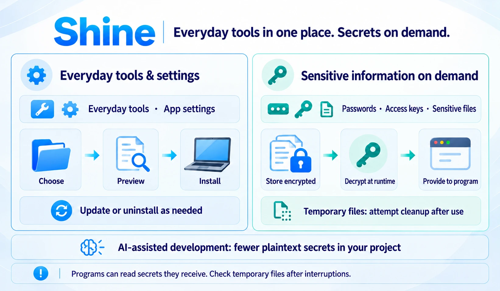

# Shine

**Shine helps you manage everyday script tools and application settings, with sensitive information
stored encrypted and used on demand.**

Shine is a command-line tool. Use existing **Presets** without writing scripts yourself, or organize
your own scripts and configuration for reuse. Required applications and runtimes must be installed
separately.

**Documentation:** [English](https://biulight.github.io/shine/) ·
[简体中文](https://biulight.github.io/shine/zh-Hans/)

[](website/static/img/shine-overview-en.webp)

## What Shine helps you do

- **Reuse scripts and settings.** Keep them together in presets, install what you need, and keep
  each computer's own values local.
- **Review changes before applying them.** Inspect changes before updating a preset. By default,
  uninstall keeps modified files and files Shine cannot confirm it manages for you to review.
- **Use sensitive information on demand.** Store passwords, access keys, and sensitive files
  encrypted, then provide them when a selected program runs. See
  [environment variables and secrets](https://biulight.github.io/shine/guides/environment).
- **Reduce plaintext secrets during AI-assisted development.** After encrypting sensitive values
  and handling the original plaintext, reduce the risk of accidental exposure when an AI scans,
  copies, or commits project files. See
  [protect secrets when using AI tools](https://biulight.github.io/shine/guides/agent-secret-safety).

Programs that receive secrets or can decrypt them can still read the plaintext. Temporary-file
cleanup can fail; check for leftovers after an interruption.

## Try what is already included

- Install `shell/proxy` to get `setproxy` and `usetproxy` as regular commands.
- Browse ready-made configuration for tools such as Starship, Git, Vim, and Ghostty.
- Use the guided Surge and Clash Verge Rev workflows when you need their application-specific setup.

```bash
shine list --available
shine install shell/proxy
shine info shell/proxy
```

Follow the [quick start](https://biulight.github.io/shine/quick-start) for the complete first run.

## Make it yours

A preset folder can arrive through any folder-sync tool, archive, network transfer, version-control
checkout, or manual copy. Shine does not prescribe how you share it.

Your own presets can turn repeated tasks such as batch renaming, spreadsheet cleanup, or document
printing into reusable commands. Each command still needs its application or runtime on the machine.
Start with the [custom preset guide](https://biulight.github.io/shine/guides/custom-presets).

Shine can also prepare selected parts of macOS, Ubuntu, or Windows, but it does not take over
third-party tool versions. See [system initialization](https://biulight.github.io/shine/guides/system-init)
for that boundary.

## Installation

macOS and Linux:

```bash
curl -fsSL https://github.com/biulight/shine/releases/latest/download/install.sh | sh
```

Windows PowerShell:

```powershell
irm https://github.com/biulight/shine/releases/latest/download/install.ps1 | iex
```

With [cargo-binstall](https://github.com/cargo-bins/cargo-binstall):

```bash
cargo binstall shine-cli
```

From source on crates.io with Rust 1.90 or later:

```bash
cargo install shine-cli
```

See [installation and upgrades](https://biulight.github.io/shine/next/installation) for supported
prebuilt targets and installation options.

## Development

Toolchain versions are pinned in `mise.toml`:

```bash
mise install
bun install --frozen-lockfile
cargo nextest run --all-features
cargo clippy --all-targets --all-features --tests --benches -- -D warnings
cargo fmt --check
bun run check:ts
```

The public documentation site is isolated under `website/`:

```bash
cd website
pnpm install --frozen-lockfile
pnpm check:locales
pnpm typecheck
pnpm build
```

Planning uses the issue workflow in [`docs/PLAN.md`](docs/PLAN.md). Contributor architecture,
invariants, and verification rules live in [`AGENTS.md`](AGENTS.md) and [`docs/kb/`](docs/kb/).

Regular development targets `release`. Version tags are created from `release`, and the release
workflow opens the post-release synchronization PR to `main`.

## License

MIT OR Apache-2.0
