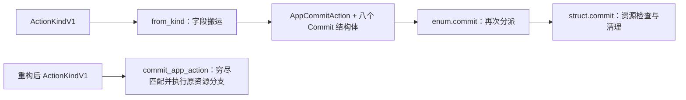

# 架构必要性审查：模型、转发层与修改扩散

基线为 `bd651fd4`。本轮接续[规模审视](maintainability-audit-2026-10-27.md)；原 B1–B4 与后续候选均已冻结。
目标是减少同一个行为需要维护的表示和连接关系，保持现有行为、稳定 API、持久化格式与安全契约。
架构审查阶段仅形成方案及可行性证据，未将 Rust 重构落地或宣布新 ADR 生效。
关闭后的行为缺陷复核与修复另见第四十八节，输入边界验证见第四十九节，不重启冻结的重构候选。

## 审查关闭结论（2026-10-28）

**本轮全库可维护性与架构必要性审查关闭，现有候选全部冻结，恢复正常功能开发。**

- **结论**：主要领域已完成有范围的源码与历史核查；明显重复中的一部分已由历史重构消除。
  现有证据未证明新的大规模精简能在保持行为、安全契约与局部可读性的同时降低总维护成本。
  这不代表全库无重复、无缺陷或所有平台行为均已验证。
- **冻结范围**：原 B1–B4、A/B/C1/D1/D2/E1、快照双入口及后续全部暂缓或保留项。
  保留源码证据与隔离原型，不进入实施队列，不继续以减行或增加候选为目标制作原型。
- **开发方式**：后续按明确的功能需求和缺陷任务推进，在实际改动中观察理解范围、同规则同步修改及漏改补修。
  必要的局部调整遵循现有仓库规则；不将本报告中的历史方案自动纳入任务。
- **重审条件**：出现可定位的重复实现导致漏改，或真实需求反复要求同步修改同一业务规则时，
  先补充具体案例、受影响消费者、可消除的对应关系及保留现状的成本比较，再明确决定是否重启该候选。
  文件数、行数、结构相似或原型测试通过本身不构成重启理由。
- **证据与授权**：本报告、规模审视的统计口径和原型结论作为基线历史证据保留；后续章节中的建议与批次均属历史内容，
  不构成当前待办或实施授权。本轮没有将 Rust 重构落地；现有行为、公开 API、持久化格式与安全边界保持不变。

## 证据的阅读与追溯

结论、取舍、消费者边界和验证限制统一保存在下列对应章节；规模统计的方法与汇总见
[规模审视](maintainability-audit-2026-10-27.md)。第一至四十七节的源码位置和历史比较对应审查基线，
第四十八节单独记录关闭后的缺陷复核与修复提交，第四十九节记录后续输入边界验证；历史记录不自动代表今天的实现或验证状态。
复核历史行为时，应按所引提交查看源码，而非依赖旧行号。

原 JSON 附件中的解释已合并到正文，不再维护第二份结论。逐文件行数、符号命中行号、临时探针
哈希、调用次数和逐轮文档增删计数已移出当前 KB；它们没有持续使用的自动消费者，也不能独立重现
临时原型。需要追查原始记录时，可查 Git 提交 `e73f1c7a52598606cf3eeecc1d53f743459f9e87` 下的
`docs/kb/operations/evidence/2026-10-27-maintainability/`。本次文档整理没有重新运行历史试验。

## 历史候选摘要（全部冻结）

| 方案 | 发现 | 建议 | 收益证据 |
| --- | --- | --- | --- |
| A：直接执行 App commit 的穷尽分派 | 一个单消费者阶段维护另一个枚举、8 个字段镜像结构体和二次分派 | 暂缓；按用户反馈保留原设计，局部可行不等于维护优势 | 临时原型删除 9 个类型、2 个文件；生产 661→391 行；测试 23→37 行；净 -256；基线与原型各 34 项筛选测试通过 |
| B：Core 独占 reviewed request 身份 | CLI 十分支 enum 镜像 Core ReviewRequest，批准后还保留另一份 request | 完整原型验证通过，但暂不推荐落地 | 7 文件迁移；生产 +100/-100，现有测试 +41/-47；消除批准后双身份，但新增公开访问器和隐含 proxy 关联；未证明实质维护收益 |
| C1：profile 文件契约与执行字节配对 | profile 内部独立构建两张表，apply 再按位置配对 | 按用户要求暂缓；保留原型证据，不作为当前实施方向 | 同一记录构造/消费，取消一处 zip；类型、文件、调用层不变；14 个差分检查点一致 |
| D1：Sys profile 代码分类 | 四个消费者重复相同分类，外层授权与选择不同 | 保留候选，不落地；D2 继续暂缓 | 四消费者隔离验证见第八节，不继续扩大小函数原型 |
| E1：CLI 展示输入契约 | 共享编码函数之后，仍跨模块逐字段补修；普通数据、已渲染内容、命令提示以字符串混合 | 对比审查后暂缓，不进入原型；保留现状 | 第十节区分接入遗漏与规则副本：条件性防遗漏收益成立，但不能证明覆盖迁移、错误边界和新抽象的总成本 |

## 一、从具体变更看修改扩散

选择两项已经实现的功能，而非假设“相似代码都可以统一”：

| 变更探针 | 历史提交 | 当前生产源码的直接引用面 | 必要与可减成本 |
| --- | --- | --- | --- |
| App JSON relocation | `2635c0a1` | `RelocateManagedJson` 出现在 13 个生产文件 | schema、权限、旧/新路径所有权、apply、receipt、恢复必需；commit 的再次字段建模可取消 |
| Shell rendered-file removal | `6ad6e25d` | `RemoveShellRenderedFile` 出现在 14 个生产文件 | 规划、权限、journal、执行重检、receipt marker 和恢复必需；prepared/action 的内部重复数据可调查；App 的显式非本域拒绝分支不算该资源实现 |
| 新增一个 review 操作类别 | 当前十类操作 | `LifecyclePlanRequest` 出现在 18 个生产文件，Core 另有 `ReviewRequest` | CLI 请求构造与展示合理；类别有镜像，但 bootstrap 附加输入有独立 CLI 职责；实际收益见 B 验证 |

这些数字是剔除测试后的精确符号引用计数，不是完整调用图，也不是必须编辑的文件数。
例如 factory 用 constructor 名称构建 Action，某些 handler 不含 variant 名；反过来，外域拒绝分支只是在维持穷尽性。
因此不能用“14 个文件”直接论证应当只有一个执行器。

对变更成本应分别问三件事：新增了多少领域规则、搬运了多少已有字段、维持了多少人为对应关系。
本轮锁定后两者；必要的领域规则与重新观察继续保留。

## 二、哪些表示有必要，哪些没有

| 表示/边界 | 承担的实际职责 | 决定 |
| --- | --- | --- |
| Preset metadata / AppFile 与 AppEntry receipt | 当前声明、解析结果与历史所有权不是同一事实；源消失仍可依据 receipt 卸载 | 保留 |
| PlanV1 与 ActionIrV1 | 前者是可审阅的语义/权限/快照契约；后者是审批后生成的精确资源操作及恢复记录 | 保留；禁止让 Plan 直接携带执行字节或替代 Action |
| ApprovedOperation | 不可 Clone/序列化、消费一次、保留配置 revision、原请求和一次性 code grants | 保留；它是 authority handoff |
| FrontendService / ReadOnlyFrontend / TrustedFrontend | 脱敏、能力收窄、人类审批与受控分派 | 保留；不能因 CLI 是主要消费者就删掉契约边界 |
| CLI LifecyclePlanRequest | 十个类别基本复制 Core，仅 bootstrap 多一份 proxy_env | 原型可取消镜像，但计入新约束和耦合成本后净收益未证实，当前保留，见 B |
| PreparedApp/Shell/SysUpgrade | 验证整批形状、全部预验证后才执行，消费后返回类型确定的结果 | 保留；不能退回向量位置约定，见 ADR 0123 |
| AppCommitAction + 8 个 *Commit 结构体 | 只把 Action 字段借出、重新装箱到枚举、再拆出来；不验证 approval、receipt，也不持有锁 | 暂缓删除；这些类型也提供局部阅读和明确输入边界，见 A |
| ShellAction / SysAction 借用视图 | 各在 5 个生产文件被引用；Shell 还统一 receipt-marker eligibility，服务多个阶段 | 本轮保留；不能把 A 的单消费者结论扩展成全部 typed view 都多余 |
| PreparedShellAction 与 journal Action | 前者含私有执行字节，后者必须无 payload；边界必要，但边界内重复字段来源可以收敛 | 见 C，保持 journal 格式及脱敏 |
| ShellManifestEntry 与 ShellLauncherReceiptV1 | mode 分别是 enum/String；manifest reader 与严格 deny_unknown_fields 的 Action DTO 接受集合不同 | 保留两个存储契约；禁止直接 type alias 改变反序列化兼容 |
| AppFileOutcome / 本地报告 / LifecycleResultV1 | 文件结果、CLI 私有诊断、稳定脱敏生命周期结果的受众不同 | 保留边界；不能简单把整个报告序列化输出 |

审批链中的多次检查也不是可以统一缓存的重复：CLI batch prevalidation 避免后一个域被拒时前一个域已产生效果；
Frontend apply 比较当前配置 revision 并重规划；领域 approved 方法在生命周期锁内重规划；资源 executor 再验证
Action 权限和 live state。它们发生在不同竞争窗口。减少请求模型或 commit 转发不改变这四个边界。

相关来源：[ADR 0077](../decisions/0077-frontend-service-contract-and-approval-ownership.md)、
[0080](../decisions/0080-trusted-frontend-execution-and-conformance.md)、
[0117](../decisions/0117-paired-shell-preparation-and-app-assessment-states.md)、
[0123](../decisions/0123-typed-upgrade-handoffs-and-launcher-tests.md)，以及
[数据流](../architecture/data-flows.md#frontend-authority-and-execution)、
[恢复不变量](../architecture/invariants.md#declarative-actions-and-recovery)。

## 三、方案 A：取消 App commit 的单消费者镜像模型

### 现状与必要性判断

**状态修正：暂不落地。** 以下设计及数字保留为可行性记录，并非实施建议。原设计按资源分组，
小方法只接收所需字段，修改清理规则可以留在局部。原型把八类行为集中到一个函数，扩大阅读与修改范围；
尚无证据证明省掉字段传递带来的收益大于这些损失。现行 ADR 0116 继续有效。

[commit.rs](../../../core/src/runtime/action_executor/commit.rs) 已拥有 journal 身份、应用状态、manifest receipt、
receipt-committed marker 及锁 guard 的检查。通过这些检查后，只在一个生产调用点使用
`AppCommitAction::from_kind(...).commit(runtime)`。

[commit/action.rs](../../../core/src/runtime/action_executor/commit/action.rs) 的转换先拆 `ActionKindV1`，
把相同字段写入 [files.rs](../../../core/src/runtime/action_executor/commit/files.rs) /
[json.rs](../../../core/src/runtime/action_executor/commit/json.rs) 的八个结构体；枚举再分派给结构体方法，
方法立即 `let Self { ... } = self`。这些结构体没有其他消费者。



若要把一个 Action 已有字段加入 commit 校验，当前需在原 Action 解构、镜像构造、结构体字段、结构体解构和
实际校验中传递，跨 action 与 files/json 两个实现位置。直接匹配后只有该 Action 分支的解构和校验。
这是取消模型维护，不是把八个结构体改名或藏到宏中。

### 历史原型设计（暂缓）

- 保留 `commit.rs` 的整个事务边界，仅将循环调用改为
  `commit_app_action(runtime: &CoreRuntime<H>, kind: &ActionKindV1) -> Result<()>`。
- 在现有 `commit/action.rs` 中直接穷尽匹配原 Action：两种 Create 返回 `Ok(())`，八种资源进入原来的检查/清理语句，
  非 App variants 显式返回原错误。不能用 wildcard，不能恢复旧式多个独立 `if let`。
- 删除 `AppCommitAction`、八个 `*Commit` 类型、`commit/files.rs` 和 `commit/json.rs`；不新建等价 DTO、参数包或 trait。
  单个异步函数约 323 行，可以集中查看覆盖，但局部阅读范围变大，不能据此声称更易维护。
- 保留原来每个 action 的 early return 范围。helper 的 `return Ok(())` 只结束当前 action，不结束外围整个 journal commit。
  保留观察顺序、mode/hash 比较、错误文字、privileged routing、部分 cleanup 失败时保留 journal 的行为。
- 对外 API、Action/schema、journal、receipt、Plan/fingerprint 均不改变；没有 migration。

这是对[ADR 0116](../decisions/0116-shared-delivery-and-resource-contracts.md)表示选择的局部简化：
保留“穷尽覆盖、拒绝外域、receipt/live-state 检查先于 journal 删除”的目标，取消实现这些目标并不必需的 borrowed enum。
正式实施时同步该 ADR 和不变量/模块图中的描述；本轮不提前修改现行架构规则。
原型证明镜像类型不是实现穷尽分派的唯一方式；它没有证明原有类型的可读性和局部变化价值可以忽略。

### 已完成的可行性验证

在独立临时源码副本中实现上述转换，按 rustfmt 格式计数：

| 范围 | 原生产行 | 原型生产行 | 原测试行 | 原型测试行 |
| --- | ---: | ---: | ---: | ---: |
| commit.rs | 72 | 68 | 0 | 0 |
| commit/action.rs | 175 | 323 | 23 | 37 |
| commit/files.rs | 275 | 0 | 0 | 0 |
| commit/json.rs | 139 | 0 | 0 | 0 |
| 合计 | 661 | 391 | 23 | 37 |

生产净 -270，测试净 +14，Rust 净 **-256**。类型 9→0，生产函数 10→1（不含外围 commit 入口），
源码文件 4→2，conversion/dispatch/resource-method 三步变为一个直接分派函数。
新增测试行用于把原外域转换拒绝测试迁移到实际 async helper，并断言没有 Host 操作；原三种输入保留。
文档同步成本尚未计入代码原型，不能据此宣称全项目总维护成本已有相同幅度下降。

八个资源方法移除 `let Self` 解构后的完整语句序列，与原型 match arm 的 token 序列一致。
基线和原型均通过 `cargo test -p shine-core --lib ... commit -- --test-threads=1` 筛选出的 34 项测试。
其中包含 create/update/removal 的 receipt-before-commit、特权 guard、恢复 cleanup、JSON 用户键保留；
也包含若干未修改的 Shell/Sys commit 测试。两次都另有 697 个 Core 单元测试被过滤，不能称为全套验证。

原型最初共用普通 target，随后基线在独立 `target/architecture-review-baseline` 重建验证；普通 target 的对应
Core 测试单元也已失效并从基线重建，depfile 确认恢复 files/json 两个模块。后续原型比较必须使用不同 target，
避免源码副本间复用相对路径 dep-info。工作区 Rust 源码始终未改动。

正式落地仍需补齐针对 cleanup 失败/取消的覆盖核对，运行完整 Core、CLI 消费者、doc-tests、lint 及原生平台检查。
临时原型证明局部可行性，不替代 macOS/Linux/Windows 发布验收。

## 四、方案 B：消除 CLI 对操作请求的重复建模

### 证据

[CLI lifecycle_plan.rs](../../../cli/src/lifecycle_plan.rs) 的 `LifecyclePlanRequest` 十个 variants 与
[Core ReviewRequest](../../../core/src/frontend/review.rs) 一一对应，`service_request()` 又写一遍十路转换。
唯一额外数据是 SysBootstrap 的 `proxy_env`，它是 CLI runtime 组装参数，不是新的一类 domain request。

批准后 `ReviewedLifecyclePlan` 仍保存 CLI request，而
[ApprovedOperation](../../../core/src/frontend/trusted.rs) 已私有保存 Core request。
CLI prepared handoff 检查前者，真正执行依赖后者；当前生产构造将它们配对，但一致性靠构造代码维持。
prepared tests 甚至可以只把 CLI 影子中的 Sys Upgrade 改成 Install，而 Core approval 内的原请求不变。
这不是已证明的外部可利用漏洞，却直接展示了双重身份模型的维护负担。

### 已验证的原型设计（未落地）

- 以现有 `ReviewRequest` 作为唯一操作类别。CLI 请求组装使用保留原名的私有字段 `LifecyclePlanRequest` struct，只存
  `request: ReviewRequest` 和 bootstrap 所需 `proxy_env: Option<BTreeMap<String, String>>`。
  `Some(empty)` 仍表示显式空覆盖，不能退化成 `None`。现有构造函数继续注入 `PlanningInputVersions`，不能因复用 Core enum 而漏掉 secret-version 绑定。
- CLI 只有 bootstrap 构造函数可以产生 proxy override；保持原来的覆盖时机与 batch runtime 沿用行为。
  不把 proxy 明文放进稳定 Plan/报告/approval 序列化，不扩大 read-only façade。
- 为 `HumanReview`、`ApprovedOperation` 提供只读 `request() -> &ReviewRequest` 访问器；不暴露可变访问、
  approval、配置 revision 或 grants，不增加 Clone/Serialize，不允许调用方替换已批准请求。
- `ReviewedLifecyclePlan` 只保留 `ApprovedOperation` 和 CLI runtime 组装附加数据，删除批准后的独立 request 副本。
  prepared wrappers 从 `approved.request()` 做完整批次/域/操作校验，执行仍消费原 approved。
- 审阅阶段用一个记录同时保存 `HumanReview` 与 CLI 附加数据，取消 `planned` 和 `human_reviews` 两个平行数组的
  `zip`。原型仍克隆 request/Plan 作为展示投影，以免另造借用视图；它们不参与批准后身份校验。
  `section_label` 继续由 CLI 匹配 Core request；保留精确标题和提示词。
- 保持 `prepare_runtime` 的 fresh capture、config digest、`with_approved_code` 与 prevalidation；
  保持执行时的 config digest 重读、Frontend apply 校验和领域锁内校验。保留 typed upgrade handoffs。

新增操作类别的**分类维护点**可由“Core enum + CLI enum + 转换表 + CLI label + Core review 分派 + apply 分派”
六处降为四处；具体 domain request 构造、报告投影和业务执行仍需修改，不把它们宣称为已消除。
这两个减少点均在原有 `lifecycle_plan.rs` 内，不能宣称少改两个文件。原型迁移触及 7 个 Rust 文件。

### 修改成本复核

| 具体变化 | 现状 | 完整 B 原型 | 判断 |
| --- | --- | --- | --- |
| 给已有 App/Shell/Sys 请求加普通字段 | CLI enum 持有 Core 请求，转换整包 clone，不逐字段复制 | 继续持有同一 Core 请求 | 不减少这类日常修改的同步点 |
| 新增顶层操作类别 | Core enum、CLI enum、转换表、label 及业务分派 | 省 CLI enum 和转换表，构造、label、业务分派仍需修改 | 有局部收益，但没有证据显示此类变化频繁到足以抵消迁移成本 |
| 调整 bootstrap proxy 策略 | proxy 与 SysBootstrap variant 绑定，配置方法局部匹配 | 请求与 Option proxy 独立存放，构造器负责关联 | 类型允许 bootstrap 无 override 或非 bootstrap 有 override；私有字段限制误用范围，仍弱于原类型约束 |
| 排查批次类型与实际执行不一致 | prepared 读 CLI shadow，Core 执行保留的 request；一致性靠私有构造 | 两者都读 approved 中的 request | 明确的结构收益；当前未发现生产入口能构造错配 |
| 阅读 CLI 展示和 typed handoff | 读取 CLI 本地类型；输入 payload 本来已依赖 Core | 多个 CLI 模块直接匹配 Core enum，另需理解 getter 和 proxy sidecar | 不新增 crate 依赖，但扩大具体 Core 类型的消费范围 |

`HumanReview::request()`、`ApprovedOperation::request()` 是两个新增 **public** 方法。
返回共享借用不会授予执行权限，调用者本来就是 trusted frontend，但它们扩大了公开 API 的长期维护面；
不能因为用于 CLI 就把它们称为“仅内部接口”。如未来落地，需要明确接受该增量并同步 ADR 0080/0123，
本轮没有修改现行 ADR，也没有把原本隐藏的 request 暴露给 read-only façade。

### 原型成本

原型基于同一 HEAD，独立于 A；基线和原型使用不同 Cargo target。两边均经 mise 固定工具链。

| 分项 | 增加 | 删除 | 净变化 |
| --- | ---: | ---: | ---: |
| 生产 | 100 | 100 | 0 |
| 现有测试调整 | 41 | 47 | -6 |
| 上述迁移合计 | 141 | 147 | -6 |

`lifecycle_plan.rs` 生产减少 10 行，Core getter 增加 10 行；其余消费者的生产行数持平。
测试减量来自 fixture 表示调整，没有删除测试案例。非 Upgrade handoff 测试从“批准后修改影子请求”改为
“实际审阅 Install 后传入 Upgrade batch”，仍断言在读取故意损坏的 trust 配置前拒绝。
另外增加了两项临时差分探针，原型文件为 188 行，连同父模块声明共 +191 行；它们是验证成本，不能算作零成本常驻测试。
若原样纳入永久测试，整批 Rust 将净 +185 行；本轮没有将其加入仓库，也没有借删测试制造生产收益。

### 行为证据与范围

- 十类构造器的完整 Core 请求逐一对照独立预期值，包括原始 target 空白、操作标志、bootstrap 顺序及六类输入版本注入。
  这是请求身份对照，并非十类完整执行或 Plan/指纹逐字节差分。
- proxy 探针覆盖无覆盖、显式空覆盖、非空替换、同批后续请求继承、fresh runtime 再次覆盖。
  实际 bootstrap 外部脚本及代理网络没有执行；不能把 helper 验证说成 review/prepare/apply 的全链路原生证据。
- 前后匹配的 lifecycle/frontend 测试覆盖完整 batch 形状、非 Upgrade/跨域先拒绝、后域预验证失败无前域效果、
  prepare 后状态变化、配置/source/权限失效、secret version、代码授权不能由自动批准替代，以及展示契约。
- CLI 集成选择已收敛空配置、三域和输出模式无操作、snapshot-only 仍需批准、用户修改保留、目标 upgrade 的范围/批准/摘要。
- Core compile-fail 文档验证保留不可复制、不可序列化、不可重复消费及 read-only 能力约束。

以上验证在 macOS 完成且通过。没有运行完整 workspace、Clippy/依赖全检查或 Linux/Windows 原生测试；
没有逐一故障注入锁竞争、取消、重试和恢复。领域执行、锁、journal/receipt 代码没有变更，仍不能把这一事实替代完整行为证明。

### 决定与更小替代

**不推荐按完整 B 立即落地，也不将它列为实质减量方案。** 结构上的主要收益是批准后只保留一个身份源，
不是删除十行分类声明本身。原型没有缩短执行链、减少 fresh capture 或领域决策，反而增加两个公开访问器和一个关联约定。

较小替代是保留 CLI 输入 enum 及 bootstrap 绑定，仅让 prepared 校验读取 approved 的身份。
但若保留影子请求，它只修正校验来源而不消除重复存储；若删除影子请求，仍须安置 proxy sidecar，
也仍需新的 Core 查询接口。这项替代未实现、未核算，不能沿用完整 B 的测试结果或宣称收益已确认。
除非出现实际错配缺陷、频繁新增操作类别，或能证明更小接口降低修改成本，否则当前保留实现更稳妥。

## 五、方案 C：Shell prepared 数据的一致性由结构承担

**后续状态：C1 按用户要求暂缓。以下为历史原型证据，不再推进代码落地或扩展试验。**

[apply.rs](../../../core/src/runtime/shell_action_executor/apply.rs) 已将 Action 和 payload 放在同一个
`PreparedShellStep`，符合 ADR 0117 的外层顺序要求。但内部仍存在：

- `prepare_caches`、`prepare_cache_removals`、`prepare_profiles` 分别维护 action 文件列表与 prepared 文件列表；
- apply 的 cache removal/profile 两处以 `zip(action_files)` 恢复位置对应；
- rendered removal、cache removal、snapshot removal、profile 四处再次从 action.kind 解构，检查与 prepared variant 一致。

这些列表目前在同一循环构造，本轮没有发现外部输入能触发错配的证据。
问题是新增一个字段或改变过滤条件时，工程师必须同时维护另一份列表和稍后执行阶段的隐式对应关系。

### 隔离原型 C1：只收敛 profile 文件记录

基于同一 `bd651fd4` 建立独立基线和原型，未叠加 A/B；各自使用独立 Cargo target。

仅修改已有三处，保留资源方法、阶段顺序及类型名称：

1. [PreparedShellProfileFile](../../../core/src/runtime/shell_action_executor.rs) 从 destination/rollback/ownership/mode
   的部分复制，变为 `contract: ShellProfileFileV1` 加 `desired_bytes: Option<Vec<u8>>`。
   上游 `ShellProfilePreparedFile`、`ShellProfileReconciliation` 输入类型不变，没有把观察结果塞回调用方。
2. [prepare_profiles](../../../core/src/runtime/shell_action_executor/apply/prepare.rs) 维持原观察及拒绝顺序，
   每个文件只 append 一个完整记录。在原 Action 构造位置用 `file.contract.clone()` 投影 journal 文件列表。
   不增加逐字段转换函数、不新增 trait/enum/通用构建器。
3. [apply 的 Profile 分支](../../../core/src/runtime/shell_action_executor/apply.rs) 直接遍历记录，
   从该记录的 contract 读取身份、路径、ownership 和 block hash，从 desired_bytes 读取执行字节。
   保留原 Action variant shape 拒绝分支，取消 `files.iter().zip(action_files)`。
   写入 mode 取自 `contract.desired` 的 identity；它仍来自相同输入 `file.unix_mode`，没有复用 earlier observation。

```text
之前：输入 → action_files.push(contract) ────→ journal
          └→ prepared_files.push(fields, bytes) ── zip(action_files) → apply

原型：输入 → prepared_files.push({ contract, desired_bytes })
                     ├→ 完整 contract clone → journal
                     └→ contract + desired_bytes → apply
```

### 维护关系与局部可读性

| 核查点 | 原设计 | C1 原型 | 结果 |
| --- | --- | --- | --- |
| 新增/筛选/重排一个 profile 文件 | 同一循环中两次 append，apply 依赖两表位置一致 | 一次 append，journal 完整投影，apply 遍历同一记录 | 删除一项人工位置对应；当前并无错配故障证据 |
| destination / rollback / ownership | contract 与 prepared 各初始化一次 | 只构造 contract，执行也读它 | 三项显式字段对应消失，投影无需逐字段维护 |
| 写入 mode | desired identity 与 prepared mode 分别保存同一输入 | 执行从 desired identity 读取 | 少一项镜像；表达式多一层 Option 读取，需理解 desired=None 表示删除 |
| 阅读一次 profile apply | 同时追踪 file 与 action_file，字段来自两者 | contract 明确承担执行约束，desired_bytes 明确承担内容 | 没有更大的总分派函数，也没有额外调用层 |
| 查找输入与职责 | 原有准备方法、执行分支、私有记录和现有 Action DTO | 相同位置和类型数量 | 阅读文件范围不扩大；既有阶段职责不合并 |
| 持久化与执行字节边界 | journal 无 payload，prepared 有字节 | 只 clone contract，bytes 不参与投影 | 保留明确边界，没有泛型序列化 prepared record |

这里的收益不来自少 10 行，而是 apply 不再要求另一张列表与当前记录同序、同长，并且路径/ownership/mode
不再分别写入两套字段。与 A 的集中分派不同，C1 不扩大单个资源行为的阅读范围；与 B 的 proxy sidecar 不同，
C1 没有把原有类型关联替换成额外可选配置约定。

仍有明确代价与残留约束：

- **不是唯一物理副本。** Action 和 prepared 内仍各有契约值；准备记录现在还保留 previous/desired identity 与
  block hash 副本。当前投影后只有借用读取，没有独立修改；未来若新增修改，必须重新审查一致性。
- `desired_bytes` 与 desired hash/mode 仍需在准备阶段一致构造，Rust 类型没有证明其内容相等。
  本次没有宣称消除全部表示一致性问题，现有 hash/ownership 检查仍必需。
- journal 从完整 contract clone 产生，新增文件契约字段只需在契约构造处赋值；新增字段的执行规则仍须显式处理。
  这减少字段搬运，不会自动实现业务语义。
- 仍需理解现有 `ShellProfileFileV1`。原 apply 已读取其中 previous 与 block hash，所以未引入新跨域依赖；
  但若未来该 DTO 与执行语义分化，局部复制可能再次更合适。

### 行为验证

使用 mise 固定工具链、offline 构建。匹配基线/原型的 Shell 筛选测试与 CLI 集成均通过。
无探针原型的 fmt 和 Core lib all-features Clippy（`-D warnings`）通过。
筛选包含混合资源逐个 applied-marker 保存失败、profile-only 删除的空 manifest 要求、审批失效、恢复保留用户编辑、
重试、正常安装/卸载、completion 的幂等及原始路径契约。Core 筛选中的虚拟平台用例不等于原生系统验证。

为避免只以测试通过推断等价，在两份临时源码中加入完全相同的观察探针，复用三个现有消费者测试及其断言：

- 混合 cache/rendered/profile/launcher 的四个进度保存故障点，各记录中断、恢复、重试三个阶段，共 12 个检查点；
- profile-only 删除/恢复，以及中断后的无关用户编辑保留，各一个检查点。

**14 个检查点的记录逐字节一致。** 比较内容包括 Host 调用入口顺序与参数（包含 metadata/read、锁获取、
rename/write/mode）、每次 write_atomic 尝试的原始字节、原 HostOperation 记录和完整内存文件/权限状态。
因此这些场景的 journal TOML、Action ID/顺序、批准指纹与权限也一致；不只比较最终文件内容。
这些是累计前缀，不能算作 14 个独立场景；探针不记录 OS 调度及锁释放时刻。

原有“journal 中不能含执行 payload”的断言继续保留。探针未改判断/错误分支，完成比较后已从两份临时源码移除。
CLI 三项集成使用 macOS 原生文件系统，涵盖 completion 创建/幂等、先按类别再全量清理 profile、默认清理与目标范围。
没有运行 Linux/Windows 原生验证，未新增任务取消、进程终止、锁竞争试验，也未穷举每个 profile rename/write/mode
故障点；不能用 applied-marker 保存失败替代这些验证。完整 workspace/依赖验收尚未执行。

### 成本与结论

| 分项 | 增加 | 删除 | 净变化 |
| --- | ---: | ---: | ---: |
| 生产（3 个已有文件） | 28 | 38 | -10 |
| 现有测试/支持 | 0 | 0 | 0 |
| 临时差分探针（不进入候选实现） | 56 | 0 | +56 |

现有类型、模块、函数、公开 API 数量均不变；profile 的两次 append 变一次，一处 zip 消失；
Action variant shape 检查继续保留。准备方法 106→101 行，执行方法 339→337 行，未集中其他资源职责。
如果将临时探针原样永久纳入，Rust 总量为 +46，不能将它们当作免费测试；原型未删除既有断言，
是否补充永久测试应针对尚未覆盖的实际风险另行判断。审视文档和证据另计，正式实施的 KB 同步未发生。

**建议保留 C1 为可选的局部一致性改进，原型验证到此止步。** 它确实减少一个需要维护的对应关系，
同时保留小范围阅读与明确输入，较 A/B 有更直接的局部维护依据。但它只是小改进，不应包装成全库架构减量收益。

不按最初设想继续改造整个 `PreparedShellStep` 或统一全部 prepared-kind：为了去掉最后一份投影而引入借用生命周期、
额外模型或全资源投影分派，没有现成收益证据。cache/cache removal 的两处双列表、另一处 zip 均保持原状，
也没有删除四处 shape 检查；它们若继续调查需分别证明收益。snapshot 的多次观察尤其不能合并。
历史定位：`c3bf48cc7df4872ecab707826aa9c7e3584351a8` 建立外层 step 配对，
`9028fdd889016aa37af760c1d705b056e134c925` 保留局部准备边界，`25dcfb6d` 修正 cleanup/profile-only
receipt 与恢复；C1 不撤回这些约束。
ADR 0117 的外层配对和既有恢复修复继续保留；本轮不改现行 ADR、不落地 Rust。

## 六、没有采用的更大方案

| 方案 | 拒绝/暂缓原因 |
| --- | --- |
| 合并 Plan 与 Action | 会混淆 review 与 execution、语义步骤与恢复资源。保留接口兼容时还要重建同等边界，成本不会凭名称合并消失 |
| 删除 Frontend、CLI 直接执行 Core | 撤掉了共享脱敏、一次性 approved 请求、configuration revision 和安全事件契约；需要复制回 CLI，形成倒退 |
| 一个跨 App/Shell/Sys 的事务引擎 | App 的逐文件 receipt/marker、Shell 的共享资源与全量 preflight、Sys 的 split-DNS/profile 不同。缺少可统一的状态机证明，不能为少写分支增加模式开关 |
| 合并所有 manifest/receipt DTO | strict/legacy reader 接受集合、enum/string、版本门禁和 raw-byte approval 绑定不同。仅看字段同名不足以证明同义 |
| App 报告只保留 files，统一推导所有计数/结果 | `upgrade.rs` 有只写 lifecycle 的缺失源/conflict/rollback 分支，也有缺失 content 时只增加 failed 的分支；cache/hook 亦不是文件项。直接从 files 推导会改输出；先改建模可能值得，但现有证据不足以保证成本下降 |
| 泛型化所有 prepared wrappers 或删除 AppInstall/AppUninstall 的相同字段包 | 形状相同不代表操作可互换；typed handoff 已防止跨域/跨操作误用。通用参数包会重新引入动态分派与检查 |

## 七、推进顺序与验收

> 历史方案：已由上述关闭决定冻结，不作为当前实施顺序。

1. **A 暂缓，保留现状**：不能以类型数或行数取代对局部阅读、明确输入和修改范围的评估。
2. **B 验证结束，完整方案暂不推荐**：保留上述证据；不自动实施较小替代，也不以纯测试通过触发迁移。
3. **C1 暂缓**：保留历史原型与结论，停止围绕小幅减行继续试验。
4. **新方向按规则归属筛选**：先核查同义规则、具体修改位置与局部阅读成本；只对净维护收益明确者继续验证。

每项记账生产、测试/支持、文档；同时记录删除的模型、规则/字段维护位置、调用层和跨层对应约束。
保留稳定 API 和持久化格式，内部接口调整按仓库实际消费者验证；没有必要的公共手册行为变更。
正式实现通过针对性前后测试后，补完整 workspace nextest、doc-tests、fmt/Clippy、依赖/拼写检查及原生平台验证。
通过的检查只因后续改动或证据缺口重跑，不为局部原型结果赋予发布结论。

本轮修改仅为审视文档与证据；原有四批小改动继续暂停。未提交、推送、发布。


## 八、其他模块：业务规则归属与真实修改扩散

初筛基于 `bd651fd4` 做源码与历史审阅；随后按用户要求，仅 D1 进入四消费者隔离验证，结果见下文。
其他方向没有制作新原型。覆盖下列业务规则链，不宣称对每个文件完成逐行证明。

### 结论与验证门槛

D1 已确认 Sys executable-profile 分类的四处实现可归一，并完成限定场景的消费者差分验证；仍不落地。
它的价值是分类变更不再要求四处同步，而不是函数短或可以少写若干行。
打包元数据副模型 D2 有重复建模事实，但尚不能证明合并后更容易理解和修改，因此不进入原型。
其他已检查链条没有达到新的架构重构门槛，不能把模块多、修复多或兼容代码多直接当作架构缺陷。

| 规则链 | 当前证据 | 决定 |
| --- | --- | --- |
| 环境源 plain/secret 覆盖 | `workspace/sources.rs::effective_bindings` 已被 compilation、broker_snapshot 共用；`source_payload.rs` 共用 sealed 校验和解密后键集合一致性 | 保留现有共享点；不能合并本地全量编译与 broker release 授权编排 |
| 环境配置分层/定向写入 | `config/env_resolution.rs` 是六层读优先级的唯一解析器；`env_write.rs` 选择写入目标并在锁前后核验快照 | 读优先级和写目标不同，不建立通用层级引擎；Global/Project DTO 差异保留 |
| 加密后端/缓存 | `secret/mod.rs` 统一密文 tag 路由；普通加密、workspace hybrid access list、单后端本地缓存有不同接收者和失败回退契约 | 保留专门入口；不以 backend 分支相似为由合并策略 |
| SSH forwarding/broker | `ssh/mod.rs` 明确 plain-only 与 `--with-secret`；`ssh/broker.rs` 冻结密文并延后授权/解密；reserved keys、mapping parser、decrypt router 已共享 | 重新观察与确认时机是边界，不合并为一个释放流程 |
| Preset env/permissions | `core/env.rs` 统一结构化声明与派生权限，运行时 App/Shell 消费同一规则；migration 保留旧字符串语法；validation 还有全分支诊断 | 保留旧格式转换与运行时解析分界；不把诊断遍历直接替代运行时选择 |
| Sys profile 代码分类 | trust、planner、compose、pack 各自维护相同三项判定 | D1：隔离验证支持分类归一，保留四消费者边界；未落地 |
| Pack 元数据副模型 | `pack.rs` 自建 8 个 App/Shell 部分 DTO、四次按 kind 解析，用于完整源树检查和 bundle 标志 | D2：重复存在；跨平台/legacy/错误边界尚未证明可低成本统一，暂缓 |
| JS/TS 分析 | 最近三个 binding 修复主要改 syntax.rs 与 RULE_VERSION；词法 lookup、pattern traversal 已局部共享 | 没有证明需要新语义框架或跨模块重写；保留现有定位范围 |
| 平台 Host/私有文件 | RealHost 原子写已经委托 Core persist；CLI persist 是重导出；file-group 还要求 inode/硬链接身份、no-clobber、私有目录和取消清理 | 共享落盘原语已存在，保留不同对象生命周期和平台实现 |

### D1：让 Sys profile 分类有一个定义位置

四处源码使用同一个 `SysShellIntegration` 输入，判定逐项一致：

```rust
!integration.eval_argv.is_empty()
    || integration.source.is_some()
    || integration.fragment.is_some()
```

| 当前实现位置 | 直接消费者 | 分类变化遗漏时的维护风险 |
| --- | --- | --- |
| [trust.rs](../../../core/src/runtime/trust.rs)，`sys_external_code_requirements` | 产生 SysProfileCode 信任要求 | 新执行入口没有被纳入应审阅的代码类别 |
| [planner/sys_support.rs](../../../core/src/runtime/planner/sys_support.rs)，`sys_item_has_executable_profile_code` | `sys_specialized.rs` 的 profile/bootstrap 计划 | 审阅计划和实际执行对是否存在代码给出不同结论 |
| [sys_profile/compose.rs](../../../core/src/runtime/sys_profile/compose.rs)，`render_integration` | 实际 profile 组合的外部代码门禁 | 修改分类时必须记得更新执行端 |
| [pack.rs](../../../core/src/runtime/pack.rs)，`has_unisolated_code` | bundle/report 的 unisolated_code 字段 | 分发报告未反映同一入口的执行性质 |

这是维护风险，不是已发现绕过漏洞：四处当前内容相同。静态核查确认输入类型、三个字段的解释与布尔表达式一致；
外层的选择范围和授权条件不相同，也不应统一。

历史依据：[ADR 0091](../decisions/0091-derived-code-boundaries-and-author-capability-statements.md)将分类确定为
从 typed entry 语义推导、独立于作者 `opaque_code` 声明。`b35caf433e8d97f9fe72ab8519161f9e376c52ee` 新增 bundle unisolated 标志时，在 pack 又写入
同一 Sys profile 分类；`eb665189` 将规划实现放到 sys_support，仍保留独立定义。
这能证明同一规则已有多个维护面，但没有证据表明发生过四处不同步的用户故障。

**已在隔离原型验证的归属，不是工作区实施：** 在现有 `SysShellIntegration` 所在 `sys_model.rs` 增加仅 runtime 内可见的
`has_executable_code(&self) -> bool`，只承载上述纯判定；四处消费者调用它。
保留 planner 的 item-level `any`，trust 的外部来源/完整分类快照/信任检查，compose 的 shell/phase 选择与即时门禁，
pack 的安装脚本或 profile 二者取 OR。方法只回答分类，绝不回答“是否允许执行”。

这样该分类规则的定义位置从 4→1；未来仅调整现有字段分类时，一个领域位置即可更新所有消费者。
首次接线仍需改四个消费者和 owner，不能宣称迁移改动文件更少。它增加一个语义查询跳转，但 owner 就是现有输入类型；
不需要新模型、参数开关、策略对象或通用安全服务。渲染不同 integration 的分支和 manifest 的 exactly-one 校验继续独立。

原型保持的语义表：path/env/aliases 不命中；非空 eval、source Some、fragment Some 命中。
保留原来的空值判断（`Some("")` 仍是 Some，是否合法由 manifest 校验决定）；不能在重构时把 aliases 扩成新执行类别。
还要分别验证外部/embedded/overlay、被禁用或不适用于当前 shell 的条目、外部 base profile、纯 package 安装与脚本安装。
这些是消费者不同的选择/授权规则，**不能因为共用分类函数而减少独立验证**。

#### 隔离验证结果与维护成本

基线、原型均从同一 HEAD 归档，使用独立 Cargo target；未叠加 A/B/C1。
原型只新增上述内部纯查询，并在 trust、sys_support、compose、pack 原位置调用它。
无新类型、公开 API、授权缓存、策略参数；manifest 校验、来源判断、状态捕获、序列化及错误分支均未移动。

| 消费者 | 保留的选择与授权范围 | 差分结果 |
| --- | --- | --- |
| 信任要求 | 按请求 item 的全部 integration 判断，不按当前 shell 或 enabled 状态过滤；外部来源、完整 category digest、base profile、grant 仍独立 | requirements 完整内容一致 |
| Profile / Bootstrap 计划 | Profile 保留显式目标和 enabled 集合检查；Bootstrap 保留本次 selected 加历史已启用条目；检测状态、script installer、base profile、审批继续分别判断 | 完整 Plan、指纹、权限、代码边界、状态动作一致 |
| 实际组合函数 | 只组合 enabled 且匹配 shell 的 integration；phase/priority/声明顺序、即时 trust 与 fragment/base 读取边界保留 | 输出原始 pre/post 字节或完整错误一致 |
| 打包 | 对完整源树及声明计算标志，不套用运行时 selected/enabled/shell；脚本安装仍独立 OR | report 与整个 tar.gz 字节一致 |

同一临时测试在两边运行，包含独立预期断言后再记录真实消费者输出，共 114 组场景：
六种 integration × 三种来源（embedded/external/overlay）× 两种授权 × 两种 shell 匹配状态，共 72 组；
另有 18 组禁用/不选中、12 组 base profile、12 组脚本安装与检测状态。
调用真实 trust API、profile/bootstrap planner、compose 函数、pack API，没有另写分类实现作为测试替身。
临时 Host 观察钩子只记录调用入口及参数，不参与判断。

114 组的记录逐字节一致，包括 metadata/read/canonicalize 等 Host 调用顺序和参数、计划、信任要求、错误、输出及归档字节。
补充 4 组 external/overlay × 无授权/有授权场景：Bootstrap 选择 other 时，已启用的 tool 仍参与 profile 检查；
有授权的两组再撤销 grant，重新规划与渲染 preflight 均拒绝，旧 Plan approval 不再有效。前后记录也完全一致。
这是 **2 个临时测试中的 118 组场景**，不是 118 个独立 nextest 测试，也不是所有维度的全笛卡尔积。

这些差异必须继续保留，不能从分类归一推导“共同授权结果”：

- 外部 eval 仅适用于 Zsh、当前为 Bash且无 grant：trust/plan 仍识别或阻止代码；compose 不渲染该 integration；pack 仍标记代码。
- 显式禁用未授权代码条目时，Profile Plan 仍检查目标；Bootstrap 只选 other 且没有历史启用 tool 时，不替 tool 申请执行。
  如果 tool 已启用，则仍必须纳入 Bootstrap 的组合前检查；本次四组补充验证覆盖了这一差别。
- 外部 base profile 不通过 integration 三字段表达。原型保留其单独门禁；当前 pack 的该标志只依据 manifest 入口，
  因而可能与 runtime 的 base-profile 信任要求不同。本轮没有改变这个既有行为，也不能用 bundle 标志替代授权。
- compose 是组合层，返回成功不是最终执行授权。空 enabled 集合等边界仍遵循原来的信任汇总方式；上层审批没有因此移除。

两边另各通过 93 项既有筛选测试（过滤器包含 Sys、pack、runtime trust，也可能选入名称含 sys 的其他测试），
保留既有审批后检测/profile 状态变化拒绝与恢复回归。原型 fmt 和 Core lib all-features Clippy（`-D warnings`）通过。
临时 matrix 与 Host 探针已从两份源码副本移除，剩余差异严格为 5 个预期生产文件。

**维护结论：** 对“调整现有 integration 的代码分类”这个变化，必须同步修改的规则定义从 4 处变为 1 处；
跨消费者核查只需核查一个领域定义和四个调用点，收益成立。对“新增 integration 类型”则仍需修改 schema 校验、
实际渲染、路径引用和相应权限等，不能宣称所有特性修改都收敛到一个文件。
局部阅读成本有小幅交换：原来就地读三项布尔表达式，现在需跳到输入类型上的一个语义查询；
业务流程与输入模型的阅读范围没有扩大，但也没有证据证明每个单独消费者都更容易阅读。

成本只作记账：生产 +11/-12（净 -1），既有测试不变；新增一个内部方法，首次接线 5 文件。
两个阶段累计使用 233 行临时验证代码，未纳入候选实现；不能把它们当作免费永久测试。
没有用减行证明收益，也不建议把完整临时矩阵固化成新的测试框架。

**决定：D1 保留为边界明确的规则归属候选，仍只留在隔离副本。D2 继续暂缓。**
本次在 macOS 上运行，matrix 使用虚拟 Linux/Bash 场景及匹配/不匹配 shell 条目；不是原生 Linux/Windows 验证，
也不是全 shell/platform 矩阵。没有运行完整 workspace/CLI/依赖检查、实际 bootstrap 工具或外部 profile 脚本，
没有新增取消、进程终止或锁竞争试验。调用记录证明所测入口的顺序，不能证明 OS 调度或锁释放时刻。

### D2：Pack 的“第二份元数据”暂不重构

[pack.rs](../../../core/src/runtime/pack.rs) 的 PackAppManifest/PackShellManifest 等 8 个局部类型，
重复理解 source、generator、hook、artifact、permissions 的源格式；分别用于 declared executable paths、
unrestricted opaque、unisolated code、author capability source 四个查询。
如果新增一种携带脚本路径的 metadata 入口，运行时支持它并不自动使 pack 识别其路径或风险标志。
这是实际的 schema 修改对应关系，不能仅解释为展示层格式不同。

但是，直接让 pack 消费 AppCategory/ShellCategory 不能视为等价：

- pack 检查完整归档源树；运行类别已经按平台、目的地和入口规则筛选，可能遗漏另一平台的脚本。
- 运行解析允许无 `files` 的 legacy discovery；pack 的局部 DTO 用空列表表示未显式列出。自动 discovery 可能扩大
  declared executable 集合，改变 `undeclared_executable_code` 拒绝契约。
- App `HookSpecToml` 使用定制反序列化保留具体错误；pack 子集忽略其他字段。校验先于打包，不能合并时改变错误优先级。
- validation 在同一快照上做原始权限诊断及各平台验证；migration 专门处理旧语法。不能抽取一个容纳所有模式的解析器。

可能方向是由各 metadata owner 提供“未过滤的声明事实”，pack 只消费事实并保留自身打包规则。
但这会新增跨模块接口，现有局部类型又只服务 pack。尚未证明能删除规则副本而不扩大阅读范围、添加第三套 DTO，
也未找到该副模型已造成多次后续同步修复的证据。因此 D2 目前不符合继续验证门槛，不制作原型。
重复 parse 的性能优化或只把四个查询并成一次读取，不构成本轮所求的架构收益。

### 防止将必要修改面误判为扩散

- 分析修复 `c781b1ec`、`5ec6e17e`、`14eac507` 都触及六个文件，但生产算法修改集中在 syntax.rs，另一个生产文件
  是规则版本失效；其余是 parser/Core 消费者测试与设计证据。六文件不是六个业务规则实现。现有
  `Bindings::visible`、`pattern_names/pattern_targets` 已承接后续修复，不能因测试增量大而再造分析框架。
- 配置解析脱敏 `960f9e4d` 触及多个 reader/writer，当前统一调用 `config_parse_error`。
  磁盘捕获、稀疏项目覆盖、保存原层与审批重检各有职责，抽成一个 Config 状态机未显示收益。
- workspace 的 local cache 和 broker snapshot 看起来重复解析，但前者有个人 backend 选择和取消后禁止二次提示，
  后者绑定远端已捕获字节和明确 release 集合。已有 `effective_bindings`/`decrypt_sealed_source` 收敛业务规则；
  合并流程反而需要模式开关，并可能扩大解密范围。

工作区没有 Rust 增删；D1 的代码与测试仅在临时副本中验证，仓库只更新审视文档与证据。
A/B/C1、D2 与原四批小改动继续暂缓，未提交、推送或发布。

## 九、从反复补修追查当前规则归属

本节按最新要求只查源码、历史 diff、ADR 与既有测试断言，不修改或复制 Rust 实现。
提交主题只用于找线索，实际判断区分生产规则、消费者接线、兼容版本失效、测试和文档。

### E1：共享了编码算法，却仍靠调用方维护展示输入契约

**确认的问题是分散的语义决策和补修负担；尚未确认任何具体重构方案优于现状。**
这是目前比单个辅助函数更值得继续审查的方向：业务代码需反复判断哪些值是普通字段、哪些是模板或已着色内容，
哪些能组成可复制命令、哪些必须保留原始进程输出。`String` 接口不能说明这些差别。
不应把它命名成“重复转义算法”：算法已经共享，新增另一个 `safe_text` 函数不能解决归属问题。

#### 历史因果链

| 提交 | 已核对的生产差异 | 说明的维护问题 |
| --- | --- | --- |
| `09bef4fe`，10 月 20 日 | `output.rs` 新增 `escape_controls`，Sys renderer 对 label 使用它 | 已有统一算法，后续仍需在消费者逐字段发现遗漏 |
| `a3cca80e`，10 月 21 日 | 同一 Sys renderer 再补 description；task save/run/info 补 cwd | 一个字段修好不保证相邻字段、同一数据的其他展示出口也覆盖 |
| `6cccf1fe`，10 月 21 日 | App report、Plan 权限/代码边界、Sys preview 等分别补编码和命令提示 | 相同展示规则跨多个业务模块；已着色 transform label 与普通 label 必须区分 |
| `886c263e`，10 月 21 日 | task 再补执行/保存失败路径；SSH cleanup warning 独立补路径与错误字段 | 成功通知与错误传播链分开承担同一字段边界，不能仅检查一个 renderer |
| `45358c1c`，10 月 21 日 | config 定向写错误模板同时处理 key/path、参数引用、前导 `-` 和不可复制命令 | 展示规则进入业务错误构造，普通字段、命令片段和结构换行过早混合 |
| `3b2a8346`，10 月 23 日 | 本地 broker diff 接共享编码；SSH broker 将有界摘要与完整多行 diff 分开 | 一次整体 sanitize 不能代替输入契约；错误复用截断规则会隐藏审批内容 |

这些主要是 10 月 19–21 日集中加固中的连续补修，**不是多个版本反复引入的独立线上回归**。
但 diff 确实证明：共享 encoder 已存在时，同一类规则仍需跨模块、跨成功/失败出口同步接线。
没有从提交数量推导“架构造成了所有缺陷”，也没有据此断言当前还有未修复漏洞。
后续 `493521d8` 已归一 LF-only diff 构造，不能把这一已解决的重复再次计入候选收益。

#### 当前源码怎样继续产生维护对应关系

| 当前边界 | 显式保留的信息 | 需要读调用链才能确定的信息 |
| --- | --- | --- |
| [output.rs](../../../cli/src/output.rs) 的 detail/summary/hint/columns | 文本位置和布局；detail 内部明确转义 | 同为字符串，detail 是普通数据，status 可已着色，hint/summary/columns 接收已组合内容；不能同样处理 |
| [presentation.rs](../../../cli/src/presentation.rs) 的 `PresentationEvent::Line` | stream 与完整 text；节间空行独立 | 原始字段、模板、颜色序列已经混合；`emit_process_output` 也产生同一种 Line |
| [main.rs](../../../cli/src/main.rs) 的错误出口 | anyhow 错误链及 already-reported 标记 | 动态字段和有意保留的模板换行早已在上游混合，最终 writer 无法恢复其边界 |
| [shell_quote.rs](../../../cli/src/shell_quote.rs) 的 command API | 原始参数的 POSIX/PowerShell 引用和 `--` 规则 | “这条提示能否安全复制”仍由 App、Plan guidance、config、trust、lint 各自判断；引用不等于展示转义 |

具体可对照 [App artifact 提示](../../../cli/src/apps/report.rs)、
[Plan stale-source 提示](../../../cli/src/lifecycle_plan/render/labels.rs)、
[定向写诊断](../../../cli/src/config/env_write.rs) 和 [lint 提示](../../../cli/src/preset_lint.rs)。
它们分别维护控制字符时使用原始参数说明、省略可复制命令的判断；lint 还要独立处理非 UTF-8 路径。
这些调用方需要保留各自措辞和参数角色，但不应被迫再次决定底层数据是否已经编码。

这不是要求业务对象新增第二套展示 DTO。合理的收益目标是：普通字段进入展示边界时一次确定处理方式，
调用方仍在原函数就地决定措辞、顺序、颜色和操作建议；之后修改同一展示策略时，不再逐处寻找嵌套的
`format → escape → color` 组合。新数据仍须由本地代码选择展示角色，不能宣称所有变化只改一个文件。

#### 可选方向与否决条件

| 方向 | 评估 |
| --- | --- |
| 保持当前实现，继续局部编码与消费者测试 | 没有迁移成本，阅读局部；仍需人工审阅每个新字段及成功/错误出口。是必须比较的基准 |
| 最终 writer/错误出口统一转义，或让 colors 自动转义 | 否决：会处理有意的 ANSI、模板换行、已渲染 diff 和进程输出；也无法恢复命令的原始参数角色 |
| 全局 UI schema、通用 renderer 或把每条输出变成事件变体 | 暂不支持：会增加字符串到模型的搬运、分派和跨文件跳转，没有证据证明比当前局部模板更易维护 |
| 在现有 CLI 展示边界明确普通字段与已渲染内容的输入契约 | 仅保留设计方向：必须证明可以替换分散决策，而非在旧 API 上再包一层；先列迁移对应关系，不制作小函数原型 |

进入代码验证前必须回答：复演上述 Sys label/description、task 成功/失败、App/Plan/config 命令提示三类真实修改，
哪些决策会落到同一 owner，哪些仍必须逐消费者修改；为了得到这一点新增多少角色、转换、跳转和例外。
若最终仍要求每个调用点写 `escape_controls` 再包新类型，或一个普通输出必须跨多个模块找措辞，则停止该方向。
现在不报“几十处变一处”、预计减行或迁移文件数；尚无具体设计支撑这些数字。

必须保留的契约包括：编码发生在身份/权限/backup 关联之后；raw argv/path、Plan/指纹、持久化字节、JSON 不变；
App install 的完整错误链与 uninstall 的单层错误不混同；stdout/stderr、着色能力、输出时机与失败前已打印内容不变。
普通字段单行、描述段落、LF-only diff、SSH 有界摘要/完整审批 diff 是不同契约。
成功 env get/decrypt/export 和子进程数据输出不能送进普通字段编码。SSH 的反斜杠与长度规则也不能顺带改掉。
既有消费者测试继续承担这些差别，不能用一组 encoder 单测替换。

### 其他跨模块共改：有历史证据，但本轮不提升为重构方案

| 规则链 | 历史与当前核查 | 决定 |
| --- | --- | --- |
| 有效 preset 来源、shim 与 completion | `66c36204` 修复 shim 的 overlay-only 目标；`2eb30a97` 又修 completion 四类 external 分支漏 overlay。当前 shim 使用 active snapshot；completion 明确保留 base/overlay ID 并集，测试甚至要求被 overlay manifest 覆盖的 baseline ID 仍可补全 | 历史确有分散遗漏，但消费者不是同一查询。按 [ADR 0119](../decisions/0119-explicit-preset-asset-readers.md) 保留只读补全、显式 live reader 与审批快照区别；统一 resolver 会改行为。只抽来源循环属于小辅助函数方向，本轮不推进 |
| Shell inspection 与计划的预期交付 | `7b235103` 已引入 `DesiredShellDelivery`，共享 layout/spec/receipt 判定；`e3e9bdd6` 后续 Windows root 修复生产仅改共享 launcher.rs | 属于已经得到收益的反例；不再合并观察流程，不重复申报旧收益 |
| ordinary/hybrid cache 输入身份 | `9787bd28` 修改共享 `compilation::snapshot_input_hash`；hybrid `local_cache` 生产差异为旧格式版本失效，仍额外绑定 backend/recipients | 多文件修改不是多份 hash 算法。共同输入规则已有 owner，格式兼容和后端选择继续局部 |
| 明文文件、proxy 与 SSH 文件边界 | `8df2d586`、`0262afe712b00e214d981f25b3009c5b65226440` 同时触及数个模块，但分别修所有权/远端参数、路径大小写和 Unicode 别名、无覆盖发布；Core `persist::finalize_temp_new` 已承接发布原语 | 尚未证明可共享同一个业务生命周期。file-group 的 `Materialized` 持有句柄和身份，清理时重新观察并保留替换文件；不能用通用 write/delete 服务替代 |

这也排除了“跨模块共改越多，合并收益越大”的排序方式。completion 的并集是行为选择，cache 版本是兼容责任，
file-group 的重检是时间边界；把它们合并可能减少文件，却增加策略参数并隐藏责任。

**本节初筛结论：新增 E1 为有源码与连续补修依据的问题候选；后续对比审查决定暂缓，见第十节。**
D1 继续保留候选，D2 与此前方案保持暂缓。生产和测试/支持代码增删均为 0；变更仅为本文、KB 索引描述及证据账本。
本轮未运行 Rust suite 或平台/外部进程试验，历史测试断言仅作为契约依据，不当作本轮通过结果。

## 十、E1 对比复核：明确契约能减少什么，不能减少什么

**决定：保留当前设计，E1 暂缓，不进入原型。** 以下是基于源码和历史补丁的反事实设计分析，不是运行过的差分实验。

### 比较基准和明确契约的具体含义

现状指 `bd651fd4` 上**已经修好**的实现、共享 encoder/quoting/diff owner 和消费者测试；不能用尚未补修的历史状态，
与假设已全部迁移的新方案比较。历史案例用于复演工作量，不把迁移时必须完成的全面字段核查当作免费前提。

“明确契约”有强弱两种版本，其成本不能混算：

- **轻量标记**：为已编码字段或完整行加私有包装，原来的字符串格式化、颜色函数、`println!`/`bail!` 继续可用。
  输入含义更可见；但普通字符串仍能绕过包装，不能据此保证相邻字段或失败出口不再遗漏。仅增加注释也属于这一层。
- **约束组合边界**：在现有展示模块内让普通动态字段自动编码，模板结构、颜色和完成文本通过受限组合入口产生；
  原始动态 `String` 不能随意声明为“已渲染”。调用方仍在原函数就地写措辞和选择字段，不引入按命令分派的全局 UI 模型。
  这是较有利于局部阅读的强版本，不以最笨重的框架作为对照；它仍要求迁移相关输出、颜色组合和错误构造入口。

强版本至少新增/强化四项职责：字段与结构的区分、完成文本的构造来源、命令提示的可复制结果、错误数据与模板的组合边界。
这不是“四个 Rust 类型”的实施承诺；可否合并表示、如何适配现有 API 尚未实现。不能给轻量标记记成本，却给它计算强版本的收益。
如果保留任意 `String → 已渲染文本` 的入口供普通调用方使用，其保证只能覆盖该入口之外的路径，仍需人工检查这类适配点。

### 按真实补修案例复演

| 案例与现状 | 明确契约能消除的工作（条件性） | 仍然必要的修改与核查 | 净收益判断 |
| --- | --- | --- | --- |
| **Sys label / description**：`09bef4fe` 先处理 label，`a3cca80e` 再处理 description；当前 [render.rs](../../../cli/src/sys/render.rs) 同一函数内两处调用同一个 encoder | 两个值都经过强版本的普通字段入口后，不再分别补写编码调用；后续新增同类字段不能在该入口忘记编码 | 首次仍需标注两个字段，保留 label 的粗体、description 的 dim、空描述分支、status 已着色内容；原来的直接 `println!` 不会因新增类型自动被拒绝 | 可减少局部漏接，不消除两套算法，因为原来就只有一套。对当前已修代码，没有减少必须同步修改的规则定义 |
| **task cwd 与失败诊断**：`a3cca80e` 在 save/run/info 加 3 次编码调用；`886c263e` 在 run/resolve/validate 的错误分支再加 11 次（含 program/error 字段） | 若普通输出和错误构造都已迁移，14 次显式调用可改由字段入口承担，遗漏编码这一项人工决定减少 | 六个函数仍各选当时可用的字段；成功提示用 `format_home`，失败用 `format`；运行前检查与 spawn 失败后的再观察不能合并；stdout/stderr、child 原始输出与退出码保留 | 14 是接入调用数，不是 14 个规则 owner。只改 lifecycle reporter 对这些直接输出和 anyhow 错误无效；要拿到完整收益，迁移范围显著扩大 |
| **App 结果与 Plan 权限**：`6cccf1fe` 编码普通 label/path/error，同时保留已着色 transform label；`permission_name` 已在一个入口编码所有权限分支的最终文本 | 类型来源可阻止把已着色片段误当普通字段再次处理；普通数据不能不经编码进入受限组合入口 | `apps/install.rs → report.rs` 的 transform 生产/传递要接新契约；权限匹配先用原始值；install 完整错误链与 uninstall 单层错误选择不变；多个布局和 backup 关联继续验证 | 有边界可见性收益，但 `permission_name` 的规则本已局部收敛。不能把每个权限 variant 或每种结果模板都计成可删除副本 |
| **App / Plan / config 命令提示**：App artifact、stale-source guidance、config example、config encryption 共 4 处检查控制字符，分布在 3 个文件 | 独立的命令提示契约可让这 4 处分类谓词归一；同一“是否提供可复制文本”规则变化只改一个定义 | 四处仍处理可复制/省略两种结果并保留措辞；artifact apply 与 uninstall --dry-run 不同；config 仍选择层级 flags、set/delete、`<VALUE>` 占位、`--set=` 选项值；原始参数的角色由消费者提供 | 这是可证明的重复判定收益，但规模相当于局部规则抽取，不足以证明整套展示输入抽象值得迁移；不据此再做小 helper 原型 |
| **broker diff 反例**：`3b2a8346` 分离有界标签与完整多行审批内容；后续 LF-only diff 已共享 | 完整 diff 若具有受限来源，可减少误送进“摘要字段”的机会 | 仍须明确选择有界摘要或完整 diff；LF 结构、SSH 反斜杠转义、长尾不得截断、TTY 确认与更新授权继续独立 | 通用“安全文本”无法推导这些业务角色。省掉角色选择会改变契约，增加新角色又增加维护概念 |

计数口径：task 的 3/11 来自两个提交在该生产文件新增的 `escape_controls` 调用表达式；当前六个函数均仍存在。
命令提示的 4 处是指定三个文件的生产分支，不含测试、trust/lint，也不是全库总数。只把相同的分类谓词计为可合并定义；
分支里的业务建议、选择条件和错误时机不能一起算作消除。
特别是 config 的 `set` 提示含 `<VALUE>`，它是待填写的命令模板，不是检查通过即可直接执行的完整命令。
归一“参数是否含控制字符”不能让结果类型自动承诺整条命令可复制执行；模板、最终位置参数和 `--set=` 选项值仍需显式区分。

### 同步修改账本

| 修改种类 | 保留现状 | 完成强版本迁移后 | 能否计为本次重构收益 |
| --- | --- | --- | --- |
| 普通单行字段编码算法变化 | 改共享 `escape_controls` 一处 | 仍改一个字段编码 owner | **1→1**，没有新增归一收益 |
| POSIX/PowerShell、program/argument、前导 `--` 的引用规则变化 | 已有共享 command API | 仍复用这些 owner | 已有收益，不能重复计账；提示 API 也不能自动推断参数角色 |
| 新普通字段忘记编码 | 每个新出口需手动接编码 | 已迁移且不能旁路的字段入口自动处理 | 确有防遗漏收益，限定于覆盖的入口；不代表遗漏整个字段、选错语义或旧出口也被检查 |
| 指定命令提示的控制字符分类变化 | 四处显式谓词 | 可以一个谓词供四处消费 | **4→1** 仅指分类定义；四处业务分支仍在 |
| 文案、条件、顺序、观察时间、stream、错误深度变化 | 各本地函数决定 | 仍各本地函数决定 | 必要职责，不能计成可消除同步修改 |
| 底层规则测试与消费者入口/状态测试 | 两者都有 | 两者仍须保留；还需覆盖新组合契约 | 不能以类型包装删除入口、身份与失败边界测试 |

因此要修正第九节的强推断：连续补修证明了**同一策略的接入遗漏**，没有证明编码算法在多个模块随需求反复同步修改。
类型约束的主要价值是缩小未来遗漏空间，而不是消除当前大量规则副本；此价值不能直接换算为净维护收益。

### 新增抽象、阅读跳转与迁移成本

| 阅读任务 | 现状需要定位 | 明确契约后新增或替换的定位 | 成本判断 |
| --- | --- | --- | --- |
| 看懂 Sys 一行文字 | 本地模板；需要确认算法时跳到 encoder；颜色在原调用处 | 本地组合；需要确认字段处理时跳到契约实现 | 字段构造可以替换原 encoder 跳转，**不武断计成每次多一跳**；但需额外学习普通字段/已渲染内容的接收规则 |
| 查 App transform 是否允许原样输出 | 本地 report 加现有 transform producer；颜色函数 | 同一 producer 加完成文本构造资格、必要的颜色适配 | producer 本来就要看；新增的是“谁能构造此值”的接口规则。若先组合成普通 String 再包装，保证反而不足 |
| 查配置错误及命令提示 | `env_write.rs` 的本地层级判断、提示分支，加 shell_quote | 同一业务函数，加可复制结果/参数角色入口和错误文本适配 | 新提示 owner 的跳转是真实新增；既有层级判断与 shell_quote 的阅读都不能删除 |
| 查 task 最终失败输出 | 本地 `bail!`、anyhow 的传播及 main 错误出口 | 为受约束错误组合增加一个契约边界，或承认 anyhow 路径不在保证范围内 | 后一种仍会保留本次历史遗漏面；前一种需要处理结构换行、cause 显示及外部错误，不能只修改 `PresentationEvent::Line` |

最小强版本可留在已有展示模块，不一定增加文件；然而无论用类型、builder 还是宏，四项契约职责仍需要学习和测试。
把普通模板变成 builder 会改写表达方式；用专用格式宏保持模板局部，则要维护格式规则与诊断，不能把宏隐藏的复杂度当收益。
`colors`/`output` 也经 CLI library 暴露，不能未经契约核验就全改签名；兼容入口或分阶段迁移还会使两套输入方式并存。
这些是设计义务，尚无实现，所以不虚构类型数、行数、迁移文件数或阅读耗时。

既有[任务进程测试](../../../tests/cli_dispatch.rs)保留原始 child stdout 和 exit 7；
[配置测试](../../../tests/env_configuration.rs)保留 storage key、shadowing，并把提示交给平台 shell 执行；
[App report 测试](../../../cli/src/apps/report.rs)区分完整/单层错误，
[Plan 测试](../../../cli/src/lifecycle_plan.rs)保留序列化、指纹与 backup 关联，
[SSH 测试](../../../cli/src/ssh/broker/tests.rs)检查长 diff 尾部和新确认。
类型约束都不能替代这些断言；它们不是本轮新运行的测试结果。

### 继续门槛与停止决定

强版本能给已覆盖字段更好的默认保证，轻量版本能改善接口说明；这两点不否认。但当前能证明的定义收敛仅限命令提示的
小范围分类，普通编码与引用算法早已共享，而本轮不能证明扩大迁移和新契约的持续成本低于保留现状。
**按“只有证明净维护收益才继续”的要求，到设计审查为止，不制作原型、不新增展示类型、不替换输出或错误链。**
以后只有出现可明确归于同一规则变化的持续跨模块共改，或已有功能改动自然覆盖相关接口迁移，并能具体核销新抽象成本，
才重新评估；不能仅因为又发现一个漏编码字段就自动启动全库展示重写。

生产、测试/支持代码本轮均 +0/-0；仅更新本报告与既有证据账本。D1 保留候选，D2 继续暂缓；未提交或推送。

## 十一、业务规则变更追踪：快照事实、平台选择与卸载清理

本轮不再围绕展示输入，也不复用 A/B/C1 的结构减量理由。核对历史生产 diff 与当前消费者。
**确有同一规则必须跨模块改的事实；尚没有足够证据支持一个新的实质重构原型。**

### 1. 快照的可执行意图：两个采集入口确实重复定义文件事实

`18eeb0e0` 为修复私有 App 执行副本丢失 helper 执行权限，在同一提交中修改了两份生产采集代码：

| 当时与当前源码 | 同步修改的规则 | 证据性质 |
| --- | --- | --- |
| [bootstrap.rs](../../../core/src/runtime/bootstrap.rs) 的 `capture_preset_tree` | 从 metadata 取 `unix_mode.unwrap_or(0) & 0o111 != 0`，连同字节交给 snapshot builder；external 与 overlay 都携带该事实 | 运行时采集的规则实现 |
| 当时 `validation.rs::snapshot_tree`，现 [validation/source.rs](../../../core/src/runtime/validation/source.rs) | 从同一类 Host metadata 独立计算相同布尔值，再调用 `file_with_executable` | 作者校验采集的第二份规则实现，不是测试或调用共享编码函数 |
| [preset.rs](../../../core/src/runtime/preset.rs) 的 `digest_v1` 与 `code_digest_v1` | 两处文件 framing 同时加入 executable marker，非可执行文件保留旧字节框架 | 同文件内的另一个重复规则；全快照与选定代码的选择域仍不同，不能与上面两处混算成“四处同一算法” |

当前两个 walker 还分别定义忽略 `node_modules`、排除树内链接、读取普通文件字节、生成逻辑路径并附带可执行事实。
这是实质的源码同步关系：如果改变“采集哪些文件事实”，只修改运行时入口不会自动改变作者校验快照。
已核对的历史证明有一次真实共改；没有证据把它扩大为这两份 walker 已反复产生不同步的线上事故。

`7e7562a6` 后续又让 Shell 交付与恢复保存同一可执行意图，但不能把这些修改都归为副本：

- **采集**确定源事实；**digest**让审批/信任绑定事实；**materialization**在写出的文件上恢复执行位。
  一个共享采集函数不会自动完成后两项，也不能省略不同执行入口的验证。
- **收敛比较**要发现 mode-only 更新；**journal/recovery**要读取旧格式。当前
  [observations.rs](../../../core/src/runtime/planner/observations.rs) 比较确定的 `(hash, bool)`，而
  [shell_action_executor.rs](../../../core/src/runtime/shell_action_executor.rs) 对旧 journal 的 `executable: None`
  保留 content-only 匹配；`None` 不能改成 `false`，恢复的 safe-partial 也不等价于收敛的 exact-tree。
- 该修复已经删除 Shell 的旧 `collect_host_files` 比较流程，规划和 `shell_snapshot_current` 现共用
  `shell_snapshot_tree_current`。这一既有收敛不能再列作待完成收益。

**可消除范围与成本：** 如果只抽可执行位谓词或 digest framing，可以减少局部规则定义，但仍是此前明确不优先的
小辅助函数方向。本轮不制作原型。若要删除整份 walker，则必须承担下面的契约适配，而非只搬走循环：

| 两入口差异 | 必须保留的边界 / 抽取成本 |
| --- | --- |
| 运行时保持普通目录的 lexical origin，仅解析被选根链接；校验先 canonicalize，再支持 repository/category/manifest 三种输入 | 根解析与来源身份仍各自拥有，不能把共享 walker 扩成来源选择服务 |
| 运行时缺失根允许空快照；校验发现不到 category 返回 `invalid_input` | 入口可用性与错误优先级不能统一 |
| 运行时返回带上下文的 anyhow；校验返回带具体 path/code/message 的 `PresetDiagnostic` | 共享采集要保留失败阶段和路径，新增可映射错误表示或回调；不是只改返回类型 |
| 运行时显式排序每层 entries；校验使用 Host 返回顺序 | RealHost/InMemoryHost 当前都排序，但公开 Host trait 没有排序承诺；不能据此改变其他 Host 的观察/首错顺序。保留差异会增加排序策略或遍历边界 |
| validation 只要求 `FileSystemObservationHost`，现有 bootstrap API 要求 `FileSystemHost` | 共享内部能力必须足够窄；不能为了复用迫使静态校验获得变更能力，公开 API 也不顺带重写 |

因此，**重复规则事实成立；整条采集流程合并的净收益尚未证明**。保留现状与现有 builder；不新增通用扫描器、
事实 DTO 或模式参数，也不把历史上的整个 Shell 修复范围计为未来可消除的改动。

### 2. 精确平台选择：当前有副本，但历史不能证明“规则变更反复共改”

`ec9c1721` 将 `unix/windows` 扩展为 `macos/linux/windows` 加兼容组 `unix`。当时 App/Shell 的文件筛选已经调用
同一个 CLI `preset_meta::platform_matches`；共同规则主要改一处。其余共改分别是 App destination 的 exact-over-unix
优先级、全平台校验枚举，以及原字符串参数改成 OS 类型，不能算多份匹配算法。

`git log --follow -G` 及迁移提交 `e4c52088` 显示，后来的 Core 迁移引入了当前两份匹配函数：
[app_metadata.rs](../../../core/src/runtime/app_metadata.rs) 的 `platform_matches` 与
[shell/metadata.rs](../../../core/src/runtime/shell/metadata.rs) 的 `shell_platform_matches`。
两者当前都规定：缺省匹配、空列表拒绝、trim/lowercase、exact OS、unix 组、OR 匹配但仍校验整个列表的非法项。
这一规则今后变化确需两处同步；但不能把更早的 `ec9c1721` 当成“当前两份函数曾同时修规则”的证据。

可消除的是两份筛选谓词。App destination map 的优先选择与文件列表 OR 不是同一规则；
`RuntimePlatform::ALL` 已共享，全平台验证调用真实 App/Shell parser，当前没有第三份 validator 匹配算法。
**记录为真实但局部的重复，不启动小函数原型，也不据此提出统一 metadata/parser。**

### 3. 卸载默认清理：共改是真的，核心分歧多数是必要职责

`25dcfb6d` 与 [ADR 0148](../decisions/0148-uninstall-includes-internal-cleanup.md) 将 CLI 策略改为默认包含内部清理，
移除 `--purge`。当前 [App](../../../cli/src/apps/uninstall.rs) 与 [Shell](../../../cli/src/shells/uninstall.rs)
各在 review 和 dry-run 请求处写 `purge: true`，共四处。它们确实承载同一 CLI 默认策略，需要同步；
但把一个布尔常量抽出来不会消除四处请求构造，不能据此重启已暂缓的 B 或通用生命周期编排。

同一提交的 Core 修改还包含独立职责：App 的失败/受保护 receipts 必须保留供重试；Shell 的无 receipt、仅 profile
移除要有受约束 Action 并重新确认 manifest 仍为空。App 整类/全域缓存清理、Shell 目标范围内保留 sibling 和额外文件、
外部源保留，本来就不是同一种清理策略。Core 的显式 `purge` 还服务既有 API 调用者并绑定指纹，不能改成全局默认。

当前 [receipts.rs](../../../core/src/runtime/shell_action_executor/receipts.rs) 的 previous/desired 检查已被 apply、commit、
recovery plan/apply 共用。消费者各自重新观察再调用共享检查，是安全时间边界；Action schema 校验则防止不合法的持久化动作，
不能只留下执行时检查。两种 receipts 检查里仍有短的 profile-only 条件重复，但不构成重新设计恢复引擎的理由。

### 本轮决定与证据边界

| 发现 | 当前可消除的重复 | 必须继续分开的职责 | 决定 |
| --- | --- | --- | --- |
| 可执行事实的双入口采集 | 两份文件事实采集策略；另有同文件 digest framing 副本 | 来源解析、诊断、观察顺序、授权绑定、落盘、旧 journal 恢复 | 历史共改证据最直接；大范围抽取收益未证，不进入原型 |
| App/Shell 平台筛选 | 两份同义筛选谓词 | App 目的地优先级、平台校验顺序、各自 metadata 选择 | 局部重复属实；没有后续规则变更的共改证据，不扩成架构方案 |
| CLI 默认清理 | 四处相同默认值及局部条件 | review/dry-run 输入、领域清理范围、Core API、重试和恢复 | 共改大部分必要；不提取常量/请求框架作为本轮成果 |

源码里的 `digests_bind_effective_executable_intent`、`shell_snapshots_preserve_captured_executables_and_repair_mode_only_changes`、
`snapshot_recovery_binds_executable_intent_but_reads_legacy_journals` 分别验证不同层次；
静态校验首错顺序、全 App 清理失败重试、profile-only 恢复及三个 CLI 卸载入口也需分别保留。
本轮读取了相关源码与测试契约，没有运行它们，也没有获得新的原生平台/取消/锁竞争验证证据。
生产与测试/支持代码均 +0/-0；仅补审查文档及既有证据账本。此前暂缓决定不变，未提交或推送。

## 十二、快照双入口复核：保留遍历，只归一文件事实规则

**结论：纯规则归一能减少重复定义，但尚不能证明总维护收益，保留两份 walker，不进入原型。**
以下是源码和历史补丁的静态推演，没有新 Rust 实现、隔离副本、运行时 trace 或差分测试。

### 公平的最小方案：共享决策，不共享 Host 观察

保留现状作为基准：两份 walker 就地决定目录是否进入、条目是否读入、metadata 如何转成可执行事实；
逻辑路径文字已经调用同一个 `path_text::preset_path`，层级合并和来源构造已经使用同一个 `PresetSnapshotBuilder`。
这些已共享的规则不能再计为候选收益。

与之对比的最小草案可以只新增一个 runtime 内的纯入口和一个三态内部结果：

- 输入是**当前条目的原始路径及调用方刚取得的 `FileMetadata`**；不接收 root/source kind/builder/Host。
- 输出是“跳过”“进入目录”“采集文件及其 executable 标志”。只在目录名恰为 `node_modules` 时跳过该目录，
  树内 symlink 跳过；普通文件使用 `unix_mode.unwrap_or(0) & 0o111 != 0`。普通文件名为 `node_modules` 仍会采集。
- 两个 walker 在原来的 metadata 调用之后使用结果，自己保留 pending 栈、`strip_prefix`、读取字节、错误包装及 builder 接线。
  不加入 `cfg!(unix)` 判断：现有采集取决于 Host 返回的 mode，不能改成取决于编译宿主。

这比共享异步 `capture_file` 更小：`host.read` 本来就是共享原语，搬进新函数只会增加 IO 转发；
`strip_prefix` 的两种错误文字也可留在原调用处。纯决策不失败，因此**不需要新错误 enum、回调、排序参数或能力适配层**。
上一节关于整份 walker 合并的成本不能照搬到此草案上。反过来，只抽一个 `is_executable` 谓词更便宜，但也只归一一条规则，
不能把目录过滤、来源或诊断的收益算给它。本轮不把这种小 helper 作为单独原型。

### 哪些同步修改能消除

| 变化 | 保留两份 walker | 纯条目决策草案 | 是否有本轮历史证据 |
| --- | --- | --- | --- |
| 调整已有 executable 布尔值的计算方式 | 两处算式需同步 | 一个纯规则 owner，调用方继续传同一 metadata | 当前两处同义；尚未找到“字段已存在后再次改解释”的共改案例，收益是条件性推演 |
| 调整目录排除或已有条目类型的采集策略 | 两处过滤分支需同步 | 规则定义从两处变一处；两个 walker 仍按结果各自入栈/读取 | 当前重复可见；没有据此声称曾反复发生遗漏 |
| **新增 executable 属性（`18eeb0e0` 的真实变化）** | 两处从 metadata 派生；运行时输出 tuple、base/overlay 接线与校验 builder 都升级 | 派生算式可只写一次，但结果契约要加字段；两入口仍要接收/转交，builder 和 digest 仍要升级 | 只消除其中的重复解释，**不能消除这次变更的跨模块接线** |
| 新增另一项需要保留的文件事实 | 修改事实模型及两条采集接线，随后改消费者 | 共享结果也要扩展，两条接线仍有义务转交；不能靠忽略新增字段来维持“不改调用方” | 假设场景，不能当已获收益；新持久化表示、digest/恢复行为仍分别决定 |
| 修改逻辑路径编码、overlay 优先级或来源构造 | 现有 shared helper/builder 承担 | 继续使用原 owner | **1→1**，无新增收益 |
| Shell 落盘与旧 journal 兼容（`7e7562a6`） | 部署、收敛、Action 与恢复分别修改 | 仍然分别修改 | 必要消费者职责，不会由纯采集规则自动完成 |

复演真实提交必须区分“已有字段换算法”和“增加新字段”。若在 `18eeb0e0` 之前已有三态纯决策，
那次补丁仍须把“采集文件”的输出从无 executable 扩为带 executable，并更新两入口。
不能拿今天已带该字段的假想接口，反推当时两个文件都不必改。

### 来源与诊断边界：全部留在本地

| 阶段 | 运行时入口 | 作者校验入口 | 纯决策的边界 |
| --- | --- | --- | --- |
| 来源解析 | 普通目录保留 lexical origin；选中根链接解析；base 后 overlay | 先 canonicalize；识别 repository/category/manifest，再求 repository root | 无来源判断、canonicalize 或 overlay 模式参数 |
| 根不可用 | capture 阶段缺失根可返回空文件集 | 类别为空或输入不合法给 `invalid_input`，不会进入相同 capture 起点 | 不改变入口检查或调用次数 |
| `read_dir` / metadata 失败 | 保留各自 anyhow 上下文及路径文字 | 保留 `read_failed`、失败阶段文字和具体 directory/entry path | 调用仍在原处；没有新的失败映射 |
| 文件相对路径失败 | `strip_prefix` 的 `preset file escaped its snapshot root` 上下文 | 原 StripPrefixError 文字，diagnostic path 指向 entry | 保持在字节 read 之前，不转成共享错误 |
| 字节 read 失败 | `reading preset file` cause 加路径上下文 | `reading preset snapshot file` cause，`read_failed` 指向 entry | read 与错误包装仍各自拥有 |
| 成功存入 | 收集 tuple、最终排序，之后分别调用 base/overlay builder 方法 | 遍历期间直接调用 base builder | 不新增提前存入或统一 origin DTO；取消/失败仍丢弃局部未完成状态 |

两入口虽然都返回快照，selected input 不代表只捕获该 category：当前校验由发现的类别推导 repository root，
再采集该 root 的树。不能借此重构缩小采集范围。Embedded builder 的 byte-only 默认行为也在本轮范围之外。

### 观察顺序：可保持，无须为纯规则引入策略开关

两份循环都继续按各自原序列执行：`read_dir → metadata(entry) → 条目决策 → 文件 strip_prefix → read`。
纯决策仅计算已经拿到的值；不能重新 metadata、合并相邻 read、并发读取、缓存之前的观察或解析树内链接。
`node_modules` 的目录 metadata 当前也会先读取；不能仅看名字就提前跳过，从而吞掉原本的 metadata 错误。
bytes 与 mode 保持原来的两步观察，不新增二次 mode 核验，也不宣称此次 refactor 获得原子快照。

用一个未排序 Host 返回两个普通文件 `[z, a]` 的**纸面例子**说明：忽略两入口进入 walker 前的不同检查后，运行时会先排序，
按 `metadata(a), read(a), metadata(z), read(z)` 处理；校验按 `metadata(z), read(z), metadata(a), read(a)` 处理。
若第一个 read 失败，各自仍必须在对应位置停止。纯决策可以保留两个序列；整 walker 共用排序则可能改变首错。
RealHost 和 InMemoryHost 当前排序不等于公开 Host trait 承诺排序。此例未用临时 Host 实验，不能报告为 trace 通过。

### 新增接口与阅读成本账本

按上述纯草案记账，不假定必须新建文件，也不把它扩大成通用 scanner：

| 项目 | 保留现状 | 纯草案 | 成本/收益解释 |
| --- | --- | --- | --- |
| 本地 walker | 2 | 2 | 遍历、错误及来源编排均不减少 |
| 规则 owner | 两份本地过滤/投影分支 | 一个纯入口，两个调用点 | 同义规则定义收敛，有确定的局部收益 |
| 新内部表示与函数 | 0 | 1 个三态结果 + 1 个纯函数 | `FileKind → 采集决策 → walker 行为` 新增一层；不是新的持久化 schema |
| 分类分派 | 两入口各自按 FileKind 处理 | owner 分派一次 FileKind，两入口各自分派采集决策 | 分派点从 2 到 3；此计数只说明间接层，不能单独证明优劣 |
| Host 转发、错误转换、策略参数 | 无新增 | 无新增 | 不能把整 walker 方案的错误 enum、排序开关成本算到这里 |
| 公开 API / builder / journal 修改 | 0 | 无须改变 | 不以收窄公开 bootstrap 的 Host bound 或更换 builder 为附带收益 |
| 阅读一个入口为何跳过/捕获某项 | 同文件内可见规则 | 需额外定位纯函数及其三态结果，之后回到本地分支 | 对局部理解增加一次规则边界跳转；若同文件放置则未必跨文件，但间接层仍在 |
| 审核跨入口规则一致性 | 对比两处实现 | 看一个规则及两个接线位置 | 对规则修改的审阅减少正文对照；来源、IO 和结果接线仍需分别看 |

只按已经拿到的 metadata 分类，不能自动保证调用者用了正确条目或正确观察时刻，也不能保证以后没有绕过入口。
当前已有独立的 root-link/overlay、observation-only 三入口校验、过滤/执行位、digest、Shell mode-only 修复与 legacy recovery 测试。
纯规则单测不能替代它们；若以后实施，还需针对分类接线与错误/顺序保留做消费者验证，不能以删除这部分测试抵消新抽象。
未写实现，所以不报 LOC 预测或实际阅读耗时；以上类型、接口和分派数是明确草案的结构账，不是编译结果。

### 决定

纯规则方案比整 walker 合并更可控，来源和诊断差异也不是它的实现障碍；这一点修正了先前过宽的成本担忧。
但最直接的历史案例是新增字段，仍要求两个入口同步接线；剩余可消除的主要是少量稳定过滤规则及布尔投影的重复定义。
为此新增三态中间分类，会削弱现有同文件即可读完采集分支的优势。本轮不能证明这一交换降低了**总**理解、修改与验证成本。
**保持两份 walker，到静态审查为止，不新增纯函数、类型或原型。** 这不是认定共享永远无价值，也不是否认重复存在。
生产与测试/支持代码均 +0/-0；仅更新报告和证据账本，既有暂缓决定不变，未提交或推送。


## 十三、继续追查反复共改：输出发布与独立安全边界

**结论：找到真实的跨入口补修链，但没有据此确认新的重构收益，不进入原型。**
本节将“同一算法重复演进”“共享能力的接入遗漏”“多个必要职责一起变化”分别核对。
快照双入口、E1、D2 和此前暂缓方向不重新启动；不以新增候选数量衡量审查进展。

### 非 force 输出发布：真实遗漏，当前算法已经共享

四项修复均发生在 2026-10-15。同一规则是：不存在覆盖授权时，最终发布必须原子拒绝既有目录项，
不能依赖较早的存在性检查。这里只计与发布有关的生产 diff，不把同提交的 SSH、Git overlay、路径别名修复算进来。

| 历史提交 | 实际补修 | 当前承接位置 |
| --- | --- | --- |
| `0262afe712b00e214d981f25b3009c5b65226440` | pack 的早期检查加覆盖写改为最终 no-clobber；Core 新增 `atomic_write_new` | [preset_pack.rs](../../../cli/src/preset_pack.rs)，[persist.rs](../../../core/src/persist.rs) |
| `eb8e1921` | copy/export 由直接写目标改为准备完整 staging、校验输出树并最终发布；新增 `finalize_temp_new` | [presets.rs](../../../cli/src/presets.rs) 的 `write_extracted_file` |
| `3db16eb4` | dotenv export 防止解密期间或并发写入的目标被覆盖；补 private no-clobber 能力 | [dotenv.rs](../../../cli/src/env/workspace/dotenv.rs) 的 `handle_export` |
| `9401f30e` | dotenv import 补 dangling entry 检查，并将非 force 写入接上已有 private no-clobber | 同文件 `init_from_dotenv_at` |

这是一次集中加固中逐入口接入的遗漏链，**不是四次业务策略变化，也不是四份原子发布算法**。
当前四个消费路径都落到 Core 的 `finalize_temp[_new] → replace_synced`。
后续修改 Unix/Windows 发布机制已有单一实现位置；新增抽象不能再次领取这部分收益。
尚保留四处“覆盖授权决定最终发布方式”的选择，属于真实的局部重复，但与完整输出契约不同。

| 消费者 | 必须就地保留的契约 | 不能统一掉的结果/观察边界 |
| --- | --- | --- |
| pack | 普通 bundle 字节、force 授权、输出路径处理 | 竞争失败映射 `output_exists`，其他失败 `output_write_failed`，保留结构化报告 |
| preset copy/export | resolved root、禁止嵌套链接/特殊条目、继承文件权限及脚本可执行位；staging 后再次校验 | 非覆盖冲突记 skipped；分开记录 created/overwritten，不改成 pack 的错误 |
| dotenv export | 私密权限由 `include_secrets` 决定，非 force 在解密前预检；dry-run 不解密 | 完整内容准备后才最终发布；竞争失败给出口专属错误，不能删除早期预检 |
| dotenv import | 全部计划目标先预检，所有生成内容均私密发布；按既有顺序逐文件写 | 保持 per-file 发布及对应提示，不引入多文件事务或借用 export 的私密性判断 |

**与保留现状的成本对照：**只增加 `New/Replace` 发布策略并不增加授权来源，仍须由四处从
`force/overwrite` 构造；若只包装已有函数，消除的是四处函数选择，不是四处业务输入。
为了同时接收完整字节和调用者准备好的 staging，至少还需区分这两种入口；权限准备和路径防护不能顺带上移。
一个更大的 Output/Publication 框架还要容纳 private/executable、skip/error、预检与最终校验等独立策略，
从本地分支变成跨接口阅读，而历史补修仍要求找到四个遗漏入口接线。
若要从结构上强制所有写入带授权，需要改动现有通用持久化 API 及无 CLI force 语义的消费者；
这是更广的契约迁移，当前没有相称的历史收益证据，且不能破坏稳定公开 API。
因此不制作策略枚举或小型 writer 原型，也不把减少 `AlreadyExists` 判断当成架构收益。

现有独立回归包括 pack 并发赢家、提取并发完整文件及硬链接保留、dotenv export 的解密期间目标竞争/private mode、
import 的 dangling entry/并发赢家。Core 原语测试不能证明各消费者正确接入，不能因共享发布而删除这些测试。

### 对照样本：多次修复并不等于多处维护同一规则

| 调查线 | 源码与历史证据 | 必要职责与判断 |
| --- | --- | --- |
| secret file-group 的 Git 防泄漏 | `28b02ec4` 在 `check_git` 修正嵌套仓库与模糊失败；`9401f30e` 在同函数修正索引路径别名；当前 [filesystem.rs](../../../cli/src/env/workspace/file_groups/filesystem.rs) 仍为 owner | [file_groups.rs](../../../cli/src/env/workspace/file_groups.rs) 的 `Selection::verify/preflight` 被 run/seal/export 复用。多次调用是不同阶段重新观察；两次规则修复没有要求三份消费算法共改，不新建统一文件操作框架 |
| 本地/SSH workspace 密钥释放 | [compilation.rs](../../../cli/src/env/workspace/compilation.rs) 与 [broker_snapshot.rs](../../../cli/src/env/workspace/broker_snapshot.rs) 已共享 `effective_bindings` 和 `decrypt_sealed_source`；[policy.rs](../../../cli/src/env/broker/policy.rs) 拥有精确请求匹配 | 本地 backend/cache 选择、broker release 集合和 [SSH coordinator](../../../cli/src/ssh/broker.rs) 的 mode/nonce/operation lock/确认生命周期不同；当前源码不支持将它们称为重复授权算法。本轮为边界复核，不声称遍历全部密钥历史 |
| Shell 升级选择与无操作 | `a3b8ad9f` 中 planner 权限范围与 Shell manifest 未变不写是不同规则；`bc47ebb6` 已让计划/执行缓存共同调用 `effective_shell_cache_logicals`；`6e98ac8b` 抽出 launcher probe | 升级目标、缓存文件、launcher 所有权和 CLI no-op 不是一个集合。当前 [plan.rs](../../../core/src/plan.rs) 已拥有 `is_converged_upgrade`；不能把“同属升级”当成重复规则并再抽统一协调层 |

本轮最强证据仍是输出发布的重复接入遗漏；其剩余可收敛面是局部方式选择，而非跨模块反复演进的独立算法。
结论限于上述样本，**不等于全库已没有值得重构的问题**。未证明新的净维护收益前保留当前职责划分。本轮未修改生产或测试代码，未执行 Rust 或原生平台验证。


## 十四、尚未深入模块：把重复实现与历史共改分别核实

**本轮未找到满足反复规则共改且已证明净维护收益的新候选，不进入原型。**
深入范围为动态补全及其路径发现、自更新/维护边界、Git 镜像和 split-DNS 的观察与内容重建；
这是从原覆盖表的入口扫描提升到历史生产 diff 与当前消费者核对，不代表这些模块此前完全未读。
输出发布保留现状，不重启 A/B/C1、D1/D2、E1 或快照方案。

### split-DNS：三份规则真实存在，但不是反复共改案例

三种受支持 OS 的配置字节编码位于：
[sys.rs](../../../core/src/runtime/sys.rs) 的 `split_dns_content`、
[planner/sys_support.rs](../../../core/src/runtime/planner/sys_support.rs) 的 `split_dns_content_for_plan`、
[sys_action_executor/split_dns.rs](../../../core/src/runtime/sys_action_executor/split_dns.rs) 的 `split_dns_request`。
macOS nameserver 行、Ubuntu Resolve 段、Windows 合成 marker/resource/server 内容确实重复，不能把它们都解释成必要阶段差异。

| 历史位置 | 核对结果 | 能证明什么 |
| --- | --- | --- |
| `12251da0`、`65effcae`，7 月 19 日 | Windows 幂等判定和 NRPT 数组/字符串归一在旧 CLI driver 内修复 | 早于当前三份规则形成；不是三消费者同步修复 |
| `e4c52088`、`e9fbd46b`，8 月 29 日 | Core 迁移保留运行域编码；纯 planner 增加一份编码 | 形成两份维护对应关系，尚非重复演进 |
| `657e3058`，9 月 1 日 | journal/recovery 新增 action-state 到 Host request 的编码 | 形成第三份；receipt/action 的持久化与恢复职责仍必要 |
| `6ec86a79`，10 月 26 日 | receipt 观察请求由空 content 改为已有 formatter 的输出；Host 提取 decoder 供直接验证 | 漏传既有契约输入；没有修改三份编码算法 |

对上述引入版本与当前正文作去缩进比较，三个函数各自一致；另沿相关路径检索规则名称/marker/NRPT 的历史，
核对搬移与恢复引入。比较只证明起点/终点正文一致，不声称穷尽中间一切改动或运行行为。
尚未找到副本形成后，因同一编码规则变化而反复修改三处的证据。

**不能直接以“3→1”推导净收益。**局部共享只能减少编码定义，不能消除以下输入和判断：
运行域从 receipt 构造期望内容；planner 绑定新鲜观察并判断 receipt ownership；恢复同时核对 journal 中
`content_hash` 与重建内容，且区分 previous/desired。Windows Host 精确匹配时返回请求中的 content，
不匹配时返回 marker；这解释了最近一次漏传为何导致误判。只统一 formatter 不强制调用方提供它。

还有一个合并前必须解决的实际边界：planner 对未知 OS 的默认分支采用 Windows 形式，另外两份采用 Ubuntu 形式；
[action.rs](../../../core/src/action.rs) 的 `valid_sys_split_dns_transition` 仅检查 OS 非空，并非三平台白名单。
正常新建 receipt 会拒绝未知 OS，但不能据此宣布全部恢复/旧数据输入等价。这里没有验证可达故障，也不将其报告成新漏洞。
把所有输入改为统一 DTO/观察对象还需适配 receipt、action state、Host 和旧 journal，增加阅读范围与兼容成本。
因此记录真实重复及边界，不抽小型编码 helper，也不提出新的 Sys 状态框架。

### 补全、自更新与 Git：共改性质不同

| 调查线 | 源码和历史证据 | 与保留现状的比较 |
| --- | --- | --- |
| 补全来源 | `479b5177` 引入 [只读发现](../../../cli/src/config/discovery.rs)，并复用路径优先级 owner；`2eb30a97` 在 [completion.rs](../../../cli/src/completion.rs) 四个收集器取消 external 分支的提前返回 | 确有本地重复 base/overlay 编排和一次遗漏，但不是跨模块规则反复变化。补全做候选并集，Sys 保留 baseline ID；运行时做文件覆盖后的有效快照，不能直接共用运行 catalog。补全还必须在 Tokio/config 初始化前同步、容错、无 trust/receipt 副作用 |
| 配置发现对应关系 | 当前 `discover_runtime_paths_read_only` 与 [load.rs](../../../cli/src/config/load.rs) 都保留部分项目继承组合；底层 `resolve_runtime_config_dirs` 已共享。`1a61ba0b7bd52411189f552653eda7c90d687774` 增加 managed-overlay 标记；`8e9fb3b8` 对 discovery 只调整旧测试 helper | 承认当前重复组合，不把“只读/初始化不同”当作所有重复的理由；但上述历史不证明两份组合曾反复共改。强行统一读写入口会扩大错误/初始化契约，纯组合抽取也尚无本轮要求的维护收益证据 |
| 自更新版本事实 | `a873c649` 新增 installed_version 并传给 CLI；`bb35541e` 新增 previous_display；`a177815c` 预览重装判断只改 update_check；`a8610720` 将预览身份改为 commit 比较 | [upgrade.rs](../../../cli/src/update_check/upgrade.rs) 拥有安装决策，[release.rs](../../../cli/src/self_install/release.rs) 拥有成功措辞。新增事实的生产/消费接线是必要职责；当前只见版本字符串展示识别的局部对应关系，不支持引入通用版本状态机 |
| 后台维护与版本门禁 | [maintenance/mod.rs](../../../cli/src/maintenance/mod.rs) 的 revision/generation/ticket 与 [update_check/mod.rs](../../../cli/src/update_check/mod.rs) 的 stable semver/auth cooldown 各有 owner；[ADR 0108](../decisions/0108-scoped-maintenance-advisories.md) 明确保留同步门禁 | TTL/重试形似不能当作重复业务规则；新维护缓存不应接管 patch gate。未找到要求两套调度规则一起改变的历史，不合并调度器 |
| Git 镜像 | `8573e454` 改为配置 URL/远端 HEAD；`e5d0107d` 增加精确 checkout 边界、环境清理与完整清扫；`163ddf75` 归一两处路径输出解码，均在 [git_pull.rs](../../../cli/src/git_pull.rs) | 后续修复集中在既有 owner；共享的 Git 命令与路径解码已承接规则。manual fast-forward 与 disposable mirror 权限不同，fetch 前后检查是重新观察；抽统一同步流程会增加模式并隐藏破坏性边界，不减少已证实的跨模块共改 |

本轮只确认源码/历史事实，不以未找到证据断言将来不会扩散。保留各模块的正常、失败与平台边界测试；
未执行 Rust 或原生平台测试，未改变现有行为/安全契约。


## 十五、代理、任务、预设工具和 App 准入复核（2026-10-28）

**没有确认新的净维护收益，不进入原型。**本轮扩展到此前未深入的透明代理目标发现/所有权、任务注册、
预设 lint/迁移，以及 App 准入的错误传播；JSON/JSONC 只作相邻规则边界检查。
不重新验证 split-DNS、输出发布及此前暂缓方向。基线仍为 `bd651fd4`。

### 最强的真实共改证据：已由既有重构承接

`442f832f` 的可执行链接修复确实要求 planner 与 Sys bootstrap 两侧修改，旧代码分别枚举候选并判定 executable。
但该提交同时建立了 [command_detection.rs](../../../core/src/runtime/command_detection.rs)：
`command_candidates`、`observe_command_candidate` 与 `is_executable` 成为当前共享定义。
[planner](../../../core/src/runtime/planner/sys_support.rs) 仍绑定每个候选及链接目标的观察身份，
[bootstrap](../../../core/src/runtime/sys_bootstrap/detection.rs) 仍选择首个可执行候选。
这些剩余差异是审批观察与执行选择职责；目前没有需再次统一的两份 Sys 规则。

[CLI proxy](../../../cli/src/env/proxy.rs) 另有 `find_target_in_paths/is_executable_target`，
但历史 `54a1e018` 只为代理补 Unix 执行位，`bc3156ae` 修改自代理拒绝及完整 launcher 卸载预检，
`457ba073348fc6cebdb4df1a5ebab3706ad497ec` 拒绝 Windows 可执行扩展名。这是不同规则，不构成同一发现算法反复跨模块共改。
代理只按 PATH 查找、排除 Shine bin 及其别名，保留选中名称供 cargo/rustup 分派；Sys 另加安装位置、Windows 候选扩展，
并允许 Host 的 mode 缺省。统一发现流程需引入搜索范围、错误策略、观察输出等配置；只共享执行位判断又回到小 helper。
现有证据不支持两者合并；不删除 planner 的完整观察或 bootstrap 的首个命中短路。

### 接入遗漏、必要接线、重复实现的具体区分

| 历史案例 | 当前源码证据 | 分类和取舍 |
| --- | --- | --- |
| `39edf006`：分析终止被 implicit teardown 吞掉 | [artifact.rs](../../../core/src/runtime/app/artifact.rs) 与 [remove.rs](../../../core/src/runtime/app/lifecycle/remove.rs) 都在普通失败降级前传播 `TerminalFailure`；[app_script.rs](../../../core/src/runtime/app_script.rs) 拥有进程取消入口 | 同一终止规则在两个既有容错边界补接，是真实遗漏。前者映射脚本结果，后者还接住 setup 错误；仅统一分类谓词不能阻止外层吞错。只有一次补修证据；统一错误模型会迁移 Result/报告/警告边界，尚无净收益证明 |
| 同提交：Windows 逻辑脚本路径 | [app_code.rs](../../../core/src/runtime/planner/app_code.rs)、[code_analysis.rs](../../../core/src/runtime/code_analysis.rs)、[app_script.rs](../../../core/src/runtime/app_script.rs) 补逻辑分隔符处理 | 规划查快照、binding 身份及实际脚本入口需一致，多个入口曾接入不全。已有 `path_text::preset_path`；保留局部剩余转换的事实，不据一次补修推出通用 Path 类型迁移 |
| `27feeeca`：结构化 env | [env.rs](../../../core/src/env.rs) 的 `resolve_env_declarations` 被 App/Shell metadata 消费，原 validation artifact-env 检查被删除；App script/Shell launch 的该次 diff 仅修改测试元数据 | 该功能已经归一 source/target/sensitivity 与派生权限。多文件修改包含接线和夹具，不能算多个重复运行算法。迁移旧映射时复用 `parse_env_specs`，另负责旧声明 sensitivity 与 TOML 保留，不是第二份新格式解析器 |
| `4b2f268d`：迁移换行 | [Core migration](../../../core/src/runtime/preset_migration.rs) 在 `push_edit` 统一恢复 LF/CRLF/EOF，再供 hash/校验；[CLI render](../../../cli/src/preset_migration/render.rs) 只在展示副本处理 CRLF，当前调用共享 diff | 两侧同时修改是原始字节与展示契约的必要协作，不能合为同一“换行归一”。App/Shell 迁移无需各有一份恢复算法；混合换行拒绝、backup-before-apply、来源重检不移动 |
| `30c98369`、`65dcac73`：任务并发和 cwd 身份 | [task/mod.rs](../../../cli/src/task/mod.rs) 在 save/delete 读前加锁；后续仅在 `resolve_task_cwd` 修复原生路径与 UTF-8 持久化检查 | 两项不同规则。save/delete 是同文件不同变更入口，cwd 没有反复跨模块共改。manifest 的 `cwd: Option<PathBuf>` 保持旧任务动态 cwd，不将其并入通用命令/配置事务框架 |

`39edf006` 最接近“安全规则由多处人工维护”的问题，但把 TerminalFailure 判断抽走不减少两处错误消费责任；
若要求结构上不可吞掉，必须重新设计这段编排的错误类型和降级出口，且仍保留不同 warning/outcome 内容与时机。
现阶段没有第二次同规则演进或边界迁移成本证据，不提出新原型。普通 teardown 失败继续非致命，终止失败必须在文件移除前返回。
参照 [ADR 0150](../decisions/0150-preset-code-analysis-admission.md) 与 [ADR 0151](../decisions/0151-structured-preset-environment-inputs.md)。

相邻扫描中，[managed_json](../../../core/src/runtime/managed_json.rs) 已集中 top-level keys 的 merge/remove/restore/hash；
[JSONC transform](../../../core/src/install/transforms/jsonc.rs) 接受 JSONC 并转换任意 JSON 值，前者要求严格 JSON object。
`e6ccd03e` 已把纯规则从 App facade 移到共享 owner（[ADR 0125](../decisions/0125-typed-shell-rows-and-managed-json.md)）。
共同 pretty-serialize/末尾 LF 外形不证明应该统一两个输入语义；本轮没有重审全部 JSON 事务历史。

本节是有范围的源码/历史审查，不是全库无重复证明。没有执行新原型、Rust 测试、真实代理安装、预设代码或原生平台操作。


## 十六、Profile、环境导出和权限判定（2026-10-28）

**本轮仍不进入原型。**审查的是 profile 内容比较/块处理、环境值选择/导出、权限声明与执行契约的历史，
不重启 C1 的记录配对、D1 的代码分类或 App 终止错误传播。持久化兼容检查限于权限/Plan 版本和字节边界，
不声称重新审计全部 journal/receipt 格式。

### 规则确实两次变化，但已有单一判定位置

`583873ca` 将 [plan.rs](../../../core/src/plan.rs) 的声明差集改为：unrestricted 代码仍必须满足 environment/admin；
`b35caf433e8d97f9fe72ab8519161f9e376c52ee` 再改为：只有 environment/admin 的缺声明进入执行阻断，其他作者能力与派生代码边界分别展示。
两次语义修改都在同一个 `PermissionSetV1::difference`（现 `missing_execution_contracts`）内。
`PermissionResolutionV1::resolve` 继续作为调用入口；schema/hash domain 与消费者报告接线是契约变化，
不是另一份权限差集算法。不能把这条真实演进链当成当前重复实现的问题。

后来 [analysis/mod.rs](../../../core/src/analysis/mod.rs) 的 `covers` 比较静态识别行为与作者声明，
包含 Network::Any 的覆盖关系；Plan 的缺声明检查只负责已有执行契约，两者不是同一规则的副本。
分析结果不能授予信任/提升权限，批准和 action 权限检查仍有独立职责。
[permission.rs](../../../core/src/permission.rs) 的路径规范化已经被分析侧复用。
把相同 PermissionV1 类型的消费者统一到一个 matcher，需要引入不同判定模式或改变准入行为，未证明收益。
参照 [ADR 0091](../decisions/0091-derived-code-boundaries-and-author-capability-statements.md) 与
[ADR 0150](../decisions/0150-preset-code-analysis-admission.md)。

### 其他历史共改的性质

| 调查线 | 源码与历史证据 | 保留边界与结论 |
| --- | --- | --- |
| Shell/Sys sentinel | `9aa615ee` 已建立 [sentinel.rs](../../../core/src/sentinel.rs) 公共原语，同时保留 bytewise/linewise 删除；当前 [Shell profile](../../../core/src/runtime/profile.rs) 与 [Sys blocks](../../../core/src/runtime/sys_profile/blocks.rs) 仍分别调用 | Shell 保留其他 CRLF 字节并可能吃掉一个前置空行，Sys 行式删除保留该空行但转换 CRLF。不是可直接互换的两份算法；本轮没有找到共享后同一删除规则反复跨模块共改，不制作统一删除策略原型 |
| Sys CRLF 判断 | `2b45c2c7` 同时修复 loader 和启动文件块比较，并建立 `normalize_eol/eol_eq`；当前 [files.rs](../../../core/src/runtime/sys_profile/files.rs) 与 blocks 复用 [line_endings.rs](../../../core/src/install/line_endings.rs) | 同一规则一次跨消费者接入，规范化算法已共享。普通收敛比较不写回仅有换行差异的文件；真实内容变化和 force 路径保留原规则。原始磁盘字节有不同换行时不调用 Git merge，避免它与内存归一结果不一致 |
| 三方合并与恢复 | [merge.rs](../../../core/src/runtime/sys_profile/merge.rs) 管理 Git/fallback 选择；[three_way.rs](../../../core/src/runtime/sys_profile/three_way.rs) 处理 base/active/template；Sys blocks 恢复所属 sentinel | 两条合并路径是可选 Git 与进程不可用/输入需归一时的后备，并非两个业务模块重复维护同一实现。sentinel 恢复只处理所属块，不等于模板三方合并。合并为通用 profile 状态机需增加输入与失败策略，历史不足以支持 |
| Shell 路径片段 | `0e9d92ea` 在 profile 内让 PATH、source/function 复用带 HOME 边界的转义 | 是局部接入并同时归一，不是反复跨模块共改；HOME 前缀可展开、其余字符字面化，Fish/PowerShell/POSIX 的语法边界保留 |
| 环境值选择与导出 | `3a8042a1` 引入 [resolve_stored_value](../../../cli/src/env/mod.rs)，当前 [export](../../../cli/src/env/commands.rs) 与 [run](../../../cli/src/env/workspace/run.rs) 复用；`91d738b7` 加 NUL 拒绝，`412f7aa7` 修 PowerShell 多行/非 ASCII 管道传输 | 后两次是同一导出模块的不同规则变化。加密优先选择已共享；远端 [SSH forwarding](../../../cli/src/ssh/mod.rs) 则明确区分 plain-only 与 secret-only，不继承普通 run 的 fallback。统一注入流程会改变授权选择或增加策略参数，未证明收益 |

没有把小型重复包装、字符校验或相同字段新增算作新架构候选。上述判断来自当前源码与相关生产 diff，
不是原生 shell/PowerShell/Git 执行验证，也不是全部历史无遗漏证明。
生产与测试代码不变。


## 十七、信任目标、授权身份与作者工具输入（2026-10-28）

**本轮不进入原型。**范围是 trust 命令、Core 信任匹配、fixture 信任选择以及 authoring/lint/validation
的模拟输入，不重新讨论代码分类、展示输入或此前暂停的 profile 方案。以下区分仍在维护的副本、
漏接新契约和已经消除的历史重复；不能将所有共改归结为必要接线，也不能将一次遗漏说成反复事故。

### 信任目标：真实镜像存在，但只找到一次语法扩展补修

`583873ca` 同时为 Core capability 和 CLI 目标语法增加 Shell；`901913fe` 才为 fixture 补上
`ShellCommand`、枚举转换和 `shell/<category>/<command>`，并增加可规划的 Shell fixture 回归。
当前 [CLI validate_target](../../../cli/src/trust.rs) 与
[fixture is_canonical_trust_target](../../../core/src/runtime/fixture.rs) 确实重复目标段数和段合法性判断；
fixture 的六项 capability 枚举也镜像 [TrustCapabilityV1](../../../core/src/trust.rs)。
这条链属于**真实规则副本导致的一次接入遗漏**，而非只有必要接线；函数历史未显示第二次目标语法演进补修。

归一最多可消除一份目标语法判断和一组 capability 枚举/转换维护关系。要让 CLI 使用它，需提供一个
跨 crate 的 Core 入口；直接复用 capability 类型还需承担生成 fixture JSON Schema 的职责（或保留 schema 适配）。
两个入口仍必须各自保留输入政策与诊断：CLI revoke 允许 `preset`，也必须能撤销源已不存在的历史目标；
fixture 只接受精确目标，并用当前快照派生实际 requirement 和 grant，不能提供任意 digest 或批量授权。
[运行时发现](../../../core/src/runtime/trust.rs) 仍须查找真实 category/command/item，
[authoring](../../../core/src/runtime/authoring.rs) 仍须确认所选 capability 存在。
共享语法不能代替这些业务接线，也不能自动补齐新执行入口或代表性测试。
局部检查将多一次进入共享定义的阅读跳转；目前未证明这一小范围防遗漏收益足以支持新的目标模型或原型。

### 信任身份：发生了多次演进，不能误报为跨模块多份匹配算法

| 变更链 | 当前责任与源码证据 | 可消除与必须保留的对应关系 |
| --- | --- | --- |
| `5e243fdd` 区分缺声明与显式空声明，后由 `b35caf433e8d97f9fe72ab8519161f9e376c52ee` 取消作者声明对信任登记/身份的限制 | 前者是 Core 增加事实字段、CLI 消费；后者删除 CLI 阻断并修改 Core 匹配。当前声明仅作审阅信息 | 字段产生与使用是必要接线；不能为已经删除的登记谓词再建立共享策略 |
| `a4398ba8f225384415375f992e42b91790f0f3e2` 加 Development mode；上述后续提交移除权限身份并拒绝 v1 grant 授权 | [trust.rs](../../../core/src/trust.rs) 的 `matches` 与 `evaluate_trust` **确有同文件内身份条件重复**，两次均同步修改；CLI、runtime 和 trusted frontend 调用既有判定 | 这是局部重复，不能称为完全单一实现；但不是跨模块规则副本。布尔匹配与多 grant 诊断不同，保留 source/code/schema 失败优先级；不将小函数整理升级为架构候选 |
| `687de821` 为 grant/revoke 加锁 | [CLI trust](../../../cli/src/trust.rs) 两个入口均在读 store 前锁定，经同一私有原子写入函数持久化 | 一次并发边界补修，不是身份算法再次分叉。grant 的人工审阅先于锁，锁内重读 store 后只加入已审阅身份；revoke 不依赖现存源码，流程不能盲目统一 |

当前 runtime 优先使用持久信任，再允许进程内 operation grant；Shell live 只接受 DevelopmentTrusted。
[code_boundaries](../../../core/src/runtime/planner/code_boundaries.rs) 则先识别 OperationConfirmation 以记录授权来源。
这些不同优先级不能因重复调用而合并。CLI 仍读取 v1 store 以列表/撤销，Core 拒绝 v1 grant 用于执行；
二者版本接受条件不同是兼容边界，参照 [ADR 0090](../decisions/0090-source-scoped-development-trust.md)
及其部分替代者 [ADR 0091](../decisions/0091-derived-code-boundaries-and-author-capability-statements.md)。

### 作者工具：平台补修确有扩散，但关键对应关系已被消除

`2794c70f` 只将 authoring 的模拟根改成宿主原生绝对路径；`213c8f3d` 才修复 fixture 仍写入旧 Unix 根、
导致状态无法被规划器观察的问题。后一次修复已经让 authoring、fixture、lint 共享
[synthetic_root](../../../core/src/runtime/authoring.rs)，同时修正 receipt 占位符的 TOML 路径表示。
这是真实的遗漏与收敛实例，不能作为当前仍需引入统一模拟上下文的理由。

`1a9d1db9` 曾让 validation HOME 相对 repository root 构造；`d77772fa` 又修复来源本身使用异平台路径时
仍非原生绝对路径的问题。当前 [validation](../../../core/src/runtime/validation.rs) 保留独立的纯校验 HOME，
并使用运行时解析器；它不读取 fixture 状态。编译宿主的 Path 语义与所模拟平台的 shell/目标选择是两个维度，
不能由单个 platform 参数替代。共用整个上下文会额外耦合校验、lint 与有状态 authoring 的 env、trust、receipt
输入边界；共享路径小函数之外，尚未找到反复同步修改这些状态规则的证据。
[ADR 0069](../decisions/0069-hypothetical-preset-authoring-plans.md) 的非可执行报告边界继续保留。

生产与测试代码不变。历史测试仅用于确认修复意图与覆盖边界，不构成本轮原生 Windows 或授权/锁竞争运行证据。这些结论只覆盖本节追溯的变更链，不声称全库已无其他架构问题。


## 十八、SSH 传输、退出与 broker 请求边界（2026-10-28）

**本轮不进入原型。**深入追溯 SSH argv、传输进程、会话退出和请求校验；此前已审查的展示编码、
workspace source precedence 与策略持久化只核对调用边界，不重复列为新候选。
这些模块存在连续补修，但需要按具体规则拆开，不能用同一目录的修复次数证明同一规则反复跨模块复制。

### 多次退出补修：资源层级与遗漏路径，不是多份清理算法

| 历史变化 | 当前源码责任 | 归类 |
| --- | --- | --- |
| `560b6212` 接管 Ctrl-C，确保 SSH 子进程结束后能继续清理 | [mod.rs](../../../cli/src/ssh/mod.rs) 的等待逻辑保留前台进程组信号语义 | 修复会话退出路径，不能与独立传输进程组强杀互换 |
| `8f246f25` 发现 abort accept loop 不会排空已启动的连接任务 | [agent.rs](../../../cli/src/ssh/agent.rs) 的 `ConnectionTasks` 与有界 `drain_connection_tasks` | 必要的任务所有权接线；仅等待监听任务不等于等待连接 |
| `97186645` 发现断连/取消后传输进程仍可能写文件 | [relay.rs](../../../cli/src/ssh/agent/transfer/relay.rs) 的 `TransferChild` 终止/回收及 Unix 进程组 | 新增子进程所有权，保留静默子进程、管道关闭后等待和后代持有管道的边界 |
| `eb8e1921` 修复 setup/spawn/wait 失败提前返回、跳过清理 | [SshSession](../../../cli/src/ssh/mod.rs) 从独占创建目录起持有资源；正常返回路径先 shutdown/drop 再传播状态 | 将原先散落的生命周期归入已有 owner；不是再复制一份目录清理算法 |

当前顺序仍是停止并等待监听任务、给连接有界排空机会、释放会话目录、传播 SSH 结果；取消时另有 Drop
路径，不能声称同步 Drop 等价于完整异步排空。传输取消独立作用于子进程/进程组。
统一成一个生命周期框架仍需保留会话、连接任务、传输进程这三个所有权范围，并区分 Ctrl-C 等待、
连接 grace period 与进程组终止；没有可删除的第二套同义清理算法，反而新增策略与跨模块阅读入口。
保留现有边界，参照 [ADR 0126](../decisions/0126-review-validation-and-execution-module-boundaries.md)
与 [ADR 0130](../decisions/0130-refresh-receipt-preparation-and-ssh-boundaries.md)。

### 传输连续修复：不同表示边界，相关规则已有唯一位置

`54a1e018` 修 SSH 参数不能原样当 SCP 参数使用；`8df2d586` 修 rsync 远端 shell 对空格/元字符的解释；
`eb8e1921` 增加 IPv6 的 SCP 选择与主机括号表示。这是三个不同规则，不是同一转义规则被反复补齐。
当前 [argv.rs](../../../cli/src/ssh/agent/transfer/argv.rs) 同时服务上传/下载和显式 SCP/fallback；
工具选择和展示使用同一个 IPv6 识别/表示实现。Rsync 保留 glob 并固定相关环境变量，SCP 保留自身参数语义。

[arguments.rs](../../../cli/src/ssh/arguments.rs) 与 SCP 翻译确有两段扫描 option token 的代码，
但“哪些字母需要值”已经共享 `VALUE_OPTION_LETTERS`。前者只找 host/remote argv 边界并保留原始 token
与顺序，后者翻译连接设置、忽略 session flags、拒绝未知选项。所追溯历史中未发现该扫描规则反复分叉修复。
建立完整 option AST 还需保留原始表示和 SCP 专用分类；不能消除翻译责任，不制作解析器原型。

`01cc7993` 同时收紧本地 hint/glob 和最终 argv 的非 UTF-8 拒绝，是一次跨阶段接入；
前者必须在工具探测/preview 前拒绝错误路径，后者还检查 glob 实际产出的路径。只在 argv 末端校验不能
替代前置检查。远端 [absolutize_remote_spec](../../../cli/src/ssh/remote_client.rs) 使用其自身环境，
本地 wire hint 仅展开 tilde；两侧环境信任不同，不能统一为一个路径展开策略。

### 请求校验与等待：重复调用不等于重复业务规则

[protocol.rs](../../../cli/src/ssh/protocol.rs) 拥有收帧大小上限；
[connection.rs](../../../cli/src/ssh/agent/connection.rs) 在请求分支校验 token 后路由；
[broker.rs](../../../cli/src/ssh/broker.rs) 共用 nonce claim/会话锁；
[policy.rs](../../../cli/src/env/broker/policy.rs) 共用 wire/snapshot 校验与精确策略匹配。
Nonce 和 wire 校验相关函数历史主要是 `77878744` 引入与后续搬移，未找到反复修改多份算法的证据。
Token 分支判断是局部重复，不能替代 Direct allow-list/必需确认、Workspace 精确匹配后可选确认、
Inspect/Enroll 不释放密钥的不同业务授权。TTY guard 已统一终端恢复机制，授权与 nonce 消耗时机仍归协调者。

`3bd77479` 给 status 加两个独立的 5 秒等待边界：连接/握手失败输出 unreachable 并成功返回，
握手后的 response 失败仍返回命令错误。Broker 共用的是 5 分钟 response 等待，传输则持续接收日志。
统一 request runner 仍需传入等待阶段、错误处置和响应种类，且不能把 timeout 扩展到未授权的路径；
这里是一处遗漏的有界等待补齐，未证明通用执行框架可减少修改对应关系。

旧的自制文件字节流/tar 实现在 `a3a60ece` 已被移除，当前只维持控制/日志协议并调用 rsync/scp，
见 [ADR 0011](../decisions/0011-ssh-local-transfer-rsync-scp.md)。旧 PutFile 路径校验问题不能作为当前
仍有两套文件传输引擎的证据，也不将当年的文件删除量算成本轮收益。

保留独立入口断言：会话启动失败/非零退出清理、传输断连/取消/后代终止、SSH/SCP option 语义、
IPv6 fallback 与 metadata-only dry-run、status 两阶段退出语义、broker nonce 拒绝及确认 guard 生命周期。
生产与测试代码均未改变；上述测试只作契约证据，本轮没有重跑 Rust、原生平台、真实 SSH/TTY 或加密设备。结论限于这些已追溯链路，不宣称全库不存在其他维护问题。

历史定位补充：`5cfbeec9f6851fceb94bee239ebf3db42767ca71` 将 SSH handshake/routing、传输策略、
argv 和 relay 分模块，保留既有规则与顺序；文件拆分本身不构成新的规则副本。

## 十九、配置字段、写入与运行时迁移（2026-10-28）

**本轮不进入原型。**补充深查项目字段继承/保存、配置写入协调、`state migrate` 和 HOME 解析历史。
此前六层 env resolver、只读发现与展示诊断的结论继续保留，不将其重新列作候选。

### 配置写入：后续接入遗漏存在，当前原语已经归一

`18eeb0e0` 把 [save.rs](../../../cli/src/config/save.rs) 与
[env_layer.rs](../../../cli/src/config/env_layer.rs) 从普通 atomic writer 切到 private writer；
`8e9fb3b8` 才把 [state.rs](../../../cli/src/state.rs) 的 recipient 改写切到同一 private writer，
同时让 config、env、proxy、recipient config migration 共用 `lock_target`。
**私有写入的接入并非一次完成**，但这不是私有写入算法的两次变化，也没有留下多份权限/原子替换实现。
不再用此链重启先前暂停的发布策略框架。

当前 [ConfigInput](../../../cli/src/config/env_resolution.rs) 统一普通文件采集和 preimage 比较，
[env_write.rs](../../../cli/src/config/env_write.rs) 统一 canonical parent 下的持久锁；
各入口的锁内操作不能仅按外形合并：

| 入口 | 必须保留的输入/观察策略 |
| --- | --- |
| Config.save | 对照已加载的目标 preimage，再把 effective config 的改动应用到原始稀疏表；不物化继承值 |
| EnvWritePlan.commit | 对照全部配置输入、目标、cwd、项目发现和环境上下文；加密先在锁外完成，锁内只提交原请求 |
| [proxy mutate_rules](../../../cli/src/env/proxy.rs) | 锁内重读最新规则并修改选定项；安装/卸载外层的生命周期与所有权检查另有职责 |
| recipient config migration / schema patch | 锁内重读原始文档；schema patch 只改两个运行时版本字段，不把旧 Config 重新序列化覆盖迁移结果 |

一个通用写事务入口仍须表达“旧快照必须不变”“全部输入必须不变”“接受最新文档并局部修改”等策略，
并容纳锁外加密、外层生命周期锁和不同 TOML patch。原语已共享，剩余对应关系多为有意保留的前置条件；
未找到同一检查算法反复在这些入口分叉的证据。跨文件写入也没有被现有锁升级为对外部编辑器/Git 的事务。
参照 [ADR 0109](../decisions/0109-env-baseline-and-directed-writes.md)。

### 项目配置：手工字段对应关系真实，通用合并不能直接替代

`86ed1e92` 将 runtime schema 排除出项目保存；`a5aed628` 建立显式 ProjectOverrides 和稀疏保存，
修复项目文件导致全局设置丢失；`7d462294` 引入全局 hybrid 偏好并排除项目写入。
这些是不同字段/边界的接入，未找到同一继承规则反复修改多个算法的补修链。
当前 [load.rs](../../../cli/src/config/load.rs) 与 save.rs 仍维护读取字段、合并行为、保存排除项的关系，
不能把它们说成完全没有对应成本。

但字段不是统一的 Option 覆盖：空 gpg/age recipients 继承；显式 age identity/identities 替换整组，
`Some(empty)` 也有含义；proxy 按 command 合并；env 由已有 resolver 处理。保存从原始表计算 delta，
保留无关原始定义与注释，并删除特定全局字段。直接序列化 ProjectOverrides 会丢失原始表信息；
字段注册表/派生宏则仍须表达每项合并和保存策略，并增加间接阅读，不能把生成映射算作消除复杂度。
保留显式局部代码，不制作模型统一原型。

### 运行时迁移：多次变化集中在同一 owner，真正转换已共享

`362173d0` 允许 runtime schema 已新时迁移旧 workspace；`e228922a` 再补旧 project/global recipient
路径，是当前-schema 分支的接入遗漏，不是另一个字段转换算法。
`f9d394ca` 为全局/项目/workspace 加 age recipient 转换及写前检查；当前
[age.rs](../../../cli/src/secret/age.rs) 的 `secure_enclave_recipient_to_tag` 是唯一实际编码转换，
state 的计数与改写都调用它。`age_migration_count` 和 `migrate_age_recipients` 的数组遍历、前缀选择仍有
**同文件内重复**，但未找到两份转换算法的反复演进，按本轮范围不做小 helper 原型。

`8e9fb3b8` 已删除“读回 GPG/age 数组再保存整个旧 Config”的对应关系，改为锁内原始文档 schema patch；
`04e138ab` 又让 inspection、rewrite、schema patch 共用安全文档解析，并集中检查 workspace table 形状。
后者修的是非法输入边界，不是另一个 recipient 格式变化。统一迁移引擎仍须保留旧/当前 runtime 分支、
完整范围的写前校验、未来 workspace 版本拒绝、注释、inline table 既有处理范围和每文件写入时机；
目前没有可据以核销新计划类型、适配器及阅读跳转的跨模块重复收益。

### HOME 解析：一次接入收敛后，后续修复落在已有 owner

`d780a4b6` 将多个消费者从直接 shellexpand 接到有效 HOME helper；`97186645` 改 OS 账号查询，
`3592e121` 修 full expansion 的非 Unicode HOME 边界，后两者分别修改
[home.rs](../../../cli/src/home.rs) 已有的事实采集/展开入口。它们不是多模块再次复制同一 HOME 算法。
传入 captured home 的 full expansion、实时 home 查询、tilde-only 与完整变量展开保留不同输入契约；
不把此前暂停的 SSH 路径问题重新扩成通用路径类型方案。本节不宣称所有路径消费者已完成非 Unicode 审计。

保留独立覆盖：项目继承且不物化、全局字段排除、identity 集合替换、陈旧快照并发拒绝、原始 schema patch、
旧/当前 schema 的迁移与 dry-run、非法 recipient/table 在写前失败、HOME 按需展开与原始路径身份。
源码和历史 diff 是本轮证据；没有执行迁移、密码工具或原生平台操作，没有改生产/测试代码。


## 二十、Host 与密钥工具的进程契约（2026-10-28）

**确认了更明确的重复补修，但本轮仍不进入原型。**静态分析 binding/版本/准入历史此前已覆盖，本轮没有
重复计入新发现；实际深查的是 Core ProcessHost 与 CLI secret exec。下述属于基础执行安全契约，
不将同类基础设施缺陷冒充预设业务规则反复跨模块变化，也不重启已暂停的 SSH 进程框架。

### 历史因果：迁移丢失保证、所有权遗漏与接入遗漏须分开

| 历史链 | 已核实的生产变化 | 性质 |
| --- | --- | --- |
| `e3dd7ec9` → `e4c52088` → `28669856` | 早期 CLI generator 已从完整 capture 后查长度改为有界读取；迁到当时的 `utils/src/runtime/host.rs` 后，CLI 委托 runtime，Host 却再次在 `wait_with_output` 后检查；后续 Core 改回并发有界读取，并补 timeout 包含 stdin 写入 | 同一保证真实地丢失并再次修复。是迁移替换实现时的契约遗漏，不能算当前还需同步修改两个 generator runner |
| `18eeb0e0` → `4da623c2` → `02ce08ac` | 普通加密 helper 已并发写 stdin/读输出/wait；新 binary helper 用 `join!` 包装共享 reader，child 归 reader 持有；stdin 失败后仍等输出。补修让 child 留在外层并 `try_join!`，失败 kill/wait | 真实的所有权/错误编排遗漏。不能误写成 binary 一开始完全没有并发，也不能把已有 reader 的复用当作完整清理契约复用 |
| `9787bd28` | age key unwrap 的部分路径继承 stderr，绕过已有 `read_key_output` 限额；改成 key 一律 pipe，默认丢弃，手机交互按相同总量限额实时转发；GPG 接收 false 参数 | shared reader 已有，调用前 pipe 设置漏接；GPG 参数接线不是第二份限额算法。QR 的及时可见是新增输出模式，不能改成等结束后打印 |
| `397d5723`、`ff10ea47` | Core 分别修 stdin EOF（drop 而非 Unix shutdown）与进程组取消/失败/终端归还 | 后续修改落在已有 Host/ProcessScope owner，不是 GPG/age 也需同步修改的同一策略 |

第一条不能由文件共改数量推出：已核对迁移提交中的旧 CLI `generate` 委托及 Host 的 post-capture 实现，
以及当前 [generator](../../../core/src/runtime/app/generator.rs) →
[app_script](../../../core/src/runtime/app_script.rs) → [RealHost](../../../core/src/runtime/host.rs) 调用链。
这些历史说明“提取了公共入口”本身不能证明原保证完整保留。

### 当前仍有重复，但完整契约不相同

[host.rs](../../../core/src/runtime/host.rs) 与 [secret/exec.rs](../../../cli/src/secret/exec.rs) 都有
并发 stdin/stdout/stderr/wait、错误终止和回收的编排；secret 模块内也有多段有界 stdout 读取。
这是实际代码重复，不用“职责不同”抹掉。但消费者契约如下：

| 执行路径 | 必须保留的边界 |
| --- | --- |
| Core ProcessHost | 可选 timeout/两路限额、Captured/Inherit、结构化 exit/interrupted；有界 Unix 进程组与继承前台 TTY 的归还由 [ProcessScope](../../../core/src/runtime/process_scope.rs) 管理 |
| 普通 GPG/age 加密 | 接受借用的输入，正常诊断可继承 stderr；输出为普通 ciphertext Vec/Output，后端负责成功/空 ciphertext 等判断；不擅自加入超时 |
| 二进制加密/解密 | Zeroizing byte buffer、调用方限额；捕获的普通诊断丢弃，phone 交互按既有选项选择；写入失败必须由仍持有 child 的编排者终止回收 |
| hybrid key unwrap | 96 字节 stdout、64 KiB stderr；Zeroizing 读取缓冲，默认不展示诊断，显式 phone 消息/QR 在限额内实时可见，失败不换后端 |

[GPG](../../../cli/src/secret/gpg.rs) 和 [age](../../../cli/src/secret/age.rs) 已共用 secret exec 的对应入口。
不能将后端 argv、stdio 选择、key 模式和身份插件检查全部看作重复算法；pipe 上限无法约束继承的 stderr，
所以原语之外的接线仍须有独立断言。参照 [ADR 0084](../decisions/0084-hybrid-secret-envelope.md)
与 [ADR 0100](../decisions/0100-sys-invocations-and-process-ownership.md)。

### 与保留现状比较

- **直接让密钥工具复用 ProcessHost**：现有公开 ProcessRequest/ProcessOutput 使用普通 Vec 并派生 Clone/Debug，
  不能当作 Zeroizing byte/key 通道的等价替代；还缺少有总量限制的实时交互输出。需要改变或另增输入/输出契约，
  迁移 stdio、错误、终端与进程范围策略，不能只删除 CLI helper 就宣称收益。
- **只共享管道读写/清理机制**：有条件消除并发编排副本，但仍需明确 child 所有权、不同 buffer/sink、限额、
  诊断模式和错误映射。若仍在 spawn 后才接管 Child，就不能消除这次 age 继承 stderr 的遗漏；若连 spawn
  一起接管，又扩大到后端交互与 Core 终端策略。尚无证据证明新增跨 crate 接口与这些适配的总成本更低。
- **维持现状**：保留有界读取、stdin EOF、输入错误终止、进程组和 QR 实时输出各自的消费者断言。
  新入口必须满足完整执行契约，不能仅以复用 reader 代替所有权验证。此次不为局部 reader 重复制作小函数原型。

结论不是“没有重复”，而是现有证据主要证明迁移/接入/所有权遗漏，尚未证明同一完整策略在当前两端反复
同步演进。公共执行器能减少哪些未来修改、不能消除哪些接线，仍不足以核销接口和阅读跳转成本。
没有运行 Rust、真实密码工具、PTY 或原生平台验证；历史测试只用于确认断言范围，生产与测试代码不变。


## 二十一、安装交付、二进制替换与卸载完成判定（2026-10-28）

**本轮未确认新的原型候选。**深查范围是发行资产映射、安装/升级二进制替换，以及 App/Shell
卸载完成策略；第十四节已覆盖的版本选择与展示事实不重复计入。历史搜索包含拆分前的
`main.rs`、`update_check.rs` 与 `build.yml`，不能用当前文件创建后的短历史代替完整演进。

| 方向 | 源码和实际演进 | 分类与判断 |
| --- | --- | --- |
| 目标名/归档名 | [打包矩阵](../../../.github/workflows/package-assets.yml)、[Rust 映射](../../../cli/src/platform.rs)、[升级选包](../../../cli/src/update_check/upgrade.rs)、[POSIX 安装器](../../../install.sh)、[PowerShell 安装器](../../../install.ps1)、[binstall 元数据](../../../Cargo.toml)都描述资产协议。`1bb73624` 只补 Mac Intel 打包；`5481c21b` 新增 Windows 打包、可执行名及运行时消费；`d7b5cc54` 新增 PowerShell 入口；`cd7d1eec` 为已有六种归档接入 binstall | 有真实的协议表示重复，但这些提交主要是供给遗漏和新增消费者接线，不是同一命名规则反复变更后修多个副本 |
| latest URL | `ded26b43c4362b790b69f22751786d33ccb58690` 修 POSIX 安装器把 latest 当作归档版本：先解析 tag，再构造版本 URL | 单入口缺少版本解析；不是所有选包器重复修同一算法，统一平台清单也不能消除此错误 |
| 本地安装与升级后同步 | `603684de` 给显式 self install 加 staged copy/rename；`27a4c42f` 将仍直接 copy 的同步路径接入已有 helper，并补缺失父目录和同路径无操作；`0a4dbbde` 两个消费者都接入同一个提权包装 | 确有历史接入遗漏，当前已收敛。提权变更需要两处 async 接线，但权限策略只实现一次 |
| App/Shell 卸载结果 | `d44b7916` 同时修两入口保护后仍成功的问题，并在首次修复就建立共享 completion policy；`7de5ee91` 将重复错误改为 typed reported failure，策略仍只改共享入口 | 曾有跨模块业务缺陷，但共同判定已经归一；不能把当前各自报告的修改算作两份完成规则 |

### 仍重复的表示，是否值得消除

**资产映射：现在不引入统一生成清单。**同一资产名确实在多个文件出现，新增平台仍需核对这些位置。
但输入分别是 Rust OS/arch、uname 别名、Windows 环境变量和 Rust target triple；打包任务还要决定
runner、交叉工具链与 binary name，发布验证另有“仅下载/原生运行”选择。生成清单可以消除目标映射、
归档模板的手工副本，不能消除这些输入适配与平台验证决策。它需要新增 schema/生成步骤/漂移检查，
或让独立安装脚本再获取清单；前者增加编辑源与产物之间的阅读跳转，后者改变引导安装依赖。
历史尚未证明重复命名补修的成本高于这些新增关系。保留 [ADR 0122](../decisions/0122-cargo-binstall-release-verification.md)
规定的既有资产布局；[release workflow](../../../.github/workflows/release.yml)已经配置六目标元数据/下载检查、
三个原生平台安装运行。这里只核查配置，不声称本轮执行了这些检查或六平台均有运行证据。

**二进制替换：不建立统一安装事务。**[binary.rs](../../../cli/src/self_install/binary.rs) 的普通路径从本地
可执行文件复制到 sibling temp，继承权限后 rename；Unix 提权分支使用 `sudo install`，不能把整个入口
都称作同一种原子替换。显式安装同路径报错并在成功后保存绝对目标；升级后同步同路径无操作，失败为警告。
[upgrade.rs](../../../cli/src/update_check/upgrade.rs) 则从归档字节写 stage、设置执行权限，把当前程序移到
backup，再替换；失败尝试恢复 backup，权限不足不自动提权。复制/写入/rename 有机制相似性，但来源、
权限、备份、恢复和错误承诺不同。共用整个流程需要模式参数与适配；只共用 stage/rename 小片段不能消除
这些维护对应关系，也没有同一替换规则反复在两端同步修补的证据。本轮不将其重新归入已暂停的输出发布方案。

**卸载完成：现有共享边界已经合适。**[uninstall.rs](../../../cli/src/uninstall.rs) 从 typed outcomes 判断
Preserved/Conflict/Failed，统一 summary 和 exit；真实执行不完整非零、成功保护预览零、预览 Failed 非零。
App 的 receipt strategy/备份/force 影响与 Shell 的 launcher ownership/保留路径/无 force 提示仍须各自实现。
进一步共享展示编排不能消除这些业务差异；还会扩大一次局部修改需要阅读的输入类型和分支。

保留的独立断言包括：资产名与平台 binary 名、缺失资产、相对安装目标持久化、同步缺失父目录、同路径
安装拒绝与同步无操作、卸载保护/部分成功/dry-run 失败、App 策略提示和 Shell 外来 launcher 保留。
本轮只阅读现有断言；没有运行安装器、Rust 测试、下载或原生平台验证。没有改生产/测试代码、制作原型、
提交或推送。结论限于本节路径，不据此宣称所有剩余模块都已深入审完。


## 二十二、维护失效、旧服务边界与终端主题（2026-10-28）

**没有新的原型候选；主题检测提供了已有收敛有效的历史证据。**第十四节已比较维护调度与版本门禁，
本轮不重复讨论统一调度器，只深入结果发布/失效、旧服务探测与显式清理，以及主题检测的跨平台消费者。

| 调查线 | 已核实的源码与历史 | 性质 |
| --- | --- | --- |
| 主题读取 | `6f23c6b9` 在 macOS/Ubuntu 两份 profile 中同步增加关闭 echo/恢复 tty；`02e49cee` 删除两份 OSC/RGB 实现，改调 Rust；随后 `f1b86b64` 修 ICANON/VMIN，`a3e68cdf` 修 macOS poll 行为，均落在 [osc.rs](../../../cli/src/theme/osc.rs) | 旧重复确实造成同步修补；已有收敛使后续共同机制只改一个 owner。不把已删除的重复重新列为候选 |
| 维护检查失效 | [lessons](../lessons.md) 记录旧显式检查被新检查/清理取代后仍报零项成功；`30697c8d` 提交内已包含 `Report.superseded`、generation 分支和显式非零退出 | 是显式消费者把丢弃结果当作成功的语义遗漏，不是另一个模块重写失效算法。不能把开发期间补修伪装成两个独立 Git 提交 |
| 旧服务探测/清理 | [legacy_serve.rs](../../../cli/src/legacy_serve.rs) 内重复固定注册路径、macOS label 匹配、Windows exact task 过滤；`30697c8d` 引入后，后续变化是测试路径比较、诊断编码和 ProcessOutput 测试字段 | 承认真实局部重复，但未找到同一服务选择规则反复跨模块修改。maintenance 只调用这里的 probe，并未再实现服务匹配 |

### 主题：共享机制已经承接真实演进，入口仍有不同输入

[theme/mod.rs](../../../cli/src/theme/mod.rs) 的同步命令从已有主题 → COLORFGBG → OSC 解析；
SSH 注入从已有主题 → 本地 OSC 解析，查询失败不阻断登录。两者共享严格主题解析、RGB 分类与 OSC 实现，
但不能把后备来源和观察时机自动视为相同。同步命令还保留 auto 开关、只读配置、已有 BAT_THEME 不覆盖；
SSH 只传展示信号，POSIX/PowerShell 注入属于必要接线。`3bd77479` 对 theme 的修改只是纠正配置错误仍传播的注释，
不是第二轮主题规则实现变更。[主题设计](../../terminal-theme-sync-prd.md)与现有输入边界一并保留。
剩下的 profile 调用片段和本地 env 分支不足以支持再建一个带模式的通用主题 resolver；它不能进一步消除
已经集中在 OSC owner 的补修，反而需要读者追踪模式对来源、错误和输出的影响。

### 维护：同样的 generation 比较，不等于同一发布流程

[maintenance/mod.rs](../../../cli/src/maintenance/mod.rs) 的 `inspect` 在锁外观察后校验 generation，
显式检查失效要报告重试，自动提醒可丢弃；worker 另外需要 revision/ticket，过期租约在开始执行前筛选。
普通调用只显示开始时已有的后台结果，worker 不打印提醒。完成状态更新已经共用 `Entry::complete`。
清理入口仅在原生清理成功后调用 `invalidate_serve`，后者修改 generation/对应 action 缓存；重置失败仅警告。
该接线保证旧 worker 不能复活提醒，不能因读写都接触 generation 就删除。

已核对 `30697c8d..HEAD` 的相关路径 diff：scope 摘要编码复用、store 锁 API 迁移、诊断编码、测试适配，
未发现这条发布/失效业务规则反复跨模块补修。一个通用结果提交器最多合并局部锁/load/save 和比较，仍须表达
inline/explicit/worker 的不同凭据与返回策略，新增模式/结果类型没有已证明的净收益。保留
[ADR 0108](../decisions/0108-scoped-maintenance-advisories.md)，不重新扩张为通用缓存框架。

### 旧服务：观察到注册不等于获得删除资格

轻量探测对包括 symlink 在内的注册项提示关注；清理要求普通文件，否则在运行 service manager 前拒绝。
Linux 无 unit 文件时清理已调用共享 native probe；macOS loaded/plist 两种状态决定 unload/remove，Windows
清理在同一次脚本里枚举并 stop/unregister，不应拆成先调用只读 probe 再靠旧布尔值删除。
共享描述表可减少路径/标识重复，但不能消除这些时序与动作分支；只有一个已退役服务的三个平台实现，
没有反复演进证据支持增加服务 descriptor/通用操作层。[ADR 0107](../decisions/0107-remove-local-http-service.md)
要求的显式清理、坏配置可达、保留发布文件继续有效；不将兼容入口当死代码删除。

保留独立覆盖：主题分片/总 deadline/真实 PTY 模式恢复；维护 scope/revision/lease、worker 与显式检查失效；
服务缺失与查询失败、linked registration 拒绝、停止失败后保留注册供重试。上述仅为源码中已有断言范围，
本轮没有运行终端、原生服务管理器或 Rust 测试，没有生产/测试修改和原型。

历史定位补充：`93241b82a63cd51809526d7916a929d20beb72f7` 让旧服务清理接入既有诊断编码，
属于共享规则接入，不是服务匹配规则的再次演进。

## 二十三、JSON 所有权恢复与模板消费契约（2026-10-28）

**不进入原型。**第十五节只相邻检查了 JSON/JSONC 输入边界，本轮深入 JSON 的子集身份、规划/恢复调用
和模板消费历史；不重启 App commit 方案 A 或先前暂停的通用展示/执行框架。

| 历史证据 | 实际变化 | 分类 |
| --- | --- | --- |
| `13a8ad27` → `2635c0a1` | 先将 JSON merge/remove 纳入 key-owned journal，再将旧/新目的地与两个 key 集合纳入一个 relocation receipt transition | 同一领域扩展事务覆盖，但非多份键算法同步补修；旧/新所有权、journal/receipt/审批接线不可删 |
| `e6ccd03e` → `a85f5bb3` | 纯 JSON 函数从 App facade 移到 managed_json；后来 planner 两处 Copy/JSON hashing 分派复用已有 `installed_strategy_hash` | 前者明确 owner，后者已消除真实分派副本。不能把历史副本继续作为当前收益 |
| `1d4773a1` | 来源消失时按 receipt source 选择卸载，dry-run 用 entry 的策略算已安装内容；新增 missing-source 报告 | 所有权来源与预览接入修复，未改键子集 hash 算法；不可通过依赖当前 source 消除旧 receipt 责任 |
| `356c82a9` → `21328660` | ccenv 的安装早已有 optional credential 补空 helper，status 漏接后补齐；后来迁 Bun，helper 和两侧调用一起删除 | 明确的接入遗漏及后续需求退出，不是当前仍需维护的两套模板默认值规则 |
| `647c9e61`、`72b79dcc` | 前者让模板失败从共有安装 helper 返回并由 install/upgrade 传播；后者增加 typed missing-input 错误，由 Shell planner 投影安全 blocker | 错误边界和生产/消费接线；后者没有重写插值算法，也不能合并成所有场景统一吞错或失败 |

### JSON：共同规则已有 owner，剩余判断并非可互换

[managed_json.rs](../../../core/src/runtime/managed_json.rs)集中 top-level payload、merge/remove/restore、
keys match/absent 和 installed subset hash。[recovery_assessment.rs](../../../core/src/runtime/action_executor/recovery_assessment.rs)
的 merge/remove 判定同时被 recovery plan/apply 使用，relocation 又组合这两个判定，并被 plan/apply/commit 使用。
已逐函数比较三个判定的引入版本与当前正文，去空白后均相同；历史检索也追到拆分前的 action_executor.rs。
这只能证明所比较起止正文相同，不证明所有中间版本或执行行为，更不构成运行测试。

merge/remove 判定中确有相似的 original/rollback 检查，但新建 JSON 没有 original、remove 要识别键已删除，
relocation 还要分别处理旧/新 key 集合和 receipt commit 后的所有权转移。[ADR 0057](../decisions/0057-key-owned-json-merge-transactions.md)
与 [ADR 0063](../decisions/0063-transactional-app-json-relocation.md)要求保留这些差别。合成通用状态机需要额外模式、
可选输入和结果映射，却没有反复同步修补的历史来证明收益；共享一个比较片段也达不到本轮门槛。
[ADR 0125](../decisions/0125-typed-shell-rows-and-managed-json.md)已有的纯 owner 应保留：source 缺 key 是错，
installed 全缺是 None、部分缺仍有 hash、null 是存在的值；统一成一个布尔 owned 会丢掉这些输入边界。

### 模板：算法共享，观察来源和错误投影仍由消费者决定

[transforms](../../../core/src/install/transforms/mod.rs)及 [template.rs](../../../core/src/install/transforms/template.rs)
只有一套 pipeline/插值实现，App assessment、Shell inspection、planner 与 rendered preparation 均调用它。
[Shell rendered preparation](../../../core/src/runtime/shell/rendered.rs)仍有 declared transforms 优先、annotation
兜底的重复选择，且其它 Shell 路径也保留选择逻辑；这是实际局部重复，不以职责差异否认。
但它们分别处理 captured desired bytes、已部署 source、embedded planned source 或 receipt-bound Live 输入，
不能把这些来源和审批前后观察合并缓存。当前证据未显示该选择规则曾反复跨模块变化，不为它抽小 helper。

[planner rendered](../../../core/src/runtime/planner/shell_convergence/command/rendered.rs)将 MissingTemplateVariables
转为不含变量名的 Blocked；其它错误仍传播。[inspection](../../../core/src/runtime/shell/inspect.rs)与执行准备保留
各自错误路径。通用 rendering context 若包入这些策略，会增加 mode/错误映射与读取跳转；只包装 specs/bytes/env
又没有消除现有 pipeline 之外的重要对应关系。保留 [ADR 0013](../decisions/0013-template-delimiter-policy.md)
的显式单一语法，不将这次审查扩大为模板系统重设计。

保留独立断言：subset 字节/hash、absent/partial/null、恢复时保留当前无关键、receipt commit 后键归用户、
两目的地恢复阻断；模板缺输入的安全 blocker、非 UTF-8 错误、失败不链接 raw 模板及观察时机。
本轮仅源码/历史比较，未运行 Rust、真实安装或平台验证，生产/测试无改动，无原型、提交或推送。


## 二十四、Frontend 清单补全、安全投影与事件（2026-10-28）

**不进入原型。**此前保留的是 Frontend 能力边界；本轮深入 inventory/inspection 缺来源补全、operation-state
与 event 的具体投影及补修历史。不重新讨论方案 B 或取消 Frontend，也不将稳定公开 DTO 当成可任意删除的中间层。

| 历史链 | 源码证据及分类 |
| --- | --- |
| `6e98ac8b` | Shell inspection 跳过普通 preset-missing 文件项，交给已有 inventory 补全；共享 `add_missing_presets` 加同 target 去重，以保留已存在的 conflict 项。这是两种报告来源的组合修复，没有另建一套 receipt 发现算法 |
| `1d4773a1` | 新增 `missing_app_sources` 服务入口，调用 runtime 的资源级缺来源查询；不改 category-level inventory 的 installed/available 判定。资源缺失与整类缺失不是同一个集合 |
| `3d10c422` | 建立 safe operation/event 投影时，Sys recovery 由直接复制 journal resource 改为 action-kind 派生 `managed-file`/`split-dns`/`profile-blocks`；旧 journal 与精确 scoped permissions 保留。是旧内部字段跨新公开边界时的遗漏，修在 Plan 生产处 |
| `503dc463` | 事件新增执行结束状态，仍由同一个 ProjectedObserver 发出；Completed 只表示调用结束，不能替代 lifecycle failed outcomes 判定。不是另一份事件脱敏算法 |
| `eb2b6e38`、`0d28f382` | 普通/显式 App inspection 共用投影并收窄 Host 能力；resource/operation ID 共用 SHA 编码。这些已有收敛不重新计为待做收益 |

### 清单：重复遍历存在，选择语义与事实范围不同

[frontend.rs](../../../core/src/frontend.rs) 的 App/Shell/Sys 收集器都调用 `mark_installed`，缺来源诊断只在
source 确实观察过时产生；installed-only 不能把未观察当不存在。Shell 还兼容已存在 launcher 的发现。
[inspection.rs](../../../core/src/frontend/inspection.rs) 中 App/Shell 复用 `add_missing_presets`，App 保留
category 过滤，Shell 保留已有 conflict。Sys inspection 另做 available/receipt 并集，确有相似 map 组装，
但 inventory 只取当前 OS 的 managed receipt，inspection 还表示 bootstrap 的 Recorded，不能把记录当软件 current。

统一 collector 能减少部分循环，却仍需传入不同 receipt 范围、观察策略、状态映射和冲突优先级；跨域输入 DTO
或策略回调会把当前局部判断分散。没有找到这些收集器因同一集合规则反复变化而同步补修的证据。
资源级 missing App 查询与类别级补全也不能相互替代；本轮不通过缓存跨调用观察或减少安全重检取得收益。

### 安全投影：字段形似并不意味着同一发布规则

[events.rs](../../../core/src/frontend/events.rs) 只允许生成 Plan 中、且满足保守语法的 target 出现在事件中，
不复制原始 detail/output/code；原事件单独送到本地 observer。[operations.rs](../../../core/src/frontend/operations.rs)
从领域已验证 journal observation 投影 opaque ID/计数/recovery Plan，不能靠计数判断仍在运行或恢复可执行。
Sys 的标签修复仍位于 [sys_action_executor.rs](../../../core/src/runtime/sys_action_executor.rs)，让直接 recovery
Plan 消费者同样受益；若只给 Frontend 增加通用 sanitizer，无法修复这个生产边界。

inventory 的 segment 检查与 event 的 ASCII/长度/Plan allow-list 并非同一种身份准入，operation ID 的 raw bytes
与 resource ID 的逻辑分隔符归一也不同。SHA 原语已共享；再建统一“安全身份”类型仍要显式选择这些规则，
增加构造、适配与阅读跳转，未证明减少真实同步补修。[read_only.rs](../../../core/src/frontend/read_only.rs)重复的
report/diagnostic 映射承担能力收窄，移除会暴露 local details/runtime，而抽小映射函数不满足本轮收益门槛。
参照 [ADR 0077](../decisions/0077-frontend-service-contract-and-approval-ownership.md)与
[ADR 0079](../decisions/0079-frontend-operation-state-and-events.md)。

核对了缺来源/冲突、installed-only、bootstrap Recorded、未知 journal、恶意事件 payload 与原事件本地交付的
现有断言；只确认源码覆盖范围，未运行测试。生产/测试无改动，没有原型、提交或推送。结论不代表其余未展开路径已完成逐行审查。


## 二十五、Workspace 明文所有权与 payload 解析（2026-10-28）

**不进入原型。**第八节已定位 source precedence/shared payload owner，本轮补核其真实修复链与错误/取消边界，
不重复提议统一普通/hybrid 缓存，不重启密钥进程执行或 SSH 授权方案。

| 历史 | 证据与分类 |
| --- | --- |
| `ae578a5a` → `eb9fb9b8` | broker 先修“返回 secret 覆盖更晚 plain”的错误，发送/接收都按源顺序筛选；后续以 `effective_bindings` 统一 local/export/broker 的胜者规则。真实规则分歧已收敛，不把现有接线算成多份 precedence 算法 |
| `eb9fb9b8` | 将成功路径手工清零迁为 SensitiveValues/Zeroizing；同一提交给普通解密缓存的 TOML 错误增加 generic 映射。原提交 parent 中该路径直接传播 parser error；不能将开发期间发现包装后的错误副本，误写成已发布 RAII 改动引入的回归 |
| `c431aeb8` | compilation、broker release 的 sealed 声明/解密 key-set 相等校验，以及 local-cache 的 sealed preflight，改用 source_payload 的共同入口 | 实际校验副本已删除；外层 release 集合与缓存 preflight 仍各自必要 |
| `b1b00fef` | 普通 cache 的外层文件、个人 hybrid 配置接入已有 config_parse_error；解密后的 payload 映射未改 | 另一个解析层漏接保护，不是已修 decrypted payload 算法再次变更；外层路径 context 和静默 cache miss 边界仍保留 |

[values.rs](../../../cli/src/env/workspace/values.rs)负责替换/Drop/未消费 iterator 值；
[run.rs](../../../cli/src/env/workspace/run.rs)在传播子进程退出前显式 drop maps，broker 成功返回 BTreeMap 是所有权转移。
不能据此宣称所有 allocator/serializer/OS/child 副本均清零；[ADR 0114](../decisions/0114-workspace-value-ownership-and-shell-lifecycle-phases.md)
明确限制为所拥有的缓冲。消费循环对已取出但不被选中的 String 仍显式清零，这不是重复的整个资源生命周期。

### 三处 decoder 的共同点与不可消除的输入契约

| 当前入口 | 保留的输入校验与失败语义 |
| --- | --- |
| [source_payload](../../../cli/src/env/workspace/source_payload.rs) | 空 payload 为零值；解密后校验 SecretPayload version。sealed consumer 另要求声明全部 sealed、解密键集合完全一致；seal 使用不带 sealed 前提的入口以接纳 pending/替换/删除键 |
| [普通 cache](../../../cli/src/env/workspace/cache.rs) | 外层 version/input hash 先判 miss；内层 version/keys 失败为错误，调用 run 警告后重新编译 captured sources |
| [hybrid local cache](../../../cli/src/env/workspace/local_cache.rs) | 外层 version/context/backend miss 可编译源；内层同时校验 context 和嵌套 payload version。开始解密后错误/取消终止，不二次提示、不自动换后端 |

三处都有 `toml::from_str` 后丢弃原 parser error、校验版本并转移 values 的代码；重复存在，但不能把各自
预条件、完整性检查和失败策略合成一套。只共享 generic decode/map_err 最多消除小片段，仍不能保证调用者
没有绕过它，也不会接管反序列化失败时 parser/临时对象的所有权。更强封装需限制构造与反序列化入口、保留
两种 payload schema，并迁移上下文/keys/空源等校验；当前历史未证明它能减少足够的真实同步维护来抵消这些成本。
[ADR 0085](../decisions/0085-local-hybrid-preferences-and-cache.md)的解密后终止策略继续保留。

[source rules](../../../cli/src/env/workspace/sources.rs)与 [sealed validation](../../../cli/src/env/workspace/source_payload.rs)
已经消除主要规则副本。对 shadowed source 仍完整校验/解密，对 broker 仍先约束全部声明与批准的 release 集合，
plain export 则不解密；合并消费流程必须加模式/授权参数，不能把不返回某键等同于无需验证该源。
现有断言覆盖 malformed decrypted payload、外层文档错误、失败/取消清零、shadowed pending、旧 broker 响应、
完整 key-set 与 reseal pending。此处只审查断言和源码，未执行密码工具、Rust 或平台测试，未修改生产/测试或制作原型。


## 二十六、Shell receipt 格式与 Bun 依赖准入（2026-10-28）

**不进入原型。**本轮深查此前只记录共享 owner 的 receipt 格式接受/当前性判定及 App/Shell Bun 依赖准入，
不重启已暂停的 launcher 所有权、模板或 Live Bun 进程退出方案。

| 历史链 | 源码证据 | 判断 |
| --- | --- | --- |
| `f768857d` → `0155d452` → `eb9fb9b8` | manifest 已支持 native-cmd-v2，Action receipt validator 漏接，导致多个 Shell 事务失败；补支持后再由 ShellReceiptConfiguration 统一格式/模式/runtime/dependency 组合校验 | 是真实消费者遗漏，当前规则副本已收敛 |
| `7b235103` | planner 的 receipt-current 比较仍只认识 live-bun-v2 或无格式，而 inspection/构造已认识 native-cmd-v2；改用 DesiredShellDelivery，共享期望格式和 receipt 比较 | 同一格式扩展在另一个判定面再次漏接。历史问题成立，但该次重构已消除对应的独立比较，不作为本轮新收益 |
| `625704dd` → `e4c52088` → `bf644384` | 原 CLI bun_runtime::resolve 被 App build/generator 和 Shell deployment 共用；Core 迁移后 App/Shell 各有快照规则，最后删除剩下的 CLI 旧实现和重复测试 | 当前不是完全单一规则 owner：Core 两份重复真实存在；删除 CLI 旧层不等于消除这两份 |

### receipt：兼容接受与当前性不能合为一个判断

[action/shell_receipt.rs](../../../core/src/action/shell_receipt.rs)被 manifest→LinkSpec、Action receipt validation、
恢复 receipt→manifest 使用。它接受仍可重建的 legacy/native-cmd-v2/live-bun-v2 组合；外层字段/路径校验继续存在。
[shell/delivery.rs](../../../core/src/runtime/shell/delivery.rs)则从当前捕获输入计算期望 LinkSpec/格式，并比较
已安装 receipt。旧格式可以合法、可恢复，同时不再是本次期望状态。两种判定都必须存在，强行变成一个入口
会增加兼容/升级模式参数，或误拒旧格式。共同规则目前各有一个 owner；保留独立消费者断言而非再做统一模型。

### Bun：尚存真实业务重复，但不升级为小函数原型

[App](../../../core/src/runtime/app.rs)的 bun_dependency_arg_inner 与
[Shell](../../../core/src/runtime/shell.rs)的 shell_bun_runtime_spec_inner 都从捕获脚本的 source kind 限定
package.json/bun.lock 来源，要求配对、解析 JSON 并拒绝任何 trustedDependencies 字段。这不能全部解释成必要接线。
已比对 `e4c52088` 当时 utils 路径的两个函数与当前对应 inner：只统一函数名并去空白后，正文各自相同。
后续 typed diagnostic 包装和模块/测试搬移不算规则改变；起止一致也不构成所有中间版本/行为的证明。

不过，Shell 要返回 dependency mode 加 package+NUL+lock 的 receipt hash；App 当前只返回启动参数。
Shell 对非 Bun/部分缺 source 情况有默认分支，App 要求脚本存在；配对错误文字与 JSON context 也不同。
共同纯判定可以消除这部分重复，却还需保留输入选取、错误适配和 Shell 哈希；将所有输出放入共同 runtime spec
会让 App 承接不消费的状态，拆成多层又增加跳转。当前未找到同一准入规则反复变化而迫使两处同步修改的历史，
不足以证明超出局部 helper 的维护收益。不能仅凭“过去曾共享”就直接回迁旧 CLI 的磁盘读取实现；当前审批绑定捕获输入。
参照 [ADR 0031](../decisions/0031-locked-external-bun-preset-dependencies.md)、
[ADR 0114](../decisions/0114-workspace-value-ownership-and-shell-lifecycle-phases.md)及
[ADR 0116](../decisions/0116-shared-delivery-and-resource-contracts.md)。

保留独立覆盖：legacy/未知格式、native-cmd 配置约束、Live Bun 安装根、receipt reconstruction/Action validation、
重复升级收敛，以及 embedded/overlay source 隔离、缺 package/lock、trustedDependencies 拒绝和 lock 改变。
本轮只读源码与历史、核查现有断言，未执行 Bun、依赖下载、Rust 或原生平台测试；无生产/测试改动或原型。


## 二十七、分析器绑定、依赖识别与证据复用（2026-10-28）

**未确认新的净维护收益，不进入原型。**本轮深查此前只检查准入接线的分析器内部：声明/写入/读取的
词法身份、loader 与依赖图，以及源码事实到逐入口证据的边界。不重启 App 终止传播、作者工具或报告投影方案。

### 连续三次补修：规则反复变化成立，跨模块副本并不成立

| 提交 | 具体问题与修复 | 共改性质 |
| --- | --- | --- |
| `c781b1ec` | generator 声明/作用域识别遗漏；通过对象别名改写成员后仍按 builtin 分类。改为成员身份、捕获位置与有预算的 alias 固定点计算 | 有限语义实现的覆盖遗漏，修复集中在 syntax.rs；声明绑定与函数作用域是同语法的不同职责，不能只统一节点名单 |
| `5ec6e17e` | 默认值、属性键及类型表达式被误当声明；解构赋值未正确使实际目标失效。声明与写入共同调用 pattern_targets | 历史上存在不一致的遍历规则，该次已收敛。不是当前仍有两套模式遍历 |
| `14eac507` | 同名局部写入误伤外部别名，require/globalThis 按拼写检查，注释和 TS 包装遗漏；修正作用域、loader 捕获时机 | 旧读取与写入的词法判断不一致；当前共享 Bindings::visible，loader 返回身份也调用 expression_at，而非保留独立拼写判断 |

逐项查看上述三份 diff：每次均改 **6 个文件**，其中生产文件只有 syntax.rs 与 analysis/mod.rs；后者每次
仅递增 RULE_VERSION。其余为两层回归测试和两份 KB。区间起点 c781b1ec 的父提交至 14eac507，
[runtime/code_analysis.rs](../../../core/src/runtime/code_analysis.rs)正文完全相同；
[analysis/mod.rs](../../../core/src/analysis/mod.rs)移除版本常量行后也完全相同。
因此不能把反复共改 6 个文件解释为 6 处语义规则。当前规则版本为 6，旧审查记录中的版本 4 已不是基线现状。

### 当前规则位置与必须保留的区别

- [syntax.rs](../../../core/src/analysis/syntax.rs)：pattern_names 过滤共享 pattern_targets 的输出；写入保留
  member target，声明仅取名称。visible 被普通读取、写入和 globalThis 判断使用；expression_at 同时服务
  调用识别与 loader 返回值。type_only_module 被 import/export 使用；builtin 同时供语法识别与依赖图解析使用。
  这些已经消除的对应关系不计为新收益。
- 声明作用域、函数执行范围与捕获时机仍是不同问题：默认参数不能被函数体 var 遮蔽，计算方法名在参数环境外，
  跨函数执行先后未知。将它们压成统一节点分类表仍需角色、范围和捕获参数，不能消除各阶段的语义判断。
  内建全局名称名单仍有局部重复，但没有发现对应的跨模块反复同步修改；不据此制作小 helper 原型。
- analysis/mod.rs 的 resolve 负责类别内相对依赖、歧义与越界；syntax.rs 负责识别真实 loader 和捕获时机。
  14eac507 的 loader 补修没有改 resolve。一个产出依赖事实、一个解析图，不是两份 loader 授权规则。
- Session 缓存的是路径/字节对应的 Facts；每次 analyze 仍按调用入口的声明与 EnvironmentContract 比较。
  runtime/code_analysis.rs 再将快照摘要、入口、声明、环境身份与统一版本绑定为私有 evidence。
  同一源码可以复用解析，却必须得到不同准入结果；不能用按文件缓存的 allowed 替代逐入口证据。

### 与保留现状相比的成本及结论

统一“绑定/作用域/依赖/准入模型”需要新的中间表示或带角色的接口，同时还要保留语法事实、入口契约及
审批身份三者的对应。现有三次修复没有跨过这条生产模块边界；新增接口和阅读跳转无法用已观察到的同步修改收益抵偿。
仅把长函数分文件、把内建名称抽成名单，或把 RULE_VERSION 包装到构造器，都不能消除上述实质判断。
规则版本递增是既有证据失效契约，两个消费者测试文件分别验证语义结果与 Plan/approval/执行边界，均不能按重复实现删除。
参照 [ADR 0150](../decisions/0150-preset-code-analysis-admission.md)与
[分析器契约](../architecture/code-analysis.md)，暂无需要进入原型的重构方案。

已有断言覆盖默认值/类型查询/解构写入、外部别名与局部同名变量、捕获前后替换 loader、依赖效果、
规则结果与 Plan 可批准性，以及共享源码但不同声明/环境的独立结果。本轮核查源码断言，未重新运行这些测试；
未执行预设、Bun、Rust 或原生平台验证。生产与测试无修改、无原型、提交或推送。


## 二十八、Sys bootstrap 安装规则、权限与执行快照（2026-10-28）

**不进入原型。**本轮补查 bootstrap provider/脚本调用策略、计划权限与 ensure-present 执行，以及新增
快照清理效果的跨模块接线。命令发现、Host 进程组、profile 合并及已暂停方向不重开。

### 现存副本与历史共改分开计算

| 证据 | 当前源码及分类 | 判断 |
| --- | --- | --- |
| `ef8a34dd` 引入 dedicated bootstrap Plan | [observations.rs](../../../core/src/runtime/planner/observations.rs) 按 provider 推导 brew/apt-get/winget，并按 OS 推导脚本解释器；[provider.rs](../../../core/src/runtime/sys_bootstrap/provider.rs) 与 [execution.rs](../../../core/src/runtime/sys_bootstrap/execution.rs) 也有对应选择 | 是当前真实的命令身份映射重复。逐段比较初始 planner 与当前，两个映射去空白后相同；相关历史检索未找到它们反复变化而两侧补修的案例 |
| `5348c0dc` 给安装权限添加 !present 条件 | executor 在 ef8a34dd 时已对 Present 提前返回；该次只修 planner 在已安装项目上仍推导安装效果的问题 | 是安全计划接入遗漏，不是修改两份 ensure-present 算法。profile 仍可能有独立效果，因此“已安装”也不能直接等同整个 bootstrap 无操作 |
| `ff10ea47` 改为每次调用独立快照并清理 | [sys_manifest.rs](../../../core/src/runtime/sys_manifest.rs) 创建捕获字节的 UUID 目录；batch 内单项执行在运行后清理自己的目录；planner 增加类别 runtime 范围的 Remove 权限 | 同一功能要求三个职责接线，但不是三份清理算法。计划不能提前选择随机目录或执行清理；效果及权限必须一起增加 |
| `8be1d54d` 修正 timeout 分类，`23f39ca9` 拆分 bootstrap | execution_result 从匹配英文文本改为 TimedOut；之后移入 execution.rs。package 与 script 都调用它；provider argv/preview/admin 共用 package_command | 是单一规则 owner 的修正及后续职责拆分。没有两套超时分类需要再次统一 |

`7f9972eb` 早期补上“授权提示前说明所属 item”，当时已经从 package_command 取得管理员要求。
当前 planner 和 executor 也共同调用 sys_install_requires_admin；不能因为附近仍有 provider 名称 match，
就把管理员策略也算成重复规则。preview 使用空 proxy，执行使用 captured proxy；展示不得获得执行授权。

### 最小复用能消除什么，不能消除什么

让 planner 复用现有 ProviderInvocation，确实可以少维护一份 provider→program 映射，无须发明通用事务引擎。
脚本解释器选择也可以局部共享。但这仍只消除两个小映射，相关管理员规则与完整 provider argv 已经共享；
现有历史不能证明这两个稳定副本反复造成同步修改。复用还需调整私有可见性，并让权限阅读跳到 argv 构造，
而脚本的 cwd、固定变量、required_env、sudo 包装及 package 的代理传递仍应分别保留。这里不夸大为必须新增
大型抽象，也不因局部可行就升级为原型。

更大的“一个安装计划同时供审批和执行”不能直接消除其余对应关系：审批仅允许观察，执行必须在新状态下
复核；完整 ProcessRequest 包含代理/环境值与随机 invocation 路径，不能成为公开 Plan 的执行载荷。
当前 [sys_specialized.rs](../../../core/src/runtime/planner/sys_specialized.rs) 推导所选项目与共享效果，
[sys_bootstrap.rs](../../../core/src/runtime/sys_bootstrap.rs) 则先做全选集 preflight，再逐项检测、授权、执行、
post-detection；首个失败停止，已成功项目的 profile/receipt 处理继续遵循既有边界。
不能为统一映射而复用旧检测结果、取消全选集预检、扩大选择范围或改为整体回滚。

### 验证边界与结论

核对现有断言：后项预检失败前无 probe/installer/admin；按请求顺序去重；首项 timeout 停止；拒绝授权无安装；
provider argv/sudo/proxy 顺序与限额、平台拒绝；独立 invocation 保留另一实例的 helper。
这些是源码中的覆盖，本轮未运行 installer、sudo、软件包管理器、Rust 测试或原生平台验证。
参照 [ADR 0044](../decisions/0044-sys-bootstrap-uses-dedicated-security-plan.md)、
[ADR 0100](../decisions/0100-sys-invocations-and-process-ownership.md)及
[ADR 0128](../decisions/0128-bootstrap-launcher-completion-and-broker-boundaries.md)。
现存小映射副本记录为事实；尚无反复跨模块修改及净维护收益的充分证据，不提出新原型。生产与测试代码零改动，未提交、推送。


## 二十九、App refresh 选择、触发与完成边界（2026-10-28）

**未确认新的净维护收益，不进入原型。**本轮深查 refresh 的选择与 receipt 所有权、手动生成器触发及
执行完成边界。只沿消费者追踪当前规则归属，不重启已暂停的 Frontend 报告、App 终止传播、B 请求模型或 A commit 方案。

### 不能把同一模块的连续修复都当成同一规则反复变化

| 历史证据 | 改动性质 | 当前归属与结论 |
| --- | --- | --- |
| `32447e54` | planner/executor 同时把未安装错误改成“先安装再刷新”的指导；选择谓词未变 | 共享 generated_file_not_installed_message。只是错误文字接入，不能算第二次所有权规则演进 |
| `7e7562a6` | 两份 refresh 选择都由只匹配 destination 改成同时匹配精确 source | 一次真实的跨模块所有权规则补修，两侧原来确有重复实现 |
| `c431aeb8` | 删除 planner/executor 两套选择循环，共用候选选择与精确 receipt admission | [refresh_selection.rs](../../../core/src/runtime/app/refresh_selection.rs) 现为共同 owner；整份文件从该提交到当前字节相同，不将已经消除的重复列为新收益 |
| `f224a865` → `bc9dbc5a` | 显式评估发现 manual generator 差异时曾错误推荐 upgrade；随后把 refresh/upgrade 分类移到 Core | [app_update_operation](../../../core/src/frontend/inspection.rs) 拥有分类；[CLI status](../../../cli/src/status.rs) 调用它。属于展示消费者接入遗漏及后续归一，不是当前两份刷新策略 |
| `de741081` → `503dc463` | refresh 审批后仍使用未填充 secret input versions 的原请求；先改用 reviewed request，之后走共同 Frontend 执行入口 | 当前 [CLI refresh](../../../cli/src/apps/refresh.rs) 将 reviewed 交给 execute_reviewed；是审批上下文接入遗漏，不是第二份生成器选择算法，不重开 B |
| `9028fdd8` → `914b8ca4` | 曾把 refresh 拆成 PreparedRefresh/AppliedRefresh 与三个阶段方法，后续删除两个单消费者状态和三个阶段方法 | 当前 [refresh.rs](../../../core/src/runtime/app/refresh.rs) 直接编排，保留共享选择记录与 per-file helper；缺乏约束价值的中间层已被去除 |

### 剩余触发判断的同与不同

[assessment.rs](../../../core/src/runtime/app/assessment.rs) 与 [generator.rs](../../../core/src/runtime/app/generator.rs)
确实重复表达 when_env 存在、显式/自动执行的条件；planner 的 generated 分支另有 manual implicit 判断。
这是现存局部规则对应关系，不能全部称为必要接线。但各入口的完整政策不同：

| 入口 | 必须保留的输入与行为 |
| --- | --- |
| 普通 inspection / install preview | 前者生成内容 deferred，后者使用静态 fallback；均不执行 generator |
| install / upgrade | install 可以运行 manual generator；upgrade 保留 manual snapshot，不把它当自动更新 |
| 显式 inspection | 包含 manual generator；when_env 缺失回退静态源；独立 trust/analysis gate，求值不写目标 |
| refresh | 仅处理精确 receipt-owned 文件；when_env 缺失为错误，显式/批量未安装处理不同；force 也不接受外来 receipt |

共同触发谓词最多减少少量条件副本；它不能取代 receipt admission、错误/fallback 政策及审批前后的新观察。
将这些入口合为通用“生成文件操作”需要角色参数或更大的结果模型，仍要解释上述差别；未发现同一触发规则
反复修改后需要同步修各模块的历史。新增 explicit evaluation/analysis 接线不等于既有重复规则反复演进。
现有 AppAssessmentPolicy 已承接批量 assessment 的模式，不能把增加另一层 policy 类型当作收益。

### 不能通过缓存选择或新阶段状态消除的责任

planner 先选择候选再读取 manifest，executor 先读取 manifest 再选择；共享选择函数无 IO，各自使用当前 receipt。
[approved.rs](../../../core/src/runtime/planner/approved.rs) 保持先取生命周期锁、再重新计划验证审批、再执行。
不传递 review-time SelectedRefreshFile 作为执行权限。生成/transform/read/install/upsert 的逐文件顺序、失败继续、
单次最终 manifest save 和 save 后 hooks 保持直接可读。最终 save 失败仍不回滚已经写入的文件，也不运行 hooks；
统一到 journaled install 或建立新事务层将改变恢复契约。

参照 [ADR 0018](../decisions/0018-manual-app-generator-refresh.md)、
[ADR 0130](../decisions/0130-refresh-receipt-preparation-and-ssh-boundaries.md)和
[ADR 0141](../decisions/0141-shared-refresh-literals-and-source-validation.md)。
核查现有断言包括精确 owner/声明顺序、显式与批量选择、授权拒绝、单文件失败继续、最终 receipt 保存失败、
锁等待期间 receipt/journal 变化及无隐式恢复。本轮只读代码和历史，没有运行 Rust、generator 或原生平台测试。
生产与测试零修改，无原型、提交或推送。


## 三十、App/Sys 特权文件原语与锁持有范围（2026-10-28）

**不进入原型。**本轮补查特权字节写入/删除、备份恢复与锁的责任层级，不重启 A commit、通用 journal 引擎、
Host 进程执行或 split-DNS 业务规则。路径/目的地候选与既有覆盖交叉核对后，未重复列为本轮新结论。

### 重复算法、接入遗漏与持有范围是三个问题

| 历史证据 | 实际变化 | 判断 |
| --- | --- | --- |
| `4c2902dc` | App 特权 removal 的执行结果增加不可克隆的 guard；commit 消费 execution 并复用已持有的锁，不再只按 operation ID 重新加锁 | apply 与 receipt/commit 之间的所有权交接缺失；是临界区生命周期问题，不是两份互斥算法 |
| `d84355d0` → `ae578a5a` | App 先增加 manifest 生命周期锁，随后 Shell/Sys 补同一边界；都在新计划/审批重检前加锁 | 是真实的跨域安全边界补接。后一个提交新增调用与锁名，复用既有操作锁；未再实现另一套超时/锁文件算法 |
| 同一 `d84355d0` | admin 锁从可超时删除的目录锁改为 persistent OS lock，和生命周期锁共用 acquire | 机制已经归一。当前 [operation_lock.rs](../../../core/src/runtime/operation_lock.rs) 拥有等待/超时/释放规则，RealHost 的两类端口都委托它 |
| `6e4bbd52` | App/Sys 各自的安装比较、备份、写失败恢复和卸载保留算法收敛为 [privileged_files.rs](../../../core/src/runtime/privileged_files.rs) | 原来是真实重复实现，但当前已删除副本。该共享文件从该提交到本基线字节未变，不算本轮新收益 |
| `914b8ca4` | 将两个领域的大测试拆成 dry-run/install/uninstall 场景，保留暂停恢复与取消探针 | 测试定位改进，不是新的文件规则演进；测试数量和文件数均不能直接作为架构收益 |

多次“锁相关”修复不能合并计作同一业务规则反复共改。领域锁保护配置目录下整个 manifest 的读改写，
全局 admin 锁保护跨配置的特权资源操作；事务 guard 还须跨越调用者负责的 receipt 保存。
它们已经共享锁机制，但持有范围必须由对应生命周期保证。只把 acquire 包到另一个 helper，无法防止 guard 过早释放。

### 当前可读边界与残留重复

[App](../../../core/src/runtime/app.rs) 的 dry-run 在共享 helper 前返回，支持 force；
[Sys](../../../core/src/runtime/sys.rs) 先决定 privileged 路由，特权路径传 force=false，非特权安装仍保留强制写入行为。
这两个薄入口承载真实政策，不只是应删除的转发。共同 helper 从观察开始持锁，覆盖备份、写入、失败恢复；
安装恢复失败保留原写入错误，卸载恢复失败则传播 move 错误，不能统一为“所有失败都回滚成功”。

事务的 [App file_ops](../../../core/src/runtime/action_executor/file_ops.rs) 与
[Sys file_ops](../../../core/src/runtime/sys_action_executor/file_ops.rs) 仍有按 privilege 分流的相似代码；
它们不拥有整个事务。App 普通 remove 对 NotFound 返回错误，Sys 普通 remove 视为成功，错误 context 也不同。
只共享无政策的分流可能减少小段代码，但尚未发现同一规则反复补修；若共享完整流程，则需显式传递缺失政策、
诊断以及锁/receipt/journal 的持有者，扩大阅读范围，不能用共享 helper 的现有收益来证明新框架有收益。

原语与 journaled executor 也不能直接合并：前者是当前调用内的尽力备份恢复，后者绑定 live identities、
journal 进度、receipt 边界及显式恢复。当前 [App execution](../../../core/src/runtime/action_executor.rs) 与
[Sys execution](../../../core/src/runtime/sys_action_executor.rs) 携带 guard，commit 保持对应 receipt 检查。
本轮只核查 guard 责任，不重新设计这些已暂停的事务模型。

### 验证范围与决定

参照 [ADR 0146](../decisions/0146-shared-file-primitives-and-test-fixtures.md)与
[ADR 0106](../decisions/0106-shell-and-sys-lifecycle-serialization.md)。现有 App/Sys 独立消费测试保留 force、
dry-run、普通/特权路由；共享 [暂停恢复探针](../../../core/src/runtime/tests/privileged_contracts.rs) 检查恢复 await
期间竞争者不能进入，以及取消/恢复失败后的锁释放、备份保留和错误传播。最终字节断言不能替代这些时序断言，
不以两个消费者都调用同一 helper 为由删除覆盖，也不新增测试框架。
尚未确认当前存在反复同步修改且能通过合并显著降低维护成本的候选。生产/测试无改动，无原型、提交或推送；
未执行 sudo、特权文件操作、Rust 测试或原生平台验证。


## 三十一、密文格式准入与接收者预检（2026-10-28）

**不进入原型。**本轮深查 secret router、hybrid wire parser 及 age recipient preflight；不重新设计已暂停的
缓存身份、解密后 payload 解析、子进程编排、配置迁移或手机授权流程。

| 历史链 | 源码证据 | 分类 |
| --- | --- | --- |
| `7d462294` → `4da623c2` | hybrid 新增后二进制文件接口到来；后者把 decrypt 的 UTF-8 转换留在文本适配器，核心移为 decrypt_bytes，静态 validate 和真实 decrypt 继续调用 Envelope::parse | 新消费者接线，无第二份 envelope parser。Envelope impl、encode 与 tag router 从 hybrid 引入到本基线文本完全一致 |
| `f9d394ca` | hybrid 原先自己检查 age 1.x，改用 age::preflight_age；普通 workspace seal 在旧 payload 解密前调用 recipient preflight | 有历史版本准入副本，该次已归一。旧插件接收者必须完整可用，不允许删掉不可用接收者后继续加密 |
| `b557470a` | phone setup 新增调用现有 preflight_age 的入口；age.rs 本次只扩充旧 phone recipient 的操作指导 | 新设置入口接线及诊断变化，不是同一版本/插件判定再次跨模块修复 |
| `30c98369` | 普通 GPG 加解密显式指定 stdout，加密拒绝成功但无 ciphertext；hybrid 严格路径此前已有 output 控制 | 普通路径输出契约漏接，修在 GPG owner；workspace 链接检查是该提交另一项独立规则，不能合并计算 |
| `4da623c2` | 文件密文新增结构准入和二进制输出接口，GPG/age binary encrypt 保留 stdout 非空判断 | 新增接口的必要契约接线；不是先前空 ciphertext 修复再次发生。重复构造部分后端 argv 的事实保留，但没有第二次同规则补修证据 |

### 当前共享位置与输入边界

[secret/mod.rs](../../../cli/src/secret/mod.rs) 的 parse_tagged_ciphertext 是 tag 解释位置：未标记 GPG、age:、hybrid:。
文本、二进制和静态文件验证调用同一路由；默认加密后端不能重新解释旧密文。
[hybrid.rs](../../../cli/src/secret/hybrid.rs) 由同一 Envelope::parse 处理 canonical Base64、版本/算法、长度和尾部字段；
validate 只解析，decrypt 在解析完成后才选后端并 unwrap，最后通过 open 验证关联数据并释放明文。
三处行为并非三份格式判断，也不能让结构检查代替密钥认证或授权。

[age.rs](../../../cli/src/secret/age.rs) 统一版本与 recipient-plugin 检查；普通加密、binary 加密和 hybrid probe
均消费这些规则。seal 在解密旧数据前做一次预检，与实际加密入口的检查保留各自时机；不缓存早先工具可用性
作为后续成功保证。接收者侧插件检查和解密 identity 插件检查仍分别依赖公开接收者与本地 identity 文件，
不应只凭相同插件名就合为一张“是否可解密”的能力表。

当前仍有小范围重复：文本/binary 的后端 match、GPG 加密 argv 与成功输出非空检查，以及接收者列表清洗。
其中 age 拒绝 recipient 内部空白，普通 GPG 只 trim/拒空；hybrid GPG 又要求完整 fingerprint，随后按本地公钥
解析并冻结实际 encryption key。它们不是可直接替换的同一 recipient validator。
GPG/age 文本加密拒空，文本解密要求 UTF-8；binary 接口接受空/非 UTF-8 明文并有调用方输出限额。
文件结构预检不调用私钥；旧非 hybrid Base64 接受 trim，hybrid 要求 canonical 原文。统一解码/后端 API 仍需
表达这些差别，不能让 legacy 数据、空文件或认证顺序随重构改变。

### 成本结论与核验边界

只共享少量清洗、tag 拼接或 argv 片段仍是小 helper，不升级为原型；统一成通用 SecretBackend 模型也没有
已观察到的反复格式变更或接收者规则共改可以抵偿接口、模式参数与阅读跳转。现有源码已将 wire parser、
tag 路由和 age 版本/插件规则放在共同定义处。保留各入口明确的输入与失败边界，不重建第二套策略层。
参照 [ADR 0008](../decisions/0008-age-secret-backend-tagged-ciphertext.md)、
[ADR 0084](../decisions/0084-hybrid-secret-envelope.md)和
[ADR 0110](../decisions/0110-workspace-secret-file-groups.md)。
核查现有固定向量、逐字节篡改/截断、malformed-before-selection、接收者拒绝及二进制空值/非 UTF-8 的测试源码。
真实 GPG/age interoperability 测试另有外部工具条件，本轮没有执行；也未操作密钥、手机或真实秘密。
生产/测试无改动，无原型、提交、推送。


## 三十二、App 目的路径准入与冲突判定（2026-10-28）

**不进入原型。**本轮补查此前只涉及错误传播的 App 目的路径链：原始声明、平台选择、展开、有效目的路径
冲突与测试消费者。只讨论这些规则的归属；不重开已暂停的平台选择、HOME、迁移事务和特权文件方案。

### 历史共改并非同一种重复

| 历史链 | 实际修改 | 分类 |
| --- | --- | --- |
| `773f3d92` | 旧 CLI resolver 在 Windows 不再把 `/etc/...` 当成绝对目的路径；当时只有一个生产 resolver 文件修改 | 平台准入修复，不能算跨模块副本同步修改 |
| `48aad5f4` | 新增每文件 dest、data-dir 和目的路径冲突检查；install 调用共同校验，upgrade 增加搬迁，manifest 按 source 或 destination 替换；generator/info/status 的相关变更只是测试字段补齐 | 新能力的必要接线；搬迁、持久化身份与目的路径解析不是同一规则的多份实现 |
| `e4c52088` → `d7f24aa0` | 生命周期迁入 Core 后旧 CLI resolver/annotation 仅供测试；Core 的 legacy annotation 提前返回绕过 ParentDir 检查。迁移断言到生产入口后补上该检查并删除旧实现 | 迁移漏接与测试重复实现共同掩盖问题，是真实维护损失；该重复已删除，当前没有第二份 CLI resolver 可再消除 |
| `1a9d1db9` | Core metadata 用 RuntimePlatform 判断非 HOME 原始路径；静态 validation 改用 portable 字符串规则并提供原生 HOME | 一次跨模块修复包含两种输入语义；其中 HOME 前缀、盘符和 parent segment 识别确有局部重复，但不是两份完整解析流程 |
| `d77772fa` | 静态 validation 的 HOME 改为编译宿主原生绝对路径，避免外来格式的 synthetic repository root 影响假设环境 | 假设环境构造修复；未再次修改 metadata 或 portable 路径判定，不能算第二次同规则共改 |

精确比较 `1a9d1db9` 与基线：metadata 的 validate_destination/is_platform_absolute 文本完全相同；
portable 的 validate_destination_path 及其后路径谓词在排除提取后的 pub(super) 可见性修饰后完全相同。
结合这些文件的提交差异，没有找到它们此后反复同步变化的证据；这是有范围的历史判断，不是全库无重复证明。

### 当前规则位置、范围与时机

- [app_metadata.rs](../../../core/src/runtime/app_metadata.rs) 保留 typed metadata 解析、按平台选取和唯一 app_destination。
  每文件 root 优先于类别 root；data-dir 来自捕获上下文；legacy annotation 是完整文件路径，不再附加 target。
  所有分支在返回前经过最终 ParentDir 检查。CLI [metadata](../../../cli/src/apps/metadata.rs) 只选输入来源并调用 Core。
- [app.rs](../../../core/src/runtime/app.rs) 的 validate_app_destinations 以 PathBuf 为键比较解析结果，静态类别检查、
  [install](../../../core/src/runtime/app/lifecycle/install.rs) 和 [upgrade](../../../core/src/runtime/app/upgrade.rs) 共用。
  静态入口每次只传一个类别；install 传本次选择集；upgrade 传安装状态筛选后的类别集合。它们不能共享一个
  预先算好的全库冲突结果。当前 install 在 manifest/cache 前校验，upgrade 在逐类别 cache reconciliation 后、
  assessment 前校验；本轮记录实际顺序，不以“统一准入”为理由移动观察或副作用。
- [validation/destinations.rs](../../../core/src/runtime/validation/destinations.rs) 在平台选择前检查所有声明分支，
  包含被 exact 分支遮住的 fallback；随后 [validation.rs](../../../core/src/runtime/validation.rs) 复用 Core metadata
  按 macOS/Linux/Windows 顺序检查有效类别。permission 错误先于 destination，第一项平台错误终止该类别检查。
  这不是另一份 effective-destination resolver，也不能删掉前置遍历后声称三平台运行已覆盖所有原始分支。

原始路径判断有重叠但不能直接互换：portable 绝对路径检查接受各 OS 形式的并集；runtime 检查选定 OS。
portable relative 拒绝两种分隔符的 parent segment 和 Windows drive-relative；metadata 的 normalize_relative
使用宿主 Path/Component。此处只确认现有接受集合不同，不将所有差异都宣称为刻意设计或已经完成安全验证。
旧 CLI collision 还曾把 Windows 字符串转小写；当前 Core 使用 PathBuf 比较，ADR 0132 明确没有重定义这项语义。
不能通过“恢复旧 helper”悄悄改变现有平台行为。

### 净维护成本判断

现有目的路径和冲突算法已经共享，抽取统一 Destination 模型不会再消除 install/upgrade 两份冲突算法。
若仅共享 HOME/盘符识别，仍是小 helper，无法解决历史上的提前返回或测试调用错误实现；若统一原始 TOML、
平台选择和最终路径，则仍须表达全分支/有效分支、原生/portable、相对 root/完整 annotation、不同诊断及选择范围，
增加模式、适配和阅读跳转。当前历史没有证明这些成本能换来反复业务修改面的下降。
实际有价值的旧重复删除已由 ADR 0132 完成，本轮不重复申报其收益，不制作原型。

参照 [ADR 0025](../decisions/0025-per-file-app-destinations.md)、
[ADR 0034](../decisions/0034-exact-preset-platform-selectors.md)、
[ADR 0126](../decisions/0126-review-validation-and-execution-module-boundaries.md)与
[ADR 0132](../decisions/0132-production-app-destinations-and-shell-guidance.md)。核查现有 portable 拒绝矩阵、
诊断先后、legacy parent-path planning、有效目的路径冲突与捕获 data-dir 的测试源码。后者经 `5239b4c2`
移至 [builtin_presets/app.rs](../../../tests/builtin_presets/app.rs)，仍调用 Core。本轮未执行 Rust 或原生平台测试。
没有生产/测试修改、原型、提交、推送。


## 三十三、命令目标身份、语法与操作选择（2026-10-28）

**确认真实规则副本，但尚不进入原型。**本轮深查 install/uninstall shim、upgrade 目标转换、installed/available
info 和 Core Shell selector；只核查原始目标身份及选择规则，不重开展示编码、来源发现、trust 或生命周期方案。

| 历史 | 源码证据与分类 |
| --- | --- |
| `d587fde7` | 引入 canonical target、唯一 bare category 与定向 upgrade。upgrade 的文件/命令 suffix 转类别明确属于操作范围，不能误认为丢失精度的解析副本 |
| `8e1fb627` | command-scoped Shell 安装同时扩展 shim 语法和当时 CLI Shell metadata parser。两侧对 category/command 的结构判断有真实对应关系；launcher、receipt、兄弟命令保留等修改则是新能力的必要接线 |
| `8b61a591` | 六个生产文件各有一个入口将 target.trim() 当作新身份：shim、upgrade、installed info resolver、available info、scoped Shell info、Core Shell parser。统一改为仅检查全空白，使用原值匹配；这是同一错误规则的多份实现，不是共享函数漏接 |
| `8a18f2e0` | 显式卸载直接分派；bare 卸载改查包含 receipt-only 的 inventory。生产修改只在 shim，修复来源消失后错误拒绝；这是操作选择范围漏接，不是第二次字符串语法修复 |
| `0ccfcb04` | targeted info/update 调整生成器提示/失败范围；Shell catalog 调整来源选择。没有改 target parser，不能并入空白规则反复补修计数 |
| `9f8f1f66` | no-op upgrade 和实际 upgrade 复用 target_upgrade_request；保留原值和类别归一。既有收敛已消除这两个入口的选择算法副本；两处 blank guard 不代表两份目标选择流程 |

`8e1fb627` 与 `8b61a591` 证明部分消费者存在需要同步维护的语法/身份关系，但六入口全体共改目前只确认
空白修复一次。当前 Core Shell parser 和 installed info resolve_target 与 `8b61a591` 后的函数正文完全相同。
不能把相关模块的后续展示、来源、提示或 no-op 修改都计成相同规则再次变化。

### 当前对应关系与不能合并的契约

| 消费者 | 当前规则和输入边界 |
| --- | --- |
| [shim](../../../cli/src/shim.rs) | App 类别或 Shell 类别/命令；bare 名称仅指类别。安装查询有效来源；卸载显式 namespace 直接分派，bare 查询含 receipts 的 inventory；解析本身不授予删除资格 |
| [Core Shell parser](../../../core/src/runtime/shell.rs) | 已去 namespace 的 category 或 category/command；planning、deploy、remove、upgrade 共用同一 parser，随后分别观察和选择，CLI metadata 仅重导出该入口 |
| [upgrade](../../../cli/src/self_install/config_upgrade.rs) | App/Shell suffix 有意收敛到所属类别；Sys 只接受单 item；prune-stale 只适用于 App。早期无操作检查与执行复用 request 构造，但仍独立获取当前状态 |
| [installed info](../../../cli/src/info/resolve.rs) | canonical 精确匹配优先于 alias；alias 可来自 display_name、目的文件名、source、command。多个候选必须报告歧义，不能把查询别名作为 mutation 身份 |
| [available info](../../../cli/src/info/mod.rs) / [scoped Shell info](../../../cli/src/shells/report.rs) | 前者在 installed 查找失败后的既定条件下回退；后者先匹配类别，再 category/command，再 bare command。有效来源、观察时机和错误传播不同于 receipt 卸载 |

仍须维护两份相近的 Shell category/command 结构校验：shim 与 Core parser。直接复用现有 parser 可以减少这一处
语法对应，但需要保留 namespace、操作特有错误和裸类别歧义；它不能修复其余四个独立入口先 trim 再调用的问题。
这只是小范围规则复用，不以“两个位置变一个”升级为架构原型。

统一成经过校验的 Target 类型也不能免费消除六处责任：顶层、scoped CLI、公开 Core parser 各有独立输入入口；
要结构上阻止身份重写，必须贯穿传参边界，否则转回 str 后仍能 trim。若进一步合并 resolver，还需表达来源、
receipt、alias、操作范围、先后顺序与诊断差异，增加类型、适配和阅读跳转。六入口都必须保留相邻类别隔离验证。
目前确认的是一次真实广泛身份修复和一处较小的重复语法，尚未证明上述迁移比保留局部显式输入更易维护。

参照 [ADR 0022](../decisions/0022-action-first-cli-and-canonical-targets.md)、
[ADR 0026](../decisions/0026-command-scoped-shell-installation.md)及 selector identity invariant。
核查 [CLI 契约测试](../../../tests/cli_dispatch.rs)的 App/Shell 相邻空白类别、拒绝未批准操作、dry-run 不写、
未选兄弟 receipt/文件保留，以及来源移除后的卸载；另核查 parser 和 info alias 歧义测试。没有运行 Rust/native
测试、生产操作或新原型；生产/测试无修改，无提交/推送。


## 三十四、Plan 路径身份、摘要协议与审批判定（2026-10-28）

**不进入原型。**此前重点审查消费者和请求传递，本轮补查 Plan 身份构造本身的修改归属；不重开请求模型、
权限政策、快照采集、恢复分派或锁范围方案。基线仍为 bd651fd4。

| 历史 | 实际共改及判断 |
| --- | --- |
| `ea9c5758` | planner、App/Shell/Sys executor 各自的 review_path/logical_path 确有副本，Unix root 多拼分隔符等问题需要一致修复。该提交同时删除四份并建立 review_path.rs；旧重复已消除，不是当前可再次申报的收益 |
| `b35caf433e8d97f9fe72ab8519161f9e376c52ee` → `9907fa47` | Plan/approval 从 v1→v2→v3，分别引入代码授权边界和 code_analysis readiness。版本、hash domain、is_ready 在 plan.rs 调整；各消费者接收新增事实与执行约束，不各自复制版本/指纹比较算法 |
| `eb665189` | 新增 PlanStepKindV1，让 relocation/prune 等执行意图脱离 diagnostic 字符串；字段通过完整 Plan 序列化绑定，fingerprint 算法未另增字段对应。planner 生产意图、factory 消费意图是必要接线 |
| `0d28f382` | 多模块 SHA-256/hex 实现收敛到 digest.rs，保留各协议 framing 和版本。大量文件共改是一次旧重复删除，不是同一业务 hash 规则需要再次同步变化 |

精确端点比较：review_path.rs 从 ea9c5758 引入至本基线整文件相同；SnapshotDigestBuilderV1 impl、
fingerprint、PlanApprovalV1 impl 和 write_frame 与 04576558 引入时正文相同。后者不表示审批语义或 digest
始终相同：schema/domain 常量、序列化字段及 is_ready 的演进会改变接受集合和结果。已核查上述功能提交的差异。

### 已共享的规则与仍然必要的输入责任

[review_path.rs](../../../core/src/runtime/review_path.rs) 统一 Shine→DataDir→Home→absolute 的匹配次序、根目录和
平台 prefix 编码；planner 与三个执行域消费同一个 owner。它是审核/权限身份，不是通用 native-path 编码，
不能替代实际 IO 的 PathBuf，也不借本轮改变非 UTF-8 接受行为、显示规则或路径 canonicalization。

[plan.rs](../../../core/src/plan.rs) 统一三类判定：快照按 label 排序并 length-frame；Plan 对完整序列化表示
使用独立 domain；approval 检查 schema、ready、精确权限集合和 fingerprint。SnapshotDigestV1 与
PlanFingerprintV1 虽都存 32 字节，语义和公共类型边界不同，共用 hex/decoder 不要求把它们改成同一类型。

[StateCapture](../../../core/src/runtime/planner.rs) 还保存 seen，但它不是重复实现公共 snapshot builder：
同 label/同值可重用，同 label/异值报错；公共 builder 拒绝任何重复 label。前者另把缺失和空字节分别表示，
后者只接受调用方提交的 framed observation。直接删去一层或让通用 builder 默认去重都会改变现有契约。

[TrustedFrontend](../../../core/src/frontend/trusted.rs) 验证 configuration revision、重新 review，再调用共同 approval
校验；[approved lifecycle](../../../core/src/runtime/planner/approved.rs) 在领域锁内重新规划并调用同一校验；
[App authority](../../../core/src/runtime/action_executor/authority.rs) 另验证 Action IR 及其所需权限是否被批准。
它们的输入、时机和职责不同。已有 recovery 在两次锁等待后重新规划的消费者测试；本轮仅作为独立观察的证据，
不重新设计锁或恢复流程。缓存前次校验结果无法替代这些责任。

### 净维护收益与验证边界

未发现当前仍由多个模块独立维护 Plan 版本或 fingerprint 判定的证据。把现有调用包装为通用审批管线，
不会消除新业务事实的采集、字段接线、独立观察或 Action 权限推导；反而增加策略参数与控制流跳转。
把 snapshot、Plan、receipt、cache 摘要合成通用模型也需保留所有 domain/framing/版本，不能仅因 hash 算法相同而合并。
局部 schema 常量配对、两种 digest newtype 的序列化样板或 readiness 错误映射，不提升为小 helper 原型。

参照 [ADR 0040](../decisions/0040-snapshot-bound-security-plan-contract.md)、
[ADR 0104](../decisions/0104-typed-planning-semantics-and-domain-phases.md)和
[ADR 0142](../decisions/0142-shared-sha256-hex-encoding.md)。核查 fixed vectors、重复 label、canonical hex、
typed intent/输入/权限变更失效及锁等待后新状态拒绝的测试源码；没有运行 Rust/native 测试或重新做完整安全审计。
生产/测试无修改，无原型、提交或推送。


## 三十五、配置与状态文档的解析错误边界（2026-10-28）

**连续补修成立，但主要是既有规则接入不完整，不进入原型。**本轮补查 TOML 文档的 source/value-bearing
错误链如何进入 CLI；不重开 E1 展示类型、配置层合并、写入锁、状态迁移算法、授权规则或解密 payload 方案。

| 历史 | 实际修改与分类 |
| --- | --- |
| `04e138ab` | state 的检查、改写和最终 schema patch 改用同一个 parse_migration_document，丢弃原 parser chain；table shape panic 同时修在 migration owner。是旧入口分散的局部收敛，不是多模块格式算法同步变化 |
| `960f9e4d` | config minimal/full/layered reader、comment-preserving writer 和 Value→typed 转换统一接 config_parse_error。只去 source excerpt 不够，类型错误消息也会带值；同次建立共同规则 |
| `b1b00fef` | 将 mapper 从私有改为 crate 内可见，workspace、personal preference、compiled cache、broker policy、trust 接用；函数正文未改 |
| `74b7792e` | proxy snapshot/rules/manifest parser 补用同一 mapper；task 保留公共持久化 reader，仅识别 TOML 错误后转换 |
| `45358c1c` | 配置、state、trust 的调用方路径/键上下文补控制字符编码；parser chain 省略规则未改。它属于另一个展示边界，不能算脱敏算法再次跨模块演进 |

后两次接入扩展确有跨模块维护成本，但不是多份规则正文一起修改。对 960f9e4d 和当前基线精确比较，
config_parse_error 除可见性外完全相同；相关路径历史中 b1b00fef、74b7792e 都是在遗漏位置接已有规则。
同一问题分批暴露不等于同一算法有多份副本，也不能据此认定未来不会再次漏接。

### 当前 owner、消费者与失败策略

[config/mod.rs](../../../cli/src/config/mod.rs) 的 config_parse_error 丢弃整个输入错误对象，再建立静态错误；
调用方随后添加文件/字段上下文。普通配置加载、env 写入、proxy、workspace、broker、trust 共用这一规则。
[state.rs](../../../cli/src/state.rs) 仍有本地 parser，保持 migration 的 file-only 错误。两者有同样的“丢弃链”
动作，但消息和返回类型不同；抽一个通用错误构造器仅是小 helper，不能防止其他入口绕过调用。

- [task/manifest.rs](../../../cli/src/task/manifest.rs) 对公共 load_toml_or_default 的 TOML 错误做定向替换，
  保留缺失文件默认值和原 I/O source。全量 map_err 为同一静态错误会误报读取失败并丢失 downcast 能力。
- [cache.rs](../../../cli/src/env/workspace/cache.rs) 外层文档错误返回 Err，由 [run.rs](../../../cli/src/env/workspace/run.rs)
  告警后重新编译捕获来源；版本/hash 不匹配则是 Ok(None)。不可把配置/trust 的失败也变成 cache miss。
- [trust.rs](../../../cli/src/trust.rs) 和 [broker/store.rs](../../../cli/src/env/broker/store.rs) 先做既有文件边界检查，
  解析后仍验证 schema/policy；malformed 文档保持错误，不修复、不清空授权。私有文件检查不是 TOML parser 职责。
- [discovery.rs](../../../cli/src/config/discovery.rs) 的 minimal reader 也使用 mapper，但消费方原有静默探测保持静默；
  serde 直接反序列化 Config 的公开行为及 [Core persistence](../../../core/src/persist.rs) 的原错误链不随 CLI 策略改变。

### 净维护收益判断

可以建立一层强制安全解析 API，但本轮证据尚不能证明净收益：需要覆盖 from_str、Value→typed、DocumentMut、
公共持久化 helper 的不同返回边界，同时保留文件上下文、静默探测、fatal/fallback、预检和读写顺序。
若仍允许直接调用原 parser，接入遗漏仍可能发生；若改变全部 API 或用通用 reader 接管这些入口，迁移与阅读范围
扩大，而真正的省略规则早已只有一个公共定义。仅包装几种 parser 会回到用户不优先的小函数方向。
必要消费者测试仍不能删除，因为 mapper 单测不能证明每个入口调用了它，或证明失败后没有写入/执行。

参照 [配置诊断 invariant](../architecture/invariants.md#config-files)与
[ADR 0145](../decisions/0145-domain-owned-manifest-schema-normalization.md)的独立 reader 错误契约。
核查 config 五层 syntax/type 失败、writer Display/Debug 链、workspace run/export、proxy/task/trust/broker malformed
输入与 cache fallback 的测试源码；未运行 Rust/native 测试、真实配置操作或秘密解密。
生产/测试零改动，无原型、提交、推送。


## 三十六、CLI 初始化前分派与副作用豁免（2026-10-28）

**不进入原型。**第十四节比较了维护调度与版本门禁，本轮补查命令路由和豁免集合本身的历史；不重开维护
存储、版本比较、主题、配置合并、请求模型或 no-op 判定方案。多处 Commands match 不自动等于同一业务规则。

| 历史 | 修改范围与分类 |
| --- | --- |
| `40109a2e` → `e1e22a16` → `657e3058` | 三种 recovery 随能力引入，依次接入同一 update_check 豁免函数；当时 maintenance 尚未引入。是新入口必要接线，不是两份豁免表反复补修 |
| `30697c8d` | 引入 maintenance eligible，同时保留独立 release gate；二者仅部分命令交集。此后到基线，两函数正文分别完全相同 |
| `8e9fb3b8` | env 查询/定向写前置，剩余 Env 命令改用 read-only config；没有修改 maintenance/update_check 分类函数。配置加载与避免附带输出是操作契约接线 |
| `3db16eb4` | Git overlay link 项目范围拒绝需先于配置初始化，故增加条件前置分派；handler 内继续负责具体范围判定。是时机漏接，其他两张豁免表未改 |
| `c6605dcb` | 从 main 拆出 pre-config 与 configured dispatcher，保留行为和次序；迁移位置不能算规则副本消除 |
| `9f8f1f66` | upgrade 在未要求 pull 时先观察是否完全收敛，成功才提前结束；不是给全部 Upgrade 命令加静态免初始化标记，亦未改其他豁免函数 |

### 当前边界与残留重复

[main.rs](../../../cli/src/main.rs) 先处理动态补全、Clap、静态补全和单线程环境设置，再创建 Tokio。
[before_config.rs](../../../cli/src/dispatch/before_config.rs) 处理免普通初始化的入口；随后
[dispatch/mod.rs](../../../cli/src/dispatch/mod.rs) 才做 maintenance、配置加载、隐藏 launch/render 分派、schema
提醒和版本检查，最后进入命令 handler。不能把这些阶段改成一个 is_read_only 布尔值：前置 env set/delete、
迁移、pack、Git link 仍可执行各自明确的写入；completions install 则保留正常配置路径。

[maintenance eligible](../../../cli/src/maintenance/mod.rs) 控制 best-effort、TTY 限定的通知及 worker；
[update_check](../../../cli/src/update_check/mod.rs) 控制可能产生 patch-required 拒绝的版本检查。当前 Update
被后者跳过但未被前者排除；SSH/Local 被 maintenance 排除而不在版本豁免集合。Recovery 仍经正常配置路由，
只是两者都豁免。共同的 Env/Run/Recovery 分支存在局部分类重叠，但不是可互换的整张业务表。

Upgrade 的前置分支有额外动态输入：pull 请求、只读配置、实际 Core Plan。只读配置加载错误直接传播，内部
收敛探测失败则回普通路径；只有确认收敛可跳过后续初始化/通知/审批。共享请求构造已在第三十三节核查，
本轮不建议把探测结果变成可复用授权，也不改变显式 pull 的顺序。

确有六组重复参数接线：List/Get/Explain/Set/Delete/Secret Encrypt 同时出现在 before_config 与
[environment dispatcher](../../../cli/src/dispatch/environment.rs)。按当前 run_command 调用图，前置成功会 Break，
失败直接传播，不会落到下层对应分支；剩余 Env 才进入 configured dispatcher。8e9fb3b8 引入前置路径时保留了
这些接线，c6605dcb 只是搬移；目前没有确认后续同一处理规则反复在两处独立补修。它是局部分派冗余，不是六份
env 业务实现，不恢复已暂停的小批删除或转发精简方向。

### 与保留现状的比较

统一 CommandPolicy 至少要分别表达配置模式、前置执行、维护、版本 gate 和动态收敛；handler 参数接线与业务
预检仍必须存在。仅集中几个静态分类可以减少查看文件的位置，但仍需逐操作理解同样的独立策略；没有已观察到
的反复分类漂移足以证明新增策略对象、阶段适配和调用跳转更易维护。直接整理六组接线又只是小范围清理。
保留当前显式时序和独立消费者回归，不提出统一启动框架或新原型。

参照 [ADR 0111](../decisions/0111-lifecycle-phase-and-cli-dispatch-refactoring.md)、
[ADR 0108](../decisions/0108-scoped-maintenance-advisories.md)和
[ADR 0153](../decisions/0153-read-only-converged-upgrade.md)。核查未初始化 env 查询、schema/invalid validation、
空状态与各域 no-op upgrade、maintenance/recovery 豁免的测试源码；未运行 Rust/native 测试、网络版本检查或后台 worker。
生产/测试零改动，无原型、提交、推送。


## 三十七、Action IR 资源契约与领域 journal 准入（2026-10-28）

**确认局部重复，但没有满足本轮要求的新原型候选。**此前审查涉及 Action 权限、commit 分派和 journal IO；
本轮追查尚未单独核对的“资源结构有效”与“领域 journal 可接纳”之间的规则对应，不重开 A、C1、receipt
格式、恢复流程或通用事务引擎。新增一种 Action 的多阶段接线，不能直接算成已有规则反复漂移。

| 源码与历史 | 分类与结论 |
| --- | --- |
| `1ee18cfd` 在 Action 与 App journal 同时加入 update 的 canonical rollback 检查；`d712a44f`、`86ff4b5b`、`7b4549ed`、`13a8ad27`、`8ce67793`、`2635c0a1` 随 removal/backup/force/JSON/relocation 新能力逐次扩展 | 有真实的重复断言，不把它全称为必要防御。但这些是新变体接入，未找到同一既有路径规则反复修正两份实现的案例 |
| 对 App executor 文件的 29 个历史提交逐版抽取 journal validate | 共九个不同版本；最后一次正文变化是 `2635c0a1` 增加 JSON relocation 分支，之后至基线的 118 行正文逐字相同。不能把文件其他阶段的补修计为该规则变化 |
| `7b235103` 将 Action validation/permission 分派到资源契约 | 共同资源分类已有唯一穷尽入口；拆文件本身不算删除业务重复。当前 router、managed_file、json、sys、opaque 五文件与该提交逐字相同 |
| `f3f9b77f` 删除 Shell journal 独立资源白名单与 receipt-marker variant 清单，改用 ShellAction | 这部分确有消除人工对应关系的历史收益，基线已经具备。新资源的 apply/commit/recovery 各阶段行为仍要分别定义，不能再把现有共享收益申报为新候选 |
| `25dcfb6d` 增加 profile-only removal：Action 限定无 receipt transition/removal 的专属边界及文件形态；执行/恢复要求当前 manifest 为空 | 前者验证记录内部结构，后者验证实时所有权。是新能力的必要接线，不是两份“manifest 为空”算法；不将已暂停的 profile 清理再列候选 |

### 哪些重复可以消除，哪些必须保留

[App journal validate](../../../core/src/runtime/action_executor.rs) 先调用 ActionIrV1::validate，再用七个 match
分支复查八种 Action 的 canonical rollback/backup 条件：Update、Relocate、Remove、RemoveWithBackup、
ForceRemove，以及 MergeJson、RemoveJson、RelocateJson。相应条件已由
[managed_file](../../../core/src/action/contracts/managed_file.rs) 和
[json](../../../core/src/action/contracts/json.rs) 拒绝；两处之间没有状态变更。这是同一输入的重复断言，
不是审批后的重新观察。路径拼装本身已经共用 managed_file_rollback_path/backup_path，没有第二套命名算法。

但相邻的 CreateManagedFileWithBackup 检查不能一并删除：公共 Action 契约只要求非空、不同路径及正确 rollback
类型，App journal 另要求固定 backup_path。把这一限制上推到所有 Action 消费者会收紧公共契约。Action schema
复查虽已被前面的 Action validate 覆盖，journal schema、approval schema 与进度校验仍是独立职责。

三个 journal 也不是同一结构：App 保留与 Action 顺序对应的逐项状态，只有 removal 可标记 receipt absence
commit；[Shell](../../../core/src/runtime/shell_action_executor.rs) 保留 applied/receipt_committed ID 集合，检查
唯一性、成员关系、先 apply 后 commit 及资源 eligibility；[Sys](../../../core/src/runtime/sys_action_executor.rs)
要求单 Action、不同的 previous/desired receipt 和目标匹配。各自 loader/save 仍先验证，恢复授权仍要绑定新观察，
不能因共享结构检查就缓存“已验证”状态或跳过下一次磁盘读取。公开 Action 字段和反序列化入口也不能由构造器替代。

### 保留现状与收敛方案的成本

| 方案 | 能消除的对应关系 | 仍需维护与新增成本 | 判断 |
| --- | --- | --- | --- |
| 保留现状 | 无新增消除 | App 的重复分支仍有阅读成本；但读者可在同一 journal 函数看到领域限制，历史未显示持续补修负担 | 本轮保留，不否认重复 |
| 直接删除已被前置验证覆盖的分支 | 减少 Action 与 App journal 的局部断言对应，不需要新接口 | 保留特殊 backup 限制、进度/版本规则和独立 malformed-journal/no-mutation 断言；不减少业务阶段或跨域消费者 | 是局部删除机会，未达到用户本轮要求，不恢复小批精简或做原型 |
| 引入统一 ValidatedAction/JournalContract | 若边界强制且不可失效，可表达结构验证已经完成 | 仍需三种领域准入/状态适配、公共 DTO 转换与读取时重新验证；增加类型和跨文件跳转，无法消除实时 receipt、权限或恢复检查 | 没有证据证明净维护收益，不建议 |

参照 [ADR 0048](../decisions/0048-separate-action-ir-and-explicit-recovery.md)、
[ADR 0116](../decisions/0116-shared-delivery-and-resource-contracts.md)和
[ADR 0118](../decisions/0118-exhaustive-shell-action-dispatch.md)。核查资源 rollback/精确权限矩阵、App receipt
缺失但未标记与已标记恢复、Shell 错误 marker/混合资源清理失败与重试、有效外域 Action 拒绝的测试源码；
这些消费者断言不能被纯结构 validator 单测替代。本轮未运行 Rust/native 测试或真实恢复操作。
生产/测试零改动，无原型、提交、推送。结论仅限上述准入链，不宣称全库没有其他修改扩散。


## 三十八、文件系统 Host 与内存模型的语义对应（2026-10-28）

**没有确认新的架构重构候选。**本轮补查 RealHost/InMemoryHost 的文件系统适配及消费者 mode 身份，
区别于此前进程执行、快照 walker、特权文件原语和锁持有范围的审查；不重开这些已暂停方案。
InMemoryHost 不只是测试 helper：普通作者 plan 与 fixture 状态搭建也使用它。两个 backend 实现同一 port，
不等于它们各有一份安装、所有权或恢复业务规则。

| 历史证据 | 实际变化与分类 |
| --- | --- |
| `657e3058` → `7b7374b5` | Shell 文件身份先修正完整 st_mode 与权限位的比较，再允许 Windows 的未声明 mode 与内存合成 mode 匹配。两次都修改同一个 shell_unix_modes_match；没有让 App/Sys/两个 Host 同步改比较算法。该函数自后者至基线正文相同 |
| `442f832f` | Sys executable symlink 判定接入共享 command_detection；InMemoryHost canonicalize 从直接查表升级为解析末端链接链、相对链接和循环检测。RealHost 仍委托原生 canonicalize。这是业务规则归一后补足模拟能力，不是两份 Sys 可执行规则；内存 canonicalize 正文与当前相同 |
| `0e9d92ea` | RealHost 删除自己较弱的原子写实现，接入 persist::atomic_write；InMemoryHost 写入改为保留已有 mode。前者是真实重复已消除，后者是同一接口承诺在内存状态中的适配；不是需要新建通用存储引擎的证据 |
| `562d1cb2` | RealHost metadata 明确拒绝 FIFO/socket/device；内存节点只有 File/Directory/Symlink，未增加另一份特殊文件准入算法。是实际 backend 能力与原生风险覆盖；RealHost metadata 正文与当前相同 |
| `d84355d0` → `ae578a5a` | 新 operation-lock port 分别接持久 OS 锁和内存 mutex；后者又把内存 privileged guard 从空对象改为实际 mutex guard。分别是接口接线与替身语义补全，不是两套领域锁范围规则反复变更 |

### 当前规则归属和不能统一的输入

[RealHost](../../../core/src/runtime/host.rs) 将文件系统观察交给 Tokio/OS，原子替换交给
[persist](../../../core/src/persist.rs)；[InMemoryHost](../../../core/src/runtime/memory.rs) 用节点/mode 表、
共享 mutex 和故障注入提供确定性状态。安装 receipt、用户修改保护、审批及恢复决策仍由共同 Core 消费者完成，
没有随 backend 复制一套业务执行器。RealHost 的 write_atomic 适配函数与 `0e9d92ea` 版本逐字相同。

mode 比较也不能仅按函数名归一：[App recovery](../../../core/src/runtime/action_executor/recovery_assessment.rs)
比较完整 Option 值；[Shell 文件身份](../../../core/src/runtime/shell_action_executor.rs) 在普通文件/内容相等后
比较低 0o7777，并仅在 Windows 接受 expected=None/actual=Some；
[Sys](../../../core/src/runtime/sys_action_executor/file_ops.rs) 在 expected=None 时不约束 mode，否则精确匹配。
它们目前接受的输入集合不同，统一掩码或 None 策略会改变契约。本轮未证明这些差异都是理想设计，但不能把
差异当作可直接合并的重复，也不能用统一底层 metadata 规范化改变已有 journal/状态快照身份。

### 发现的是验证边界，不是已证明的业务缺陷

从当前源码可直接确认内存模型没有完整模拟 OS：read 只跟随一次直接存储的 target，不像 canonicalize 那样
解析相对链接链；write_atomic 直接替换节点，未先拒绝目录；write 复用 write_atomic；rename 会自行建立目标
父目录。RealHost 对应操作分别调用原生 read/write/rename 或持久化实现。它们表明某些测试输入不能仅靠内存
结果证明真实文件系统行为，并不证明现有生产消费者在这些输入上已发生错误。本轮未执行差分实验。

已有原生测试分别覆盖 executable symlink、FIFO capture 拒绝、原子替换失败保留目录与清理 stage；Shell mode
测试区分宿主 Windows 与 Unix，内存并发测试验证领域 receipt/approval 接线。原生边界和确定性故障场景的
断言职责不同，不能以“同一 Host 接口”为理由去掉任一类，也不能把虚拟平台选择当成原生平台证据。

保留现状仍需维护模型的能力边界。全部换成临时磁盘 Host 会使作者模拟和跨平台 fixture 承担真实文件系统准备、
权限/链接差异及故障时机控制；统一文件系统语义引擎仍要保留原生操作、虚拟节点和平台适配，增加模式与阅读
跳转。二者都没有消除本轮已观察到的重复业务 owner，不能证明抵消迁移成本。若未来要补具体模型行为，应先
给出真实消费者或最小契约反例及受影响断言；这属于定向保真度修正，不能自动升级为架构精简收益。

参照 [ADR 0038](../decisions/0038-core-runtime-host-ports.md)、
[Host invariants](../architecture/invariants.md)和 [data flows](../architecture/data-flows.md)。
生产/测试零改动，无原型、提交、推送；只读源码、提交和现有测试，不运行 Rust/native 测试或真实 Host 操作。
本节范围内未找到同一业务规则反复跨模块补修的证据，不代表所有文件系统边界已经穷尽。


## 三十九、Identity 初始化、插件交接与配置登记（2026-10-28）

**不进入原型。**本轮深查此前未独立追溯的 identity 创建与 phone setup 交接，不重开 age 版本/接收者预检、
进程框架、配置合并、状态迁移或 E1 展示契约。多处出现 age1tag 不代表同一业务规则拥有多份实现。

| 历史 | 源码变化与分类 |
| --- | --- |
| `c9855eba` | 新增 phone setup JSON handoff、结果/公开 stub 核验和全局 identity 追加；配置 resolver 接入有序多 identity。是新能力跨层接线，插件配对生命周期没有复制到 Shine |
| `f9d394ca` | Touch ID keygen 加 --recipient-type=tag；secret/age 增加旧 SE recipient 转换与版本/插件预检，hybrid 改用共同 age preflight。生成参数、旧值兼容和加密工具可用性是不同职责；已有版本规则副本在该次归一 |
| `b557470a` | phone 新增 requested recipient type，从前缀判断升级为 Bech32/type/key-shape 校验；CLI enum、argv 和返回值验证同时接线。age.rs 仅更新旧 phone recipient 指导；没有同步修改另一份 phone 格式算法 |
| `47499e3a` | phone 接入实验性 macOS，按宿主获取默认 label，继续复用同一 run_phone_setup 与结果校验 | 平台接线，不增加 macOS 配对执行器 |
| `687de821` | --force 仍把已存在路径传给 keygen；修复时建立共同 generate_identity 和 private stage，普通/Touch ID 共同使用 | 本地输出边界缺陷，修复后共同流程已经存在；同提交的 trust/broker 存储锁是独立规则 |
| `bb83e5c5` | 普通/Touch ID argv 由 lossy String 改为 OsString，配置 hint 对不可表示路径不再伪造值 | 同文件两种后端参数接线的一次修正；不是 phone 路径登记规则的重复实现。不重开已暂停的展示重构 |

### 当前职责与真实对应关系

[identity.rs](../../../cli/src/env/identity.rs) 的 generate_identity 已同时承接普通与 Touch ID 的 keygen、权限、
recipient 提取和强制替换。--force 在相邻私有目录中生成，验证成功后才发布；无 force 保留工具独占创建语义。
这里的验证包括命令成功、文件读取及 recipient 注释提取，不能声称它执行了 phone 的严格 Bech32 校验。
用户选择 output，成功后只提供配置提示，不自动登记。复制这些流程到新 backend 对象没有当前收益。

phone 的 output 由插件分配；Shine 先拒绝项目 identity override，按请求预检，再启动一次 setup。它校验 schema、
所请求的 recipient type、编码与 tag 结构、绝对普通文件、phone identity 行及 stub 注释一致性后，重新加载全局
配置并追加原始路径。已有隐式默认 identity 先转为显式保留；不改变 secret_backend/age_recipients。配置保存失败
保留配对和 stub，报告可手工补写的 TOML，不重试 setup、不复制/删除插件资产。这些边界由
[ADR 0075](../decisions/0075-phone-identity-setup-handoff.md)明确要求，不能归入本地文件失败清理。

三个容易误算为重复的规则：

- CLI PhoneRecipientType → setup argv → 返回 HRP/type 的对应属于请求/响应协议接线。当前
  validate_phone_recipient 与 run_phone_setup 正文均与 `b557470a` 相同，未确认反复同步补修；不能把 enum 和
  返回值检查合并成“请求了所以可信”。
- [旧 SE 转换](../../../cli/src/secret/age.rs)检查 age1se 编码并保持 data 改写 HRP；phone validator 则要求本次
  请求的 tag/phone 类型，tag 还要求 33 字节和压缩点前缀。二者不是等价准入；phone 旧格式也不能套 SE 转换。
- add_age_identity_path 与有界 stdout reader 的正文均与 `c9855eba` 相同。前者消费既有配置 resolver，后者接
  插件 JSON；配置字段演进、输出诊断和工具执行修改不能算成这两个规则本身反复变化。该正文比较不代表依赖语义不变。

### 维护收益判断

统一 IdentityBackend/初始化事务仍需表达：输出由谁选择、是否拥有待发布文件、结果是注释还是 JSON、是否登记
配置、配置失败后资产归谁、是否允许重试/清理。当前普通与 Touch ID 已共享应共享的文件阶段，phone 的特殊
策略仍须保留。新接口只能搬走这些显式选择，并增加跨类型/跨文件阅读；没有已观察到的重复修复可抵偿。
只抽 Bech32 或 argv 小函数也不能减少上述协议责任，因此不做原型、不扩展为统一身份管理服务。

核查既有 keygen 失败/无 recipient 保留旧文件、phone 返回类型/大小写/key-shape/stub 不一致拒绝、仅调用一次、
配置失败保留 stub 与手工 TOML、预检拒绝前不配对的测试源码。受控脚本测试不等于真实 age/plugin/手机、TPM 或
Secure Enclave 验证；本轮未运行任何这些测试或身份创建操作。参照
[identity invariants](../architecture/invariants.md)与 [data flows](../architecture/data-flows.md)。
生产/测试零改动，无原型、提交、推送。结论仅限本节交接链。


## 四十、全局 status/update 的状态聚合与统计单位（2026-10-28）

**有局部重复，但不进入原型。**本轮追查此前未独立展开的 Core 文件状态 → CLI 行 → 全局类别/摘要链，
不重开 Frontend inventory、安全报告、E1 展示编码、generator refresh 分类或快照 diff 方案。

| 历史 | 实际问题与归属 |
| --- | --- |
| `0bb73033` | 全局 status 新增 Shell/App 类别聚合，默认类别与 diff 明细保留不同粒度。App 最高状态/部分安装逻辑与已有类别行构造存在重叠，是真实副本，不全部归为必要展示 |
| `9211642c` → `84fcd2ff` | 先加入 RefreshRequired，后以 generator 未评估/失败/需信任三态替换。枚举、行文本、类别文本和 summary 同步接线；是状态词汇扩展。当时 summary 把三个 generator 状态计入 user_modified，类别文字却已正确区分 |
| `bc9dbc5a` | 将 status.rs 的类别状态与 inspection lifecycle/操作分类移入 Core；CLI 类别行调用 app_category_status。没有删除 list 中全局聚合的另一段 partial/max 逻辑，不能宣称该次已全库归一 |
| `e6ccd03e` | Shell 将符号推断状态、label 重建 target 改为 typed row/selector；类别严重度统一调用 ShellRowStatus.priority，保留同优先级最后行的状态文字 | 旧字符串耦合已经消除，不把它重新列为待做收益 |
| `48fd7bbe` | status 改取 Sys 完整 inspection 而非仅 updates；summary 单独计 generator 三态，并区分类别/文件单位 | 前者是查询范围遗漏，后者是 summary 消费者的错误归类；没有重写另一份 Core 状态算法 |
| `91033d99` | StatusInputs 补入既有 missing_app_sources 查询，保留 receipt-only App 的可见性 | 接入遗漏，查询规则仍由共同 owner 实现 |
| `9601926f` | 全局状态行与列宽补编码，未改类别聚合或状态选择 | 展示入口补修，不能累计为业务聚合规则反复变化 |

### 真实重复与必要投影的边界

[Core app_category_status](../../../core/src/frontend/inspection.rs)与
[CLI app_category_statuses](../../../cli/src/list/projection.rs)都包含最高状态和 UpToDate+NotInstalled→Partial
规则。状态排序来自同一个 [InspectionFileStatus](../../../core/src/runtime/inspection.rs) 的 Ord，并没有各自
维护两张 App 优先级表。CLI 外层还负责忽略全未安装类别、单行保留 label/destination、多行隐藏 destination、
汇总 upgrade/refresh 信息；这些不是 pure status helper 的职责。

[status.rs](../../../cli/src/status.rs) 的类别行构造已经调用 Core 聚合；Files 模式先产生多行，随后全局 status
又归为类别。状态文字存在重叠，但 Partial 的展示不同，单行又沿用已有文字，不能直接替换整个 presenter。
复用既有 Core 聚合可以减少一小段 partial/max 副本，不必新增框架；本轮没有证据说明这一小段曾反复导致
跨模块修复，不恢复小型 helper 或小批精简原型。

Shell 不能直接使用 App 的最大 FileStatus：它额外考虑 link_conflict/preset_missing 的 Attention，按 typed
severity 选择已安装行，保留同级最后一行文字；只有其最高已安装状态为 UpToDate 才升为 partial。
update 则必须用 lifecycle Pending 的 target 集合过滤，并分别保留升级、手工刷新和仅需关注的条目；不能把
“可见/已安装/有关注”合并成一个 pending 布尔值。`FileStatus`、`LifecycleStatus`、类别汇总不是三个同义枚举。

### 为什么真实补修没有证明统一视图模型的收益

`48fd7bbe` 的错误不是 max/partial 算错，而是调用方只拿 Sys updates、把 generator 计入错误计数器。
`91033d99` 则是缺少独立来源缺失查询。共享聚合算法或状态 label 无法自动补齐这些输入。统一所有查询/摘要
还必须保留 status 先打印 Shell attention、update 查询全部域后再输出、独立 Shell captures、generator opt-in、
失败展示后非零退出，以及默认类别/diff 文件计数和 receipt-only 可见性；会增加模式、适配与阅读跳转。

正文端点比较确认 Core app_category_status、CLI app_status_presentation 与 `bc9dbc5a` 相同，CLI App/Shell
类别聚合与 `eb2b6e38` 拆分版本相同。这不证明依赖语义永不变化，但不支持把后续显示/取数补修归因于这些算法。
保留现状；不引入统一 StatusPolicy/跨域视图模型，不减少独立消费者测试。

参照 [ADR 0125](../decisions/0125-typed-shell-rows-and-managed-json.md)、
[ADR 0129](../decisions/0129-observation-only-inspection-and-cli-list-phases.md)及
[list invariants](../architecture/invariants.md)。核查 Pending/手工刷新/冲突过滤、部分安装，以及 generator
unknown/trust/failure 的类别与文件计数、真实用户修改分离的测试源码；未运行 Rust/Bun/原生测试或 generator。
生产/测试零改动，无原型、提交、推送。不据此宣称其他状态消费者均无遗漏。


## 四十一、构建输入、源码包边界与回归触发（2026-10-28）

**不进入原型。**本轮补查构建/交付支持代码，不重开 preset pack 元数据、运行时 walker、发行资产映射或
安装器。这里确有多入口维护，但包成员、内嵌内容、重编译输入和测试触发不是同一个集合。

| 历史 | 证据与分类 |
| --- | --- |
| `e2723a0f` | 新增 build.rs 追踪 presets，避免修改内容后未重新嵌入；是构建入口漏接，不是第二套运行时来源选择 |
| `c99792ca` | CLI package 从 cli/ 移到仓库根；Cargo include、RustEmbed folder、build rerun 路径同步调整 | 同一布局变更的必要接线。没有反复改变一套文件过滤规则的证据 |
| `7c844c35` | 源码包新增 skills/** | 新交付物准入；不改变内嵌 preset 内容或运行时授权 |
| `28669856` | CI 与本地 hook 的 Clippy/nextest 同时补 --workspace | 真实的双入口范围遗漏。共同执行范围被分别声明，但仅确认该次修复；后续触发条件修改不应累计为同一范围算法反复变化 |
| `8be1d54d` | Bun hook 从单个 preset 目录扩大为所有维护的 TS，固定嵌套 Bun runtime 并增加 tooling 测试 | 接入遗漏；其后 `5239b4c2` 将逐项 test:ts 清单换成 bun test ./presets，消除新增测试文件时手工追加入口的对应关系 |
| `5239b4c2` | 内置 preset 断言迁入独立 integration target，并发现 Cargo basename include 收入嵌套 README/LICENSE；改根锚定并排除 node_modules | 测试迁移需包成员/hook 接线；匹配缺陷修在 Cargo 清单。source_package 测试读取真实清单，不另写过滤实现 |
| `4ece7d6b` | 引入 nextest leak policy，hook 与输入覆盖断言补 .config/nextest.toml | 新验证输入必要接线；失败策略在 nextest 配置一处，不是 hook 和测试重复实现泄漏判断 |

### 现有对应关系及收益边界

[Cargo include](../../../Cargo.toml)决定源码包成员；[PresetAssets](../../../cli/src/presets.rs)从指定目录提供
内嵌内容；[build.rs](../../../cli/build.rs)追踪 presets 和版本来源输入，还承担 Windows binary stack 设置。
这三个入口同含 presets 路径，但后两者不负责源码包 README/LICENSE/skills/test target 准入，Cargo include
也不能替代重编译触发。一个通用文件列表必须额外标注这些用途，仍需各工具适配；当前历史不足以抵偿生成器、
配置 schema、产物与源之间的阅读跳转。本轮不把 Cargo 的排除策略等同于任意开发目录构建的内容过滤。

[source_package](../../../tests/source_package.rs)从真实 Cargo.toml 读取 include，交给隔离 fixture 的 Cargo
package --list 匹配。required/unwanted 样例是独立断言，不是第二份 glob 算法。它能检查所选样例的成员关系，
不能据此证明整个真实源码包可编译、发布成功或任意脏工作区的二进制与发布包一致。本轮没有运行它。

[builtin support](../../../tests/builtin_presets/support.rs)直接读取生产 embedded API 并构建 Core snapshot，
不复制 preset 发现/平台准入算法；[capability docs](../../../tests/builtin_presets/docs.rs)也从 Core selector
结果生成两种语言的块。仓库缺 docs/manual 时该文档断言跳过，因此不能把 packaged tests 通过等同于手册一致。
迁移后目录更集中和新测试更多本身都不计为精简收益，既有断言去向由 ADR 0147 记录。

CI 与 hook 仍分别写 workspace 命令，确有小范围命令文本对应；本地 Git 环境清理与 CI target matrix 又各有
职责。[tooling tests](../../../presets/tooling.test.ts)读取真实 hook regexp，扫描维护的 preset 文件并加入
工具配置样例；新增配置输入仍要决定是否触发检查，抽公共命令不能消除这一责任。当前 Bun 目录发现已经消除
逐测试入口登记；不再为少量命令字符串做包装原型，也不引入覆盖所有交付/验证用途的输入图框架。

端点比较：Cargo include、source_package 和 builtin support 与 `5239b4c2` 相同；build.rs 全文与
`71314a6e` 相同。参照 [ADR 0147](../decisions/0147-built-in-preset-contract-tests.md)、
[构建及能力文档 invariants](../architecture/invariants.md)和 Cargo include lesson。
核查 package 正反样例、hook 覆盖断言、文档缺席/更新开关与原生三平台 CI 配置；这不是本轮执行或 CI 通过证据。
生产/测试零改动，无原型、提交、推送。只补审查文档；未运行 Cargo package/build、Rust/Bun 测试或发布。


## 四十二、内置 Clash/Surge 业务脚本与 Core 诊断交接（2026-10-28）

**未确认新的原型候选。**本轮扩展到 Rust 引擎调用、此前未深入的内置 preset 业务脚本；没有运行脚本、
访问订阅/控制器或修改用户配置。不重开通用 artifact/hook 调度、App refresh、profile 恢复或 E1 展示方案。

| 历史 | 业务规则 | 分类 |
| --- | --- | --- |
| `b4625e5c` | Clash 将 composite source 渲染为已绑定的四类 editor 文档，而非把同一 YAML 直接当成各类格式；修复集中在该 preset 的 build.ts、说明与测试 | 外部格式适配，不是 Surge/Core 重复实现这套格式 |
| `3cdb8c49` | 删除 Clash 硬编码 PROVIDERS，renderPayload 同时返回配置正文与从 rule-providers 派生的名单；缺配置/空名单为 skipped | 真正消除一份规则数据副本，当前已完成；不能把它作为待做收益 |
| `8bf0631d` → `2c78a55d` | 所有 provider 刷新成功后才关闭连接；随后 script hook 复用同一 build.ts，syncPayload 保留 bindings 改变时只写文件、不联系控制器的两阶段流程 | 新行为接线和已有共同实现。hook 与显式 artifact 的授权、失败归属仍不同 |
| `bc5f71a1` → `ae578a5a` | Surge build/unbuild 改用共同 profile-artifact；后来 malformed legacy block 修复只改共同 withoutLegacyGroupBlock | 同一文件修改规则已有 owner，两个消费者不需各补一次；不能删除历史安全修复 |
| `aa89fde7` | Surge generator 输出固定诊断码，Core 新增严格 stderr allow-list 映射；同时增加第二个订阅声明，仍复用原 generator | 是真实跨语言协议接线与新数据入口，不是两套订阅转换或网络错误检测算法 |

### 看似相同的流程为什么不能直接合并

[Clash build.ts](../../../presets/app/clash-verge/build.ts)读取用户已有 profiles.yaml 的 current/bindings，验证
四类绑定文件名，渲染 composite YAML，并通过 YAML 语义比较避免无效重写；不会自行登记绑定或改订阅私有索引。
绑定文件变化时返回 bindings-updated，要求用户重新选择订阅；未变化才依次刷新派生 provider，全部成功才关闭
现有连接。provider 部分失败不会把前面成功的网络操作回滚。unbuild 只给出用户清理绑定的指导。

[Surge profile-artifact](../../../presets/app/surge/profile-artifact.ts)操作用户选择的 profile：三类 section
到 local include 的关系由同一个 targets 定义，Rule 插入前面，Proxy/Group 追加；patch/unpatch 保留各自
增删语义，复用解析、legacy 拒绝与文件替换。它保留逐行结束符和 mode，拒绝 symlink/非法 UTF-8/缺失 include。
reloadSurge 的不可用/非零状态处理，与 Clash 控制器失败返回非零的行为不同，不能统一成一个成功/失败策略。

[Surge subscription generator](../../../presets/app/surge/generate-subscription.ts)则只把成功转换内容写 stdout，
由 Core 管理目标文件；不是上面两种 artifact 的第三份落盘流程。两个源 URL 通过 metadata env 映射消费同一
转换器，不为每个订阅复制解析器。任意流程合并仍需输入格式、所有权、输出目的、幂等比较、远端效果及失败策略，
新增模式与跨模块跳转没有已观察到的重复补修收益抵偿。

### 仍存在的维护对应关系

Clash hook/artifact 各自声明同一个脚本与 env，当前有文字重复，但入口授权和观察时机应分别存在。复用脚本已
消除两份同步算法；metadata 别名或继承机制只减少声明重复，却让每个入口的可用输入不再局部明确，不推进。

Core 的 [generator_failure_detail](../../../core/src/runtime/app/generator.rs)确实知道 Surge 专属诊断词汇，
增加新可展示诊断需要生产者和 allow-list 同步。它没有再次解析 URI 或判断网络失败，而是拒绝非 UTF-8、多行、
未知码及越界 HTTP status，避免把秘密 stderr 当作可展示文本。这是显式协议对应，不能改为直接信任脚本文字。
目前只确认 `aa89fde7` 引入，映射正文至基线未变；未发现反复同步补码历史，额外跨语言 schema/codegen 收益未证。

端点比较：Clash build.ts 与 `2c78a55d`、Surge profile-artifact 与 `ae578a5a`、subscription generator 与
`aa89fde7` 全文相同；Core 诊断函数与 `aa89fde7` 的旧 app.rs 正文相同（不含后来扩大的可见性）。
参照 [ADR 0017](../decisions/0017-built-in-surge-profile-artifact.md)、
[ADR 0076](../decisions/0076-script-hooks-share-the-parent-app-plan.md)、
[preset authoring](../preset-authoring.md)与 [invariants](../architecture/invariants.md)。
核查任意 provider 名称/部分失败、先刷新后断连、bindings 改变零请求、Surge 逆向 include 与 symlink 拒绝、
Core 不可信 stderr 拒绝的既有测试源码。受控 fetch/脚本断言不代表真实 Clash/Surge 或订阅服务验证；本轮未运行测试。
Rust/TypeScript 生产与测试零改动，无原型、提交、推送。其余内置脚本不由本节推定已深入检查。


## 四十三、剩余项 1：内置 Shell 工具业务规则（2026-10-28）

**保留现状，不进入原型。**逐项检查 agent/ccenv 与 image-tools 的实现、入口、metadata 和相关测试，
追溯 provider 演进、脚本迁移、凭据交互及图片别名补修。当前 endpoint 与历史逐段比较见证据账本
`remaining_deep_review_2026_10_28`；这是源码审查，没有启动 Claude、解密密钥或处理用户图片。

| 源码与历史 | 修改扩散性质 | 当前维护成本判断 |
| --- | --- | --- |
| `3dbe905546c51210c2d0fb1053f8e563468e906c` 加 Qwen、`6472f5f7` 加 Codex 都修改 cc.sh/cc.ps1 的菜单、凭据和 env；`21328660` 删除双实现，改 [cc.ts](../../../presets/shell/agent/cc.ts) | 曾有同一 provider 规则反复跨平台同步，当前已归一 | provider 注册表、统一凭据选择和子进程环境构造已经承担收益，不重复申报 |
| `d2060815` 更新 Qwen 模型只改同一注册表和相应断言；`9fd2a4f5` 修正 secret decrypt argv 与交互 stdio，并修正 fake runner 对 argv 的理解 | 单 owner 业务变更；真实 CLI 协议接入遗漏同时被测试替身掩盖 | 不能只依赖 fake runner 证明真实 PIN/触摸交互；但再加跨语言凭据框架不能消除实际 CLI 接线义务 |
| `0e712563` 从引入起让 compress/resize/convert 共用 [image-tools.ts](../../../presets/shell/image-tools/image-tools.ts)；`0262afe712b00e214d981f25b3009c5b65226440` 在该文件补全路径/文件身份 | 两个观察点共用 imagePathIdentity/sameImagePath，三个命令没有各修一份算法 | 批次预检防止覆盖其他输入；执行时再判当前输入，时机与集合不同，不能省略一个 |

ccenv 按 `KEY_SECRET → KEY_GPG_SECRET → KEY` 选凭据，已存在 secret 解密失败即停止，不降级；probe 安静，
decrypt 才继承终端，Claude 使用清理后的子环境。provider env 与 managedEnvironmentKeys 仍有本地对应：
清理集合还包含 API/OAuth 等不由当前 provider 设置的旧值，不能直接由当前 env keys 替代。它是本地策略，
没有找到多模块反复同步清理集合的历史。cc.ts 全文与 `9fd2a4f5` 相同。

图片工具的扫描只读一层、拒绝显式 symlink 输入；扩展名准入和解码后格式校验分别防止不同问题。输出命名、
CLI/env 默认值、源与目标身份、逐文件继续及最终非零状态都已有共同实现。`0262afe712b00e214d981f25b3009c5b65226440` 同时改 workspace
路径与 pack，不表示三者拥有同一可替换算法：workspace 是私密文件选择/锁身份，图片是全批次输入保护，
pack 是单 bundle 无覆盖发布。Rust 持久化还承担 fsync/mode 契约，TS writer 不能作为相同实现替换。
图片实现全文与 `0262afe712b00e214d981f25b3009c5b65226440` 相同；不建立跨语言路径/发布框架。

核查既有断言：secret 失败不读 plaintext、清除旧 provider 值、argv/退出码；图片 case/Unicode/hard-link/
目录别名保留原始字节、无 force 保留输出、同格式与小尺寸跳过。目录 symlink 例明确跳过 Windows。
参照 [ADR 0019](../decisions/0019-ccenv-bun-claude-process-scope.md)、
[ADR 0030](../decisions/0030-built-in-image-tools-batch-contract.md)。本轮未运行 Bun 或原生工具验证。

## 四十四、剩余项 2：Sys 内置安装脚本（2026-10-28）

**确认局部重复，但不建立公共安装脚本框架。**读取当前 macOS 3 个、Ubuntu 14 个 install 脚本并逐项核对
metadata 消费者；Windows 当前没有 script-kind install item。所有 17 个文件从引入到基线正文均未变化：
15 个由 `aae9a9d5` 引入，Ubuntu Bun 由 `2d490fdb` 引入，Ubuntu Rust 由 `6c4f309b` 引入。
这仅描述当前路径历史，不声称旧平台 dispatcher 从未发生过相同规则变更。

| 规则 | 当前副本与必要差异 | 是否有本轮可执行收益 |
| --- | --- | --- |
| AstroNvim、Homebrew、Rust | macOS/Ubuntu 三对脚本除 shebang 外正文相同 | 真实重复，但短小且未找到拆分后反复补修；引入 shared asset 布局和加载边界缺乏收益证明 |
| Rust 安装与 Yazi 依赖 | Ubuntu yazi 另外调用 rustup，再用目标 HOME 的 cargo 安装两个 crate | 存在依赖步骤重合，curl 选项也不同；独立 yazi item 不等于用户已选 rust item，不能以默认选择顺序替代依赖 |
| APT 前置步骤 | bat/eza/yazi 都涉及包管理，但 bat 补 batcat 链接，eza 配 keyring/repository，yazi 有系统依赖和 Cargo | `apt-get update` 外形重复不构成同一完整安装事务；集中成批处理会改变每项执行、失败和完成检测边界 |
| 宿主执行规则 | [execution.rs](../../../core/src/runtime/sys_bootstrap/execution.rs) 统一解释器、受控 env、提权、timeout 和日志，脚本由捕获的 category materialize | 共享机制已存在；不再把脚本搬回平台 dispatcher 或让它们互相调用 Shine |

`aae9a9d5` 删除旧三平台 init dispatcher 和私有状态协议，是已经完成的架构精简。
剩余重复的最小改法仍需让两个 category 都获得同一 helper，并保持单 category 复制、外部覆盖、快照与
分析/信任输入闭合；只移到仓库公共目录并不自动成为运行时依赖。把安装 URL/版本/步骤变成另一份声明，
又会让阅读从每项脚本跳到解释器或适配器。没有反复修改证据支持这项成本。

[内置 Sys 测试](../../../tests/builtin_presets/sys.rs)只证明三平台 rust Plan ready；不能证明 17 个上游安装
脚本在原生宿主成功，也不证明远端下载内容的当前行为。参照
[ADR 0027](../decisions/0027-sys-bootstrap-providers-and-profile-composition.md)、
[ADR 0028](../decisions/0028-sys-preset-v2-single-execution-contract.md)。未下载、执行安装器或修改宿主。

## 四十五、剩余项 3：Preset 迁移完整维护关系（2026-10-28）

**保留分阶段职责，不引入统一迁移引擎或第二套候选类型。**核查 [CLI facade](../../../cli/src/preset_migration.rs)、
discovery/assessment/apply、[Core 候选生成](../../../core/src/runtime/preset_migration.rs)与既有入口测试。

| 对应关系 | 源码证据与历史 | 是否可消除 |
| --- | --- | --- |
| Core report 与 process-local edits | Core 首次构建脱敏报告；CLI candidate validation/managed-overlay 过滤后调用 sync_report_with_edits | 确有剩余字段一致性责任；CLI 并未再实现 TOML 转换。sync 函数正文自 `1a61ba0b7bd52411189f552653eda7c90d687774` 未变，未找到反复漂移补修 |
| migrate 与 update/upgrade compatibility | 两条入口都 plan→validate→managed-overlay 策略；只有 migrate 保留 display edits、请求确认并写入 | 同一 facade 有短编排重复，规则调用已共享；一般化为带模式的 workflow 将隐藏写入权限与观察顺序 |
| effective candidate 与源观察 | validate_candidate 用有效文件构造候选，删除 overlay 时显露 base；migration_source_observations 保留目标 category 的物理 source_files，包括 shadowed base | 两种集合不可互换；有效内容校验不能替代物理来源再检查 |
| 来源重复检查 | create_backup_set 前、apply_edits 前共享 ensure_sources_unchanged；apply 内再次逐文件比较 preimage | 是备份间隙和逐文件写入的必要重新观察，不是三份比较算法 |
| 部分完成 | 完整 private backup set 先成功，之后逐文件替换/删除；后续失败保留已有修改及备份，剩余 blocker 仍使命令失败 | 不是 App journal 恢复；复用通用事务会改变当前部分完成和手工恢复契约 |

`1a61ba0b7bd52411189f552653eda7c90d687774` 引入 reviewed source migration；`2b049ee8` 修复 candidate validation 的 Windows 原生根；
`db73cde6` 按上述职责拆分并补备份后 shadowed source/逐文件重检/备份失败断言。
`27feeeca` 的 env 迁移扩展位于 Core env 转换及其消费者，未修改 CLI assessment/apply；
`4b2f268d` 的换行规则位于 push_edit，展示只处理副本。当前 assessment.rs、apply.rs 与 `db73cde6` 全文相同。
这些变更未显示“同一转换规则在 Core 与 CLI 各修一次”的反复问题。

现有独立断言分别覆盖：候选过滤后 report 不残留编辑；备份失败前零源码写入；备份后 shadowed base 变化
拒绝全部编辑；逐文件变化拒绝后续编辑；真实 CLI 双类别迁移保留 CRLF/EOF、备份原字节、匹配候选 hash、
重复 dry-run 零变更及不创建 App manifest。不能用共同 writer 测试替代这些消费者边界。
参照 [ADR 0074](../decisions/0074-reviewed-preset-source-migration.md)、
[ADR 0124](../decisions/0124-app-inspection-profile-migration-and-shell-metadata.md)。本轮仅阅读断言，未运行迁移。

## 四十六、剩余项 4：测试与模拟支持的规则归属（2026-10-28）

**保留独立消费者和故障边界，不通过减少测试掩盖生产收益不足。**本轮补查正式 `preset test` 的状态构造、
报告比较与中断处理，以及 CLI 环境 guard、三种 manifest reader、代表性进程 fixture 和 Host 探针。
正式 [fixture.rs](../../../core/src/runtime/fixture.rs) 是生产功能，不能统一计为可删的测试支持。

| 维护关系 | 历史与现状 | 取舍 |
| --- | --- | --- |
| 夹具状态与 authoring 根 | `213c8f3d` 让 fixture/authoring/lint 共用 synthetic_root，并保留 receipt TOML 的 Windows 路径表示 | 真正消除一处状态/规划根漂移；当前已共享，不重开小路径 helper |
| 进程 env/cwd 与锁 | `8be1d54d` 引入恢复后解锁的 guard、测试锁复用生产 OS 锁；`157f9c9a` 删除各调用方手工恢复；`4ece7d6b` 改用标准库锁 API | 共享策略确实承接后续变化；输入设置仍由每个测试选择，不能混成一个全局场景 fixture |
| App manifest 兼容矩阵 | `6e4bbd52` 将共同输入移到 APP_MANIFEST_COMPATIBILITY_CASES，三个 reader 保留调用和断言 | 缺省/旧版/未来版本输入只维护一份；直接 reader、生命周期错误上下文、恢复 raw bytes 仍分别验证 |
| fixture expectation→actual→report | `9907fa47` 为 analysis 加字段、比较和未完成 case 投影 | 是新报告能力接线，未复制分析算法；可选 expectation、去重排序和未完成不计为通过必须保留 |
| 锁探针与只读 Host | LockedHost 委托 InMemoryHost，在恢复 await 处暂停检查持锁；ObservationOnlyHost 只实现观察能力 | 功能不同；统一大型 MockHost 会增加开关并弱化局部可见的能力限制 |

`preset test` 只接受受限声明状态：名字/秘密版本/文件/命令存在性/当前 receipt/精确 trust；调用正式
synthetic authoring planner，之后比较声明过的 expectation。不是另一个生命周期执行器。
新增 permission/action 仍可能需要 fixture 文本投影和 schema 接线，这是公开输出能力；不是重复判定权限。
当前信任 capability 镜像已在第十七节审过，本轮不再次提出同一抽象。

进程夹具比较：[cli_dispatch](../../../tests/cli_dispatch.rs) 故意让 state 缺席以验证零初始化；
[list_views](../../../tests/list_views.rs) 初始化 config 和 update cache 以观察列表；
[env_configuration](../../../tests/env_configuration.rs) 使用 `--config-dir` 并清除同名 env override，验证层级选择。
三者 HOME 装饰相似，但统一 fixture 若默认创建 state、缓存或覆盖 env，就改变被测输入。
路径/环境搭建的局部重复尚不足以抵偿模式参数、跨文件跳转和迁移全部消费者的成本。

断言核查包含：guard 正常/异常退出恢复值、缺席和 cwd；OS 锁活 owner 拒绝竞争与进程退出释放；
fixture seed 真正被 planner 观察且报告不泄漏内容；三个 reader 的读取次数/错误链/raw bytes；
App/Sys 共享恢复探针的继续、取消、竞争和备份保留。未删除任何测试，未运行 Rust 或原生平台验证。
参照 [ADR 0113](../decisions/0113-runtime-inputs-and-test-resource-lifetimes.md)、
[ADR 0146](../decisions/0146-shared-file-primitives-and-test-fixtures.md)。本节不声称逐一重审全部 87,234 行测试/支持。

## 四十七、剩余清单的覆盖收口与边界（2026-10-28）

本轮四项各自完成了限定范围内的源码、消费者、历史和反例核查，未确认新原型候选。
不能把“没有新候选”表述成“全库无重复”，也不再把已经审过的主题换名为尚未审查模块。

较低优先级的 schema/初始化入口另核对如下：
[Core schema](../../../core/src/runtime/schema.rs)从真实 Rust 类型生成，[CLI schema](../../../cli/src/preset_schema.rs)
只组装 live Clap help 与选定命令清单。`1a61ba0b7bd52411189f552653eda7c90d687774` 加 migrate 时确需登记 report 与帮助入口，
`9907fa47` 更新 report 版本是协议接线；没有第二份字段 schema 可删除。
[init_template](../../../core/src/init_template.rs)已被 App/Shell/Sys 共用，三者保留不同模板与权限位置；
不据少量相似输出包装再加 dispatcher。本轮只核查归属，不宣称这些 writer 的并发正确性已经运行验证。

Live Bun/launcher 已暂停方向不重开；记录上的“尚未完整逐路径审查”不等于自动获得新原型授权。
本轮也不声称覆盖所有内置 profile fragment、所有原生 Shell/PowerShell 行为、所有历史提交或所有故障时序。
后续深查应由具体未覆盖契约、真实补修或复现触发，而不是以新增章节数作为全库审查进度。

所有生产、测试与支持文件保持不变；仅更新审查文档。未执行 presets、外部工具、网络安装或测试，
无原型、提交、推送；不改变既有候选和暂缓决定。


## 四十八、关闭后的缺陷复核与处理（2026-10-28）

用户要求从审查材料中分离实际问题并逐项修复。本节独立于已关闭的架构审查：历史已修问题不重复立项，
结构重复不自动成为缺陷，缺少原生运行证据也不等于行为错误。第 1–47 节的源码与“零改动”记录仍指审查基线。

| 类别 | 证据与当前处置 |
| --- | --- |
| 当前已复现缺陷 F01 | `preset new` 无 force 创建的 TOCTOU 与悬空链接问题，已作局部修复，见下文 |
| 历史已修 | 输出发布、SSH 清理、配置解析泄漏、provider 双实现等已有明确修复提交；保留原报告中的历史证据，不将旧症状当作新待办 |
| 架构维护风险 | A/B/C1/D1/D2/E1、快照采集等候选继续冻结；没有新的实际错配反例时不进入缺陷修复队列 |
| 模型保真度边界 | 第三十八节的 InMemoryHost 链接/rename/write 差异仍需实际消费者反例；不把不完整 OS 模型直接判为生产漏洞 |
| 输入边界 | 第十四节的 split-DNS 未知 OS 默认分支差异已作定向验证，见第四十九节；未发现所测内置 Host 路径的行为错误，保留现有接受集合 |
| 原生或外部验证缺口 | Windows/Linux、真实安装器、手机、控制器等未运行事项按受影响路径验证；不据此新增通用框架或删除独立测试 |

### F01：模板创建未在最终文件创建时强制无覆盖

- **优先级与影响**：P2，App/Shell/Sys `preset new` 共用
  [write_shine_toml_template](../../../core/src/init_template.rs)。原实现 `exists()` 后无条件 write：
  悬空 `shine.toml` 链接会被视为缺席并写入其目标；并发调用可同时报告成功并覆盖对方内容。
- **复现**：在本地临时目录直接调用生产入口，新增悬空链接和并发单赢家回归均在修改前失败。
  链接例返回成功并创建原本缺席的 referent；并发例出现多个成功写入者。它们是同一创建边界缺失的两个表现。
- **修复**（提交 `c381da24dff663155f5967b44010ea9133c19b6d`）：非 force 分支使用 `OpenOptions::create_new`，
  已有目录项或竞争赢家统一返回原有冲突提示。
  保留同步公开 API、返回值与显式 force 分支；不引入异步包装、通用 writer 或新的 fsync/崩溃原子性承诺。
- **回归范围**：Core 验证链接与 absent referent 保留、并发唯一成功及完整赢家字节；
  [CLI 回归](../../../tests/cli_dispatch.rs)验证三种类别的悬空链接拒绝，以及既有创建/拒绝/force 行为。
  符号链接回归为 Unix 条件编译，并发回归可在各平台运行；本轮原生运行证据仅来自 macOS。
- **文档**：同步双语 custom-presets 中无 force 的目录项与并发保护说明；原因和长期边界记入
  [lessons](../lessons.md)。这是既有无覆盖契约的缺陷修复，不计为架构精简收益。

本轮只对 F01 作代码修复，其他类别没有被冒充为已确认缺陷。未提交或推送；后续新增修复项应先记录
具体失败输入、生产入口和可复现断言，再实施最小行为修正。

## 四十九、split-DNS 输入边界定向验证（2026-10-28）

在 `9912c547` 基础上复核第十四节的未知 OS 差异。结论是**保留现有生产逻辑，不统一 formatter，
不收紧 Action 或 journal 的 OS 接受集合**。本次增加定向回归，未将结构差异认定为已复现故障。

- **正常新建入口**：`split_dns_receipt` 只接受 macos、ubuntu、windows；未知 OS 在生成 receipt 时返回错误。
  [新建回归](../../../core/src/runtime/sys.rs)固定这一边界，不增加支持的平台。
- **已有数据入口**：Action 只要求非空 OS；journal 装载还检查 schema、Action、目标和 receipt transition，
  但没有 OS 白名单。因此不能把新建入口的限制当作全部恢复输入的限制。测试从真实安装失败生成的 journal
  派生未知 OS 输入；这是构造的兼容性案例，不是发现了某个历史发布版本曾产生此类数据。
- **规划观察**：`sys_receipt_modified` 用实际观察内容中的 marker 判断所有权。RealHost 对非 Windows
  请求读取资源文件，不使用请求中的预期 content；Windows 才使用 NRPT 观察和预期内容。因此未知 OS 的
  formatter 默认分支差异没有在该路径变成错误的磁盘观察。原生临时文件测试分别验证 marker 存在和用户内容，
  并确认观察不改写文件；这一结论不扩展到任意第三方 Host 实现。
- **恢复约束**：恢复使用自身重建内容和 journal 中的 content hash 检查当前资源。新增消费者回归通过正式
  `plan_sys_operation_recovery` / `recover_sys_operation_approved`：匹配内容可恢复，用户修改使计划阻塞，
  原批准不能执行，资源和 journal 保留；恢复匹配内容并重新审阅后可完成清理。

回归位于 [planner/tests/sys.rs](../../../core/src/runtime/planner/tests/sys.rs)，复用既有安装失败场景的准备过程，
没有复制执行或恢复算法。原有 receipt 提交失败回归仍保留。原生证据仅覆盖 macOS 临时文件的只读观察；
恢复变更在 InMemoryHost 中验证，没有操作真实 DNS、NRPT、系统服务或管理员文件，没有原生 Linux/Windows 验证。

后续按功能需求推进。D1 分类归一、C1 profile 契约配对保留为相关功能变更时重新评估的局部改进，
不单独启动迁移；A/B/D2/E1、快照归一及大型框架候选继续暂缓。没有用户可见行为变化，公共手册无需更新。
